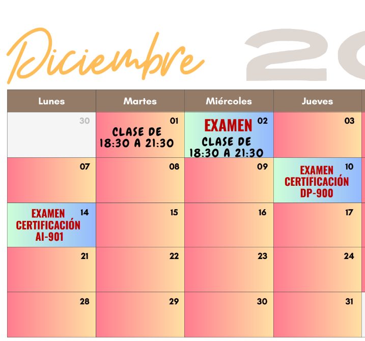

# Calendario — Introducción al Big Data e IA

## Vista de calendario

> Esta es la versión estática para GitHub de la vista Calendar de Notion. Se actualiza automáticamente desde la base de datos **Clases**.

### Noviembre 2026

| Lunes | Martes | Miércoles | Jueves | Viernes | Sábado | Domingo |
| --- | --- | --- | --- | --- | --- | --- |
|  |  |  |  |  |  | **1** |
| **2** | **3** | **4** | **5** | **6** | **7** | **8** |
| **9** | **10** 🔖Clase 03 - (DP-900) Data Concepts \| Azure Data Relational | **11** 🔖Clase 04 - Explorar Azure Storage para datos no relacionales | **12** | **13** | **14** | **15** |
| **16** 🔖Clase 05 - Explore Azure Cosmos DB | **17** 🔖Clase 06 - Microsoft Fabric | **18** 🔖Clase 07 - Power BI | **19** 🔖Clase 08 - (DP-900) 🔖Clase 09 - (AI-901) Labs 1 y 2 | **20** | **21** | **22** |
| **23** 🔖Clase 10 - (AI-901) Labs 3 y 4 | **24** 🔖Clase 11 - (AI-901) Labs 5 y 6 | **25** 🔖Clase 12 - (AI-901) Labs 7 y 8 | **26** 🔖Clase 13 - (AI-901) Labs 9 y 10 | **27** | **28** | **29** |
| **30** 🔖Clase 14 - (AI-901) Labs 11 y 12 |  |  |  |  |  |  |

### Diciembre 2026

| Lunes | Martes | Miércoles | Jueves | Viernes | Sábado | Domingo |
| --- | --- | --- | --- | --- | --- | --- |
|  | **1** 🔖Clase 15 - (AI-901) Labs 13 y 14 | **2** 🔖Clase 16 - Examen Final | **3** | **4** | **5** | **6** |
| **7** | **8** | **9** | **10** | **11** | **12** | **13** |
| **14** | **15** | **16** | **17** | **18** | **19** | **20** |
| **21** | **22** | **23** | **24** | **25** | **26** | **27** |
| **28** | **29** | **30** | **31** |  |  |  |

