# 🔖Clase 03 - (DP-900) Data Concepts | Azure Data Relational

## Sesión 1: Data concepts and Data Roles

> Los datos son el combustible de la transformación digital de cualquier organización. Antes de hablar de servicios de Azure, conviene dominar el vocabulario base: qué es un dato, en qué formatos se guarda, dónde se almacena y para qué tipo de procesamiento se usa. Todo lo que viene después en la certificación (bases de datos relacionales, NoSQL, analítica) se apoya en estos conceptos.

---

### Sección 1: ¿Qué es un dato? Entidades y atributos

Un **dato** es un hecho registrado: un número, una descripción, una observación. Por sí solo dice poco; cobra sentido cuando se organiza alrededor de las cosas que le importan al negocio.

- **Entidad**: algo relevante para la organización sobre lo que guardamos información. Ejemplos: *Cliente*, *Producto*, *Pedido*, *Envío*, *Póliza*.
- **Atributo**: cada característica de esa entidad. Un *Cliente* tiene nombre, dirección, teléfono, email…
- **Instancia**: cada caso concreto de la entidad (el cliente “Laura Gómez”, el pedido nº 10045).
> 💡 **Ejemplo de negocio — aseguradora**
> Entidad *Póliza* → atributos: número de póliza, tipo (hogar, auto, vida), fecha de alta, prima anual, cliente titular.
> Cada póliza firmada es una instancia de esa entidad.

---

### Sección 2: Clasificación de los datos según su estructura

El examen pide distinguir con soltura tres categorías (y reconocer una cuarta que gana protagonismo con la IA).

Clasificación de los datos según su estructura

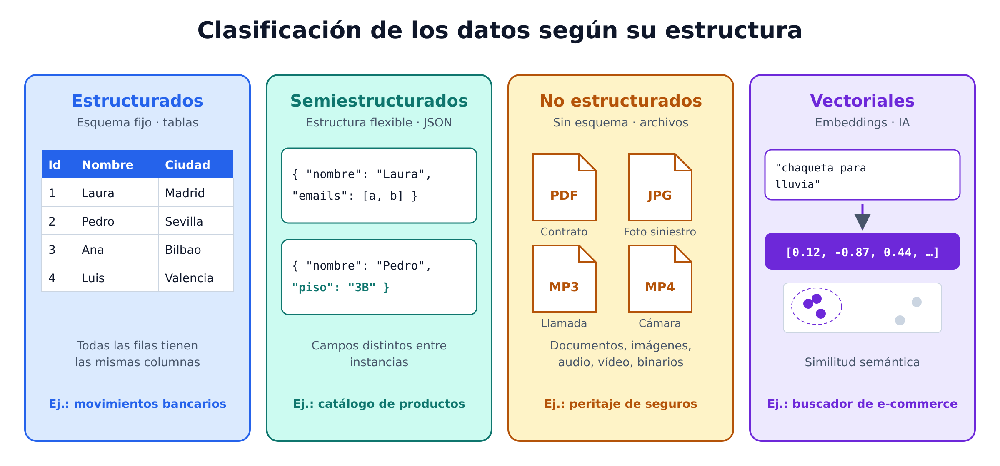

#### Datos estructurados

Siguen un **esquema fijo**: todas las instancias tienen exactamente los mismos campos. Lo habitual es representarlos en **tablas** (filas = instancias, columnas = atributos). Las tablas pueden relacionarse entre sí mediante claves, lo que da lugar al **modelo relacional**.

| IdCliente | Nombre | Ciudad | Email |
| --- | --- | --- | --- |
| 1 | Laura Gómez | Madrid | [laura@contoso.com](mailto:laura@contoso.com) |
| 2 | Pedro Ruiz | Sevilla | [pedro@fabrikam.com](mailto:pedro@fabrikam.com) |

#### Datos semiestructurados

Tienen **cierta estructura, pero permiten variación** entre instancias. Un cliente puede tener dos emails, otro ninguno, otro un campo “piso/puerta” que el resto no tiene. El formato más común es **JSON**.

```json
// Cliente 1
{
  "nombre": "Laura",
  "apellido": "Gómez",
  "direccion": { "calle": "Gran Vía 1", "ciudad": "Madrid", "cp": "28013" },
  "contacto": [
    { "tipo": "movil", "numero": "600 111 222" },
    { "tipo": "email", "direccion": "laura@contoso.com" }
  ]
}

// Cliente 2: tiene "piso" y solo un email
{
  "nombre": "Pedro",
  "apellido": "Ruiz",
  "direccion": { "calle": "Av. Constitución 5", "piso": "3B", "ciudad": "Sevilla", "cp": "41001" },
  "contacto": [
    { "tipo": "email", "direccion": "pedro@fabrikam.com" }
  ]
}
```

#### Datos no estructurados

No siguen una estructura definida: **documentos, imágenes, audio, vídeo, archivos binarios**. Ejemplos: PDFs de contratos, fotos de daños de un siniestro, grabaciones del call center, vídeo de cámaras de un almacén.

#### Datos vectoriales (embeddings)

Son una **representación numérica del contenido** (texto, imágenes…) en forma de vector. Las aplicaciones de IA los usan para encontrar contenido **semánticamente similar** aunque no comparta palabras exactas.

> 💡 **Ejemplo :  e-commerce de moda**
> Un cliente busca “chaqueta para lluvia en la montaña”. Con embeddings, el buscador devuelve un “cortavientos impermeable de trekking” aunque ninguna palabra coincida literalmente.

#### Comparativa rápida

| Tipo | Esquema | Formato típico | Ejemplo de negocio |
| --- | --- | --- | --- |
| Estructurado | Fijo, igual para todos | Tablas, CSV | Movimientos bancarios |
| Semiestructurado | Flexible, varía entre instancias | JSON, XML | Catálogo de productos con atributos distintos por categoría |
| No estructurado | Sin esquema | PDF, JPG, MP3, MP4 | Fotos de siniestros, contratos escaneados |
| Vectorial | Vectores numéricos | Arrays de floats | Búsqueda semántica en el catálogo |

#### Dónde se guardan: dos grandes familias

Independientemente de su estructura, los datos se guardan en uno de estos dos tipos de almacén:

1. **Almacenes de archivos** (file stores)
2. **Bases de datos**
Las dos secciones siguientes las desarrollan.

---

### Sección 3: Almacenamiento en archivos

Guardar datos en archivos es lo más básico de cualquier sistema. En las empresas, los archivos importantes se centralizan en almacenamiento compartido, cada vez más **en la nube**, por coste, seguridad, fiabilidad y capacidad de escalar a grandes volúmenes.

¿Qué formato elegir? Depende de tres factores:

- El **tipo de dato** (estructurado, semiestructurado o no estructurado).
- Las **aplicaciones y servicios** que van a leer, escribir y procesar el archivo.
- Si debe ser **legible por personas** o estar **optimizado** para almacenamiento y procesamiento.
#### Texto delimitado (CSV, TSV, ancho fijo)

Texto plano con un **separador de campos** y un **terminador de fila**. El más habitual es **CSV** (valores separados por comas); la primera línea puede llevar los nombres de los campos. Variantes: **TSV** (tabuladores), delimitado por espacios y **ancho fijo** (cada campo ocupa un número fijo de caracteres).

```plain text
Nombre,Apellido,Email
Laura,Gómez,laura@contoso.com
Pedro,Ruiz,pedro@fabrikam.com
```

✅ Ideal para datos **estructurados** que deben ser legibles y compatibles con casi cualquier herramienta (Excel, bases de datos, Python…).

> 💡 **Ejemplo — banca**: el extracto mensual que un banco exporta para la gestoría de una pyme suele ser un CSV.

#### JSON (JavaScript Object Notation)

Formato **jerárquico** basado en objetos con atributos. Un atributo puede contener otro objeto o una colección de objetos, lo que lo hace válido tanto para datos estructurados como semiestructurados.

Reglas de sintaxis que conviene reconocer:

- Objetos entre llaves `{ ... }`
- Colecciones (arrays) entre corchetes `[ ... ]`
- Atributos como pares `"nombre": valor`, separados por comas
```json
{
  "clientes": [
    {
      "nombre": "Laura",
      "apellido": "Gómez",
      "contacto": [
        { "tipo": "movil", "numero": "600 111 222" },
        { "tipo": "email", "direccion": "laura@contoso.com" }
      ]
    },
    {
      "nombre": "Pedro",
      "apellido": "Ruiz",
      "contacto": [
        { "tipo": "email", "direccion": "pedro@fabrikam.com" }
      ]
    }
  ]
}
```

> 💡 **Ejemplo — logística**: la API de una empresa de transporte devuelve el estado de cada envío en JSON (eventos de tracking con número variable de escalas).

#### XML (Extensible Markup Language)

Formato legible, muy popular en los 90 y 2000, hoy **desplazado en gran parte por JSON** (menos verboso). Usa **etiquetas** entre `< >` para definir **elementos** y **atributos**. Sigue presente en sistemas heredados, facturación electrónica o intercambio bancario.

```xml
<Clientes>
  <Cliente nombre="Laura" apellido="Gómez">
    <Contactos>
      <Contacto tipo="movil" numero="600 111 222"/>
      <Contacto tipo="email" direccion="laura@contoso.com"/>
    </Contactos>
  </Cliente>
</Clientes>
```

#### BLOB (Binary Large Object)

En el fondo, todo archivo son unos y ceros. En los formatos legibles, esos bytes se traducen a caracteres mediante una codificación (ASCII, Unicode). Pero muchos formatos, sobre todo de **datos no estructurados**, guardan **binario en bruto** que una aplicación debe interpretar: imágenes, vídeo, audio, documentos de aplicaciones concretas. A estos archivos se les llama **BLOBs**.

> 🔗 Esta palabra reaparece en Azure: el servicio **Azure Blob Storage** guarda precisamente este tipo de archivos.

#### Formatos optimizados: Parquet, Avro y Delta Lake

Los formatos legibles son cómodos, pero **no están optimizados** ni en espacio ni en velocidad de procesamiento. Para big data se usan formatos especializados con compresión, indexación y almacenamiento eficiente.

Formatos optimizados: Parquet, Avro y Delta Lake

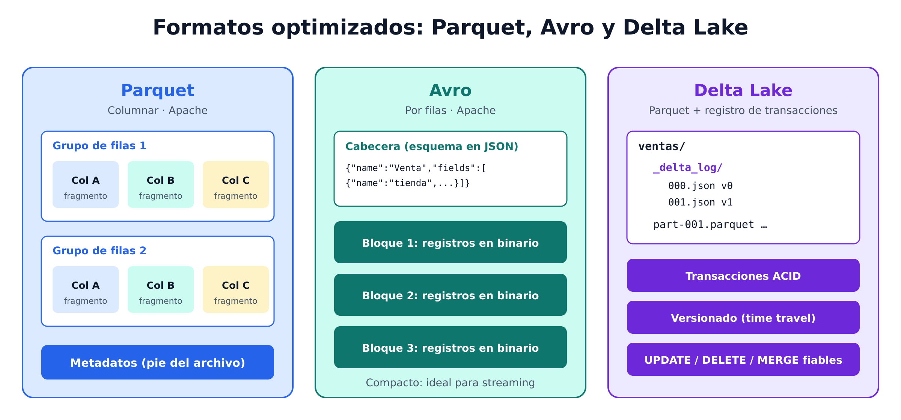

**Parquet** (proyecto Apache)

- Formato **columnar**: los datos de cada columna se guardan juntos.
- El archivo se organiza en **grupos de filas** (row groups), cada uno con **fragmentos** (chunks) por columna.
- Incluye **metadatos** que describen qué filas hay en cada fragmento, para localizar rápido los datos necesarios y leer solo las columnas pedidas.
- Muy eficiente con **tipos anidados**, compresión y codificación.
- Es el formato estrella en **data lakes y lakehouses**.
**Avro** (proyecto Apache)

- Formato **orientado a filas**.
- Cada archivo tiene una **cabecera en JSON** que describe la estructura de los datos.
- Los datos se guardan en **binario**, en bloques de registros; la aplicación usa la cabecera para interpretarlos.
- Muy bueno para **comprimir** y **minimizar almacenamiento y ancho de banda** (por ejemplo, en mensajería y streaming).
**Delta Lake** (open source)

- Se construye **sobre Parquet** añadiendo un **registro de transacciones** (transaction log).
- Aporta **transacciones ACID**, **versionado** de datos (viaje en el tiempo) y **actualizaciones fiables** sobre archivos en un data lake.
- Es el formato por defecto de **Azure Databricks** y el formato de tablas de **Microsoft Fabric**.
#### ¿Por qué columnar vs. por filas?

Almacenamiento por filas frente a columnar

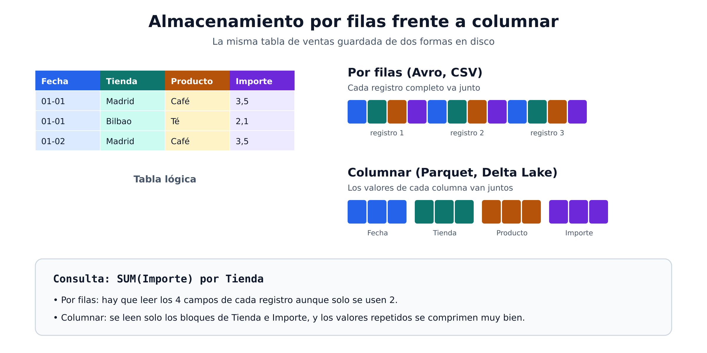

```plain text
Tabla de ventas: Fecha | Tienda | Producto | Importe

Por filas (Avro):      [2026-01-01, Madrid, Café, 3.5] [2026-01-01, Bilbao, Té, 2.1] ...
Por columnas (Parquet): [2026-01-01, 2026-01-01, ...] [Madrid, Bilbao, ...] [Café, Té, ...] [3.5, 2.1, ...]
```

Si un analista pide “suma del importe por tienda”, Parquet solo lee dos columnas e ignora el resto; además, valores repetidos de una misma columna se comprimen muy bien. Avro es mejor cuando se escribe o lee **registro a registro completo** (por ejemplo, eventos que llegan uno a uno).

| Formato | Orientación | Legible | Punto fuerte | Uso típico |
| --- | --- | --- | --- | --- |
| CSV / TSV | Filas | Sí | Compatibilidad universal | Exportaciones, intercambio sencillo |
| JSON | Jerárquico | Sí | Flexibilidad (semiestructurado) | APIs, documentos NoSQL |
| XML | Jerárquico | Sí | Sistemas heredados | Integraciones antiguas, facturación |
| BLOB | Binario | No | Datos no estructurados | Imágenes, vídeo, audio |
| Avro | Filas | No (cabecera JSON) | Compresión, ancho de banda | Streaming, mensajería |
| Parquet | Columnas | No | Consultas analíticas rápidas | Data lakes, lakehouses |
| Delta Lake | Columnas (Parquet + log) | No | ACID, versionado, updates | Lakehouses (Databricks, Fabric) |

---

### Sección 4: Bases de datos

Una **base de datos** es un sistema central donde los datos se almacenan y se consultan. En sentido amplio, un sistema de archivos es una especie de base de datos, pero en el ámbito profesional nos referimos a un **sistema dedicado a gestionar registros**, no archivos.

#### Bases de datos relacionales

Almacenan y consultan **datos estructurados** en **tablas** que representan entidades (clientes, productos, pedidos).

- **Clave primaria (PK)**: identifica de forma única cada fila.
- **Clave foránea (FK)**: referencia la clave primaria de otra tabla para relacionarlas.
- **Normalización**: diseño que, entre otras cosas, **elimina datos duplicados**. Los datos de un cliente se guardan **una sola vez**, no repetidos en cada pedido que haga.
- **SQL** (Structured Query Language): lenguaje para gestionar y consultar las tablas. Se basa en un estándar ANSI, así que es muy parecido entre sistemas (SQL Server, PostgreSQL, MySQL, Oracle…).
Modelo relacional: claves primarias y foráneas

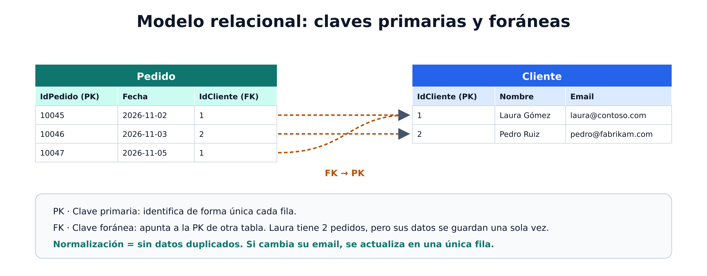

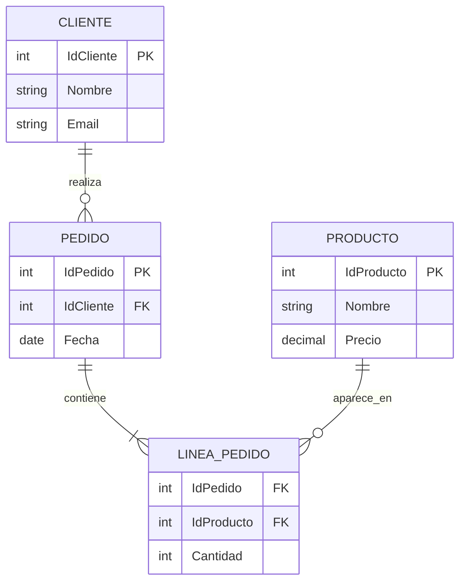

```sql
-- ¿Qué ha comprado cada cliente en noviembre?
SELECT c.Nombre, p.IdPedido, p.Fecha
FROM Cliente AS c
JOIN Pedido  AS p ON p.IdCliente = c.IdCliente
WHERE p.Fecha >= '2026-11-01';
```

> 💡 **Ejemplo — retail**: si el email de un cliente cambia, en un modelo normalizado se actualiza en **una sola fila** de *Cliente*, y todos sus pedidos lo “ven” automáticamente a través de la clave.

#### Bases de datos no relacionales (NoSQL)

Sistemas que **no aplican un esquema relacional**. Se les llama NoSQL aunque algunos admiten variantes de SQL. Hay cuatro tipos que el examen pide reconocer:

Los cuatro tipos de bases de datos no relacionales

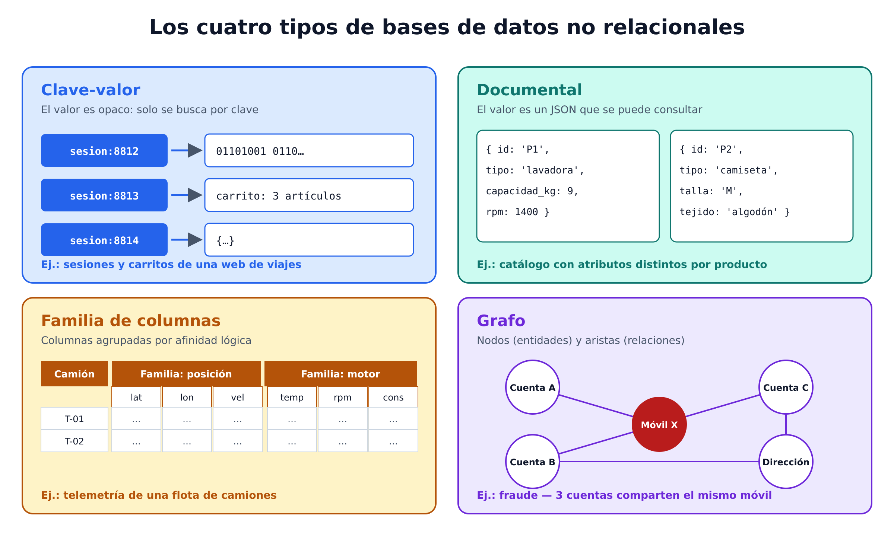

**1. Clave-valor**
Cada registro es una **clave única** y un **valor** en cualquier formato (el sistema no interpreta el valor).
> 💡 Carrito de la compra o sesión de usuario en una web: clave = id de sesión, valor = contenido del carrito. Lectura/escritura ultrarrápida.

**2. Documentales**
Caso particular de clave-valor en el que el valor es un **documento JSON** que el sistema sabe **analizar y consultar**.
> 💡 Catálogo de productos: una lavadora tiene “capacidad_kg” y “rpm”; una camiseta tiene “talla” y “tejido”. Cada producto es un documento con sus propios campos.

**3. Familia de columnas**
Datos tabulares en filas y columnas, pero las columnas se agrupan en **familias** de columnas relacionadas lógicamente.
> 💡 Telemetría de una flota de camiones: familia “posición” (lat, lon, velocidad) y familia “motor” (temperatura, rpm, consumo).

**4. Grafos**
Almacenan entidades como **nodos** y las relaciones como **aristas** (links).
> 💡 Detección de fraude en banca: cuentas, tarjetas, dispositivos y direcciones conectados; un anillo de cuentas que comparten dispositivo salta a la vista recorriendo el grafo.

| Tipo NoSQL | Unidad de datos | Consulta típica | Caso de negocio |
| --- | --- | --- | --- |
| Clave-valor | Clave → valor opaco | Buscar por clave | Sesiones, carritos, caché |
| Documental | Clave → JSON consultable | Filtrar por campos del documento | Catálogos, perfiles de cliente |
| Familia de columnas | Filas con grupos de columnas | Leer familias concretas a gran escala | IoT, telemetría |
| Grafo | Nodos + relaciones | Recorrer relaciones | Fraude, recomendaciones, redes |

---

### Sección 5: Procesamiento transaccional (OLTP)

Un sistema transaccional es lo que la mayoría entiende por “informática de empresa”: registra **transacciones**, es decir, eventos concretos que la organización quiere seguir. Una transacción es una **unidad de trabajo pequeña y discreta**:

- Una transferencia entre cuentas en un banco.
- El cobro de una compra en un TPV de supermercado.
- La reserva de un asiento en una aerolínea.
Características:

- **Alto volumen**: pueden ser millones de transacciones al día.
- **Acceso rápido** a los datos.
- Se denomina **OLTP** (*Online Transactional Processing*).
- La base de datos está optimizada para **lectura y escritura**, con operaciones **CRUD**: *Create, Read, Update, Delete*.
- Da servicio a las aplicaciones de negocio en vivo, llamadas **LOB** (*line of business*): ERP, CRM, TPV, banca online…
#### Las propiedades ACID

Para garantizar la integridad, los sistemas OLTP aplican transacciones con semántica **ACID**. Usaremos un ejemplo único para las cuatro:

> 🏦 **Transferencia de 40 € de la Cuenta A (saldo 100 €) a la Cuenta B (saldo 50 €).**
> El sistema debe cargar en A y abonar en B como una única operación fiable.

Propiedades ACID

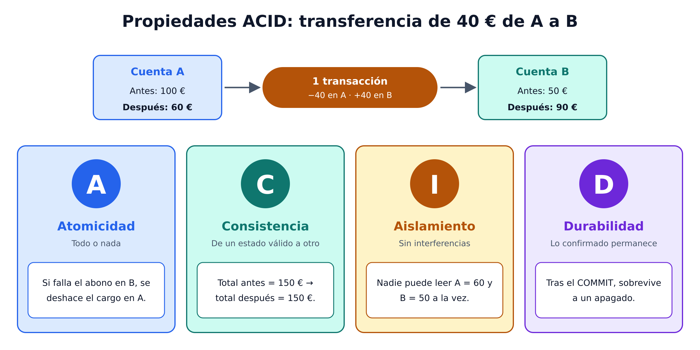

| Propiedad | Qué garantiza | En el ejemplo |
| --- | --- | --- |
| **A**tomicidad | La transacción es una unidad: o se completa entera o falla entera | Si el abono en B falla, el cargo en A se deshace. Nunca desaparecen 40 € |
| **C**onsistencia | Los datos solo pasan de un estado válido a otro estado válido | Antes: A=100, B=50 (total 150). Después: A=60, B=90 (total 150) |
| a**I**slamiento (Isolation) | Transacciones concurrentes no interfieren entre sí | Una consulta de saldos simultánea no puede ver A=60 y B=50 a la vez |
| **D**urabilidad | Lo confirmado (commit) permanece | Si el servidor se apaga tras el commit, al reiniciar A=60 y B=90 |

```sql
BEGIN TRANSACTION;
    UPDATE Cuentas SET Saldo = Saldo - 40 WHERE IdCuenta = 'A';
    UPDATE Cuentas SET Saldo = Saldo + 40 WHERE IdCuenta = 'B';
COMMIT TRANSACTION;   -- Si algo falla antes: ROLLBACK y no cambia nada
```

---

### Sección 6: Procesamiento analítico

El procesamiento analítico usa sistemas de **solo lectura o mayoritariamente lectura** que almacenan **grandes volúmenes de datos históricos** o métricas de negocio. Puede basarse en una “foto” de los datos en un momento dado o en una serie de fotos a lo largo del tiempo.

#### Arquitectura analítica típica

Arquitectura analítica típica

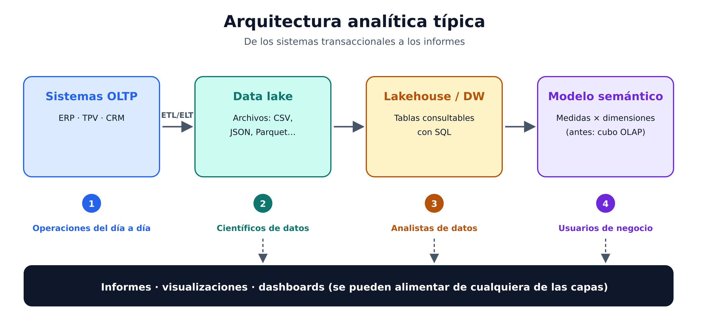

1. **Ingesta**: los datos operativos se extraen y se cargan en un **data lake**.
- **ETL** (*Extract, Transform, Load*): se transforman antes de cargar.
- **ELT** (*Extract, Load, Transform*): se cargan en bruto y se transforman después; patrón habitual en los **lakehouses** modernos.
2. **Modelado en tablas**: en un **lakehouse** (tablas sobre archivos del lago) o en un **data warehouse** (motor SQL relacional completo).
3. **Modelo analítico**: los datos se agregan en un **modelo OLAP**, hoy llamado **modelo semántico** (antes, **cubo**). Las **medidas** numéricas de las tablas de **hechos** se calculan para las intersecciones de **dimensiones**. Ejemplo: ingresos totales por fecha, cliente y producto. Los **modelos semánticos de Power BI** son el ejemplo más común.
4. **Consumo**: lago, almacén y modelo pueden consultarse para crear informes, visualizaciones y dashboards.
#### Data lake, data warehouse y data lakehouse

| Concepto | Qué es | Fortaleza |
| --- | --- | --- |
| **Data lake** | Gran repositorio de **archivos** de todo tipo | Volumen masivo, flexibilidad, bajo coste |
| **Data warehouse** | Almacén con **esquema relacional optimizado para lectura** | Consultas de informes y visualización |
| **Data lakehouse** | Combina el almacenamiento flexible del lago con la **semántica de consulta relacional** del warehouse | Lo mejor de ambos, una sola copia de los datos |

> ⚠️ En analítica es frecuente **desnormalizar** (introducir algo de duplicación respecto al OLTP) para que las consultas sean más rápidas. Es justo lo contrario que buscamos en OLTP.

#### Modelo semántico y drill up / drill down

Como el modelo semántico tiene los datos **preagregados** por niveles jerárquicos, permite navegar arriba y abajo muy rápido:

```plain text
Ventas totales España: 12,4 M€
  └─ Región Centro: 4,1 M€          ← drill down
       └─ Madrid: 3,2 M€
            └─ Tienda Gran Vía: 0,6 M€
```

#### Quién trabaja en cada etapa

| Perfil | Dónde trabaja | Ejemplo |
| --- | --- | --- |
| Científico de datos | Archivos del **data lake** | Modelo de predicción de bajas de clientes (churn) |
| Analista de datos | Tablas del **data warehouse** | Informe de rentabilidad por línea de producto |
| Usuario de negocio | **Modelo semántico** vía informes y dashboards | Director comercial revisando ventas semanales |

#### Plataformas modernas de analítica en Microsoft

No hace falta dominarlas todavía; basta con saber qué hace cada una:

- **Microsoft Fabric**: plataforma **SaaS unificada** de analítica que reúne almacenamiento, ingeniería de datos, data warehousing e informes en un único espacio de trabajo.
- **Azure Databricks**: plataforma de analítica en la nube para **ingeniería de datos y ciencia de datos a gran escala**, con **Delta Lake** como formato por defecto.
- **Microsoft Purview**: **gobierno, seguridad y cumplimiento** unificados; permite descubrir, clasificar, proteger y gestionar datos de todas las fuentes.
Ambas plataformas analíticas incluyen asistentes de IA en lenguaje natural: **Copilot** en Fabric y funciones asistidas como **Genie Code** en Azure Databricks.

#### Arquitectura medallón

Patrón muy extendido para organizar los datos de un lakehouse en tres capas de calidad:

Arquitectura medallón

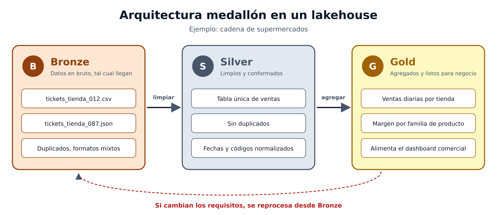

| Capa | Contenido | Ejemplo en una cadena de supermercados |
| --- | --- | --- |
| 🥉 **Bronze** | Datos **en bruto**, tal como llegan de origen, sin transformar | Ficheros de tickets de todos los TPV, con duplicados y formatos distintos |
| 🥈 **Silver** | Datos **limpios y conformados**: sin duplicados, tipos estandarizados | Tabla única de ventas con fechas, importes y códigos de tienda normalizados |
| 🥇 **Gold** | Datos **agregados y listos para negocio**, modelados para informes concretos | Ventas diarias por tienda y familia de producto para el dashboard comercial |

¿Por qué se usa? Porque define **fronteras de calidad claras** entre capas y, si cambian los requisitos, siempre se puede **reprocesar desde Bronze**, donde están los registros originales.

---

### Sección 7: OLTP frente a analítica (OLAP)

| Criterio | Transaccional (OLTP) | Analítico (OLAP) |
| --- | --- | --- |
| Objetivo | Registrar operaciones del día a día | Analizar y tomar decisiones |
| Operaciones | CRUD, lectura y escritura | Lectura (o mayoritariamente lectura) |
| Datos | Actuales, detalle de cada transacción | Históricos, agregados |
| Volumen por operación | Pocas filas, muchísimas operaciones | Muchísimas filas, menos consultas |
| Diseño | Normalizado | Desnormalizado / modelo dimensional |
| Garantías | ACID | Rendimiento de consulta |
| Usuarios | Aplicaciones LOB, empleados de operaciones | Analistas, científicos de datos, dirección |
| Ejemplo | TPV registrando una venta | Dashboard de ventas del último año por región |

---

### Sección 8: Prompts para practicar con un asistente de IA

Copia y pega estos prompts en Copilot, Claude u otro asistente para reforzar los conceptos.

**Clasificar datos**

```plain text
Actúa como formador de la certificación DP-900. Te doy una lista de fuentes de datos de una cadena hotelera:
reservas en el PMS, reseñas de clientes en texto libre, fotos de habitaciones, logs JSON de la app móvil,
grabaciones de llamadas de recepción y la tabla de tarifas. Clasifica cada una como estructurada,
semiestructurada o no estructurada y justifica en una línea.
```

**Elegir formato de archivo**

```plain text
Soy ingeniero de datos en una empresa de logística. Tengo que guardar 3 años de eventos de tracking
de envíos (500 millones de filas) para que los analistas calculen tiempos medios de entrega por ruta.
Compara CSV, JSON, Avro, Parquet y Delta Lake para este caso y recomiéndame uno, explicando el porqué.
```

**Elegir tipo de base de datos NoSQL**

```plain text
Para cada escenario, dime qué tipo de base de datos no relacional (clave-valor, documental, familia de
columnas o grafo) encaja mejor y por qué: (1) sesiones de usuario de una web de viajes, (2) catálogo
de productos de electrónica con especificaciones distintas por producto, (3) telemetría de 10.000
sensores industriales, (4) detección de redes de fraude con tarjetas.
```

**Explicar ACID con un caso propio**

```plain text
Explícame las cuatro propiedades ACID usando como ejemplo la compra de un billete de avión en el que
se reserva el asiento y se cobra la tarjeta. Para cada propiedad, describe qué pasaría si NO se cumpliera.
```

**Diseñar una arquitectura medallón**

```plain text
Diseña las capas Bronze, Silver y Gold para una aseguradora que recibe partes de siniestros desde
una app móvil (JSON), un call center (CSV diario) y peritos (PDF y fotos). Indica qué contiene cada
capa, qué transformaciones se aplican entre capas y qué informes saldrían de Gold.
```

**Generar preguntas de repaso**

```plain text
Genera 10 preguntas tipo test estilo DP-900 sobre formatos de datos, bases de datos relacionales y
NoSQL, OLTP vs OLAP y arquitectura medallón. Cuatro opciones por pregunta, indica la correcta y
explica por qué las demás son incorrectas.
```

---

### Sección 9: Claves para el examen

- **JSON = semiestructurado** por excelencia; **CSV = estructurado**; imágenes, vídeo, audio y PDF = **no estructurado**.
- **BLOB** = datos binarios, típicamente no estructurados.
- **Parquet = columnar**; **Avro = por filas con cabecera JSON**; **Delta Lake = Parquet + registro de transacciones (ACID, versionado)**.
- **Documental** es un tipo especial de **clave-valor** donde el valor es JSON consultable.
- **Normalizar** = eliminar duplicados (OLTP). **Desnormalizar** = duplicar para consultar más rápido (analítica).
- **ACID** se asocia a **OLTP**. Saber definir cada letra con el ejemplo de la transferencia bancaria.
- **ETL** transforma antes de cargar; **ELT** carga y transforma después (habitual en lakehouses).
- **Data warehouse** = relacional optimizado para lectura; **data lake** = archivos; **lakehouse** = la combinación.
- **Modelo semántico** = nombre actual del modelo OLAP / cubo: **medidas** (hechos) agregadas por **dimensiones**.
- **Medallón**: Bronze (bruto) → Silver (limpio) → Gold (agregado para negocio).
- **Fabric** = SaaS unificado de analítica; **Databricks** = Spark + Delta Lake a gran escala; **Purview** = gobierno de datos.
## Sesión 2: Data Relational concepts and Azure Data Relational services

Una solución de datos no la construye una sola persona ni un solo servicio. Hay perfiles profesionales con responsabilidades diferenciadas que trabajan con un conjunto amplio de servicios en la nube. En esta clase conectamos ambas piezas: **quién hace qué** y **con qué herramienta de Azure / Microsoft lo hace**.

---

### Sección 1: Roles frente a personas

Los roles relacionados con datos pueden ser más orientados a negocio, más de ingeniería, más de investigación o híbridos. Cada organización los nombra a su manera, pero hay un reparto de responsabilidades bastante estándar.

> ⚠️ **Rol ≠ persona.** Un rol define tareas y responsabilidades. En una empresa mediana, la misma persona puede actuar como administrador de base de datos cuando aprovisiona una base de datos transaccional y, minutos después, como ingeniero de datos cuando crea un pipeline que mueve esos datos a un data warehouse.

Los cuatro roles clave que trabaja el módulo:

| Rol | Misión en una frase |
| --- | --- |
| **Administrador de bases de datos (DBA)** | Que las bases de datos estén disponibles, rindan bien, sean seguras y se puedan recuperar |
| **Ingeniero de datos** | Que los datos fluyan, limpios y gobernados, desde los orígenes hasta los almacenes analíticos |
| **Analista de datos** | Que el negocio entienda sus datos y tome decisiones con ellos |
| **Ingeniero de IA** | Que las aplicaciones y flujos de datos incorporen capacidades de IA |

Los cuatro roles clave del mundo de los datos

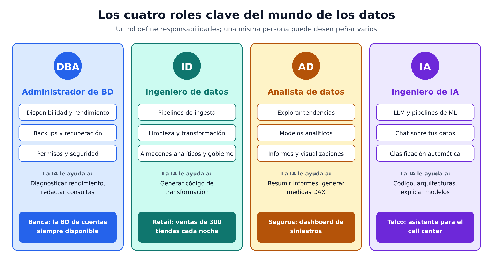

---

### Sección 2: Administrador de bases de datos (DBA)

Responsable del **diseño, implementación, mantenimiento y operación** de sistemas de bases de datos, tanto **on-premises como en la nube**.

Responsabilidades principales:

- **Disponibilidad** y **rendimiento** consistente; optimización de las bases de datos.
- **Copias de seguridad y recuperación**: define con los responsables de negocio políticas, herramientas y procesos para recuperarse de un desastre natural o de un error humano.
- **Seguridad**: concede y revoca privilegios, da o deniega acceso a los usuarios.
> 💡 **Ejemplo — banca online**: el DBA garantiza que la base de datos de cuentas responde en milisegundos en hora punta, que hay backups cada pocos minutos y que un empleado de sucursal solo ve los clientes de su oficina.

**IA en el rol**: cada vez se usan herramientas de IA para diagnosticar problemas de rendimiento y redactar consultas en lenguaje natural, sin sustituir el criterio experto del DBA.

---

### Sección 3: Ingeniero de datos

Colabora con las partes interesadas para **diseñar e implementar cargas de trabajo de datos**:

- **Pipelines de ingesta** de datos.
- Actividades de **limpieza y transformación**.
- **Almacenes de datos** para cargas analíticas.
Trabaja con un abanico amplio de tecnologías: bases de datos relacionales y no relacionales, almacenes de archivos y **flujos de datos (streams)**. Además:

- Garantiza la **privacidad** de los datos en la nube y en el tránsito desde on-premises a la nube.
- **Gestiona y monitoriza** los pipelines para asegurar que las cargas se ejecutan como se espera.
- Identifica **reglas de gobierno del dato**.
> 💡 **Ejemplo — cadena de supermercados**: cada noche, el ingeniero de datos recoge las ventas de 300 tiendas, elimina tickets duplicados, unifica códigos de producto y deja una tabla limpia en el lakehouse antes de las 7:00 para que el equipo comercial la consulte.

**IA en el rol**: generar código de transformación y sugerir configuraciones en lenguaje natural; las decisiones de arquitectura y de calidad del dato siguen siendo humanas.

---

### Sección 4: Analista de datos

Ayuda a la empresa a **maximizar el valor de sus activos de datos**:

- **Explora** los datos para identificar tendencias y relaciones.
- **Diseña y construye modelos analíticos**.
- Habilita la analítica avanzada mediante **informes y visualizaciones**.
- Convierte datos en bruto en **conclusiones relevantes** según requisitos de negocio identificados.
> 💡 **Ejemplo — aseguradora**: la analista detecta que los siniestros de hogar por agua se disparan en tres provincias en otoño y construye un dashboard que el área de suscripción usa para ajustar primas.

**IA en el rol**: resumir informes, sugerir visualizaciones y generar expresiones analíticas (por ejemplo, medidas DAX) en lenguaje natural; el conocimiento del negocio y la capacidad de comunicar siguen siendo clave.

---

### Sección 5: Ingeniero de IA

Construye e integra **funcionalidades basadas en IA** en aplicaciones y flujos de datos. Trabaja con:

- **Modelos de lenguaje de gran tamaño (LLM)**: sistemas de IA entrenados con enormes cantidades de texto que entienden y generan lenguaje humano.
- **Pipelines de machine learning**.
- **Fuentes de datos** para habilitar escenarios inteligentes.
Escenarios típicos: **chat sobre tus datos** (*chat-over-your-data*), **generación de contenido** y **clasificación automática**.

Colabora estrechamente con:

- **Ingenieros de datos**, para acceder a los datos y prepararlos.
- **Analistas de datos**, para llevar los resultados de la IA a informes y aplicaciones.
Su plataforma de referencia es **Microsoft Foundry**, para construir, probar y desplegar estas soluciones.

> 💡 **Ejemplo — operador de telecomunicaciones**: el ingeniero de IA crea un asistente que responde a los agentes del call center consultando contratos, tarifas y el historial del cliente, y clasifica automáticamente el motivo de cada llamada.

**IA en el rol**: la asistencia de IA es central en su día a día (generar código, explicar el comportamiento de modelos, sugerir arquitecturas), pero el **diseño, la evaluación y el despliegue responsable** son responsabilidades humanas.

#### Otros roles que conviene conocer

El módulo menciona que existen más perfiles: **científico de datos** (*data scientist*), **arquitecto de datos** (*data architect*), y otros técnicos que trabajan con datos como **desarrolladores de aplicaciones** e **ingenieros de software**.

---

### Sección 6: Modelos de servicio en la nube

Antes de repasar los servicios, dos términos que aparecen constantemente (y uno más que ayuda a completar el mapa):

| Modelo | Quién gestiona qué | Analogía | Ejemplo en datos |
| --- | --- | --- | --- |
| **IaaS** (*Infrastructure as a Service*) | Microsoft da la máquina virtual; tú gestionas SO, motor, parches, backups | Alquilar un local vacío | SQL Server en una máquina virtual de Azure |
| **PaaS** (*Platform as a Service*) | Microsoft gestiona servidores, parches y backups; tú te centras en datos y aplicaciones | Alquilar un local amueblado con mantenimiento incluido | Azure SQL Database, Microsoft Foundry |
| **SaaS** (*Software as a Service*) | Producto completo listo para usar por internet; sin instalar ni gestionar infraestructura | Contratar un servicio de catering | Microsoft Fabric, Power BI |

IaaS, PaaS y SaaS

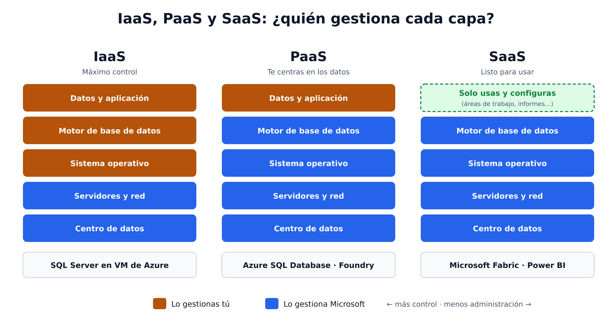

> 🎯 Cuanto más a la derecha (IaaS → PaaS → SaaS), **menos administración** y **menos control** de configuración.

---

### Sección 7: Servicios para datos transaccionales

#### Familia Azure SQL

**Azure SQL** es el nombre colectivo de una familia de bases de datos relacionales basadas en el **motor de Microsoft SQL Server**.

| Servicio | Modelo | Control | Responsabilidad de administración | Cuándo elegirlo |
| --- | --- | --- | --- | --- |
| **Azure SQL Database** | PaaS totalmente gestionado | Menor | Mínima | Aplicaciones nuevas en la nube |
| **Azure SQL Managed Instance** | Instancia de SQL Server alojada con mantenimiento automatizado | Media: más configurable que SQL Database | Mayor que SQL Database | Migrar aplicaciones de SQL Server on-premises con pocos cambios |
| **SQL Server en VM de Azure** (Azure SQL VM) | Máquina virtual con SQL Server instalado | Máxima | Total | Necesidades de configuración muy específicas o software que exige acceso al SO |

Familia Azure SQL

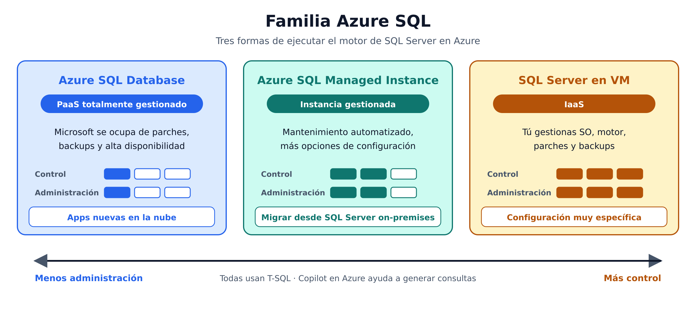

Uso por rol:

- **DBA**: aprovisiona y gestiona estas bases de datos para las aplicaciones LOB que guardan datos transaccionales.
- **Ingeniero de datos**: las usa como **origen** de pipelines ETL hacia un sistema analítico.
- **Analista**: puede consultarlas directamente para informes, aunque en empresas grandes lo normal es combinar sus datos con otras fuentes en un almacén analítico.
**IA**: **Microsoft Copilot en Azure** ayuda a DBAs y desarrolladores a generar consultas T-SQL y a diagnosticar problemas en Azure SQL Database en lenguaje natural.

#### Bases de datos de código abierto en Azure

Servicios gestionados para motores relacionales open source:

- **Azure Database for MySQL**: sencillo de usar, muy común en aplicaciones con stack **LAMP** (*Linux, Apache, MySQL, PHP*). Ejemplo: la tienda online de una pyme hecha en WordPress/WooCommerce.
- **Azure Database for PostgreSQL**: base de datos **híbrida relacional-objeto**. Además de tablas relacionales, admite **tipos de datos personalizados** con propiedades no relacionales.
Los roles las usan igual que Azure SQL: el DBA las gestiona, el ingeniero las usa como origen y el analista las consulta.

#### Azure Cosmos DB

Base de datos **NoSQL de escala global** que admite **múltiples API**, de modo que permite guardar y gestionar datos como:

- **documentos JSON**
- **pares clave-valor**
- **familias de columnas**
- **grafos**
¿Quién la gestiona? A veces el DBA, pero con frecuencia son los **desarrolladores de software** quienes gestionan el almacenamiento NoSQL como parte de la arquitectura de la aplicación. Los **ingenieros de datos** a menudo deben integrar Cosmos DB en las soluciones analíticas.

> 💡 **Ejemplo — app de reparto a domicilio con usuarios en varios continentes**: perfiles de usuario y pedidos en documentos JSON, replicados en varias regiones para baja latencia.

**IA**: la extensión de Azure Cosmos DB para Visual Studio Code incluye un **asesor de consultas asistido por IA (en preview)** para generar y explicar consultas en lenguaje natural.

#### Azure Storage

Servicio **básico** de Azure para guardar datos en:

| Opción | Qué es | Ejemplo |
| --- | --- | --- |
| **Contenedores de blobs** | Almacenamiento escalable y económico de **archivos binarios** | Fotos de producto, vídeos, backups, ficheros Parquet |
| **Recursos compartidos de archivos** (*File shares*) | Carpetas de red como las de una red corporativa | Carpeta compartida del departamento financiero |
| **Tablas** | Almacenamiento **clave-valor** para lecturas y escrituras rápidas | Configuración o estado de dispositivos de una app |

**Data lake en Azure**: los ingenieros de datos usan Azure Storage para alojar data lakes, que son **blob storage con espacio de nombres jerárquico**, lo que permite organizar los archivos en **carpetas** dentro de un sistema de archivos distribuido (Azure Data Lake Storage Gen2).

Azure Cosmos DB y Azure Storage

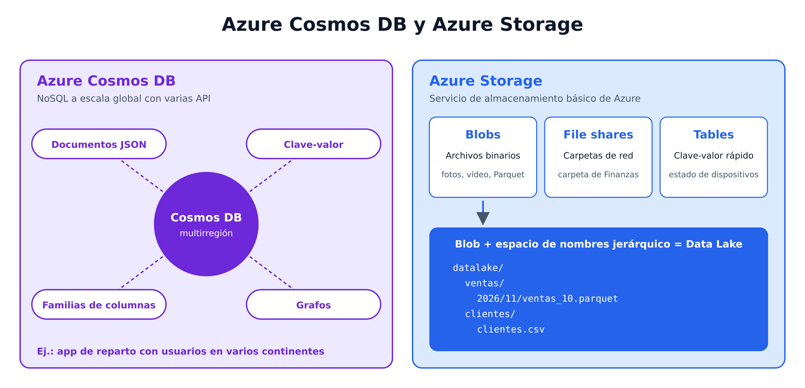

---

### Sección 8: Servicios de integración, analítica, gobierno e IA

#### Azure Data Factory

Servicio para **definir y programar pipelines** que **transfieren y transforman datos**. Se integra con otros servicios de Azure: ingiere de almacenes en la nube, procesa con cómputo en la nube y guarda el resultado en otro almacén.

- Lo usan los **ingenieros de datos** para construir soluciones **ETL** que alimentan almacenes analíticos con datos de los sistemas transaccionales.
- Está integrado en Microsoft Fabric como **Fabric Data Factory**, la **siguiente generación** de Azure Data Factory, cuyos pipelines trabajan directamente con **OneLake** y otros elementos de Fabric.
#### Microsoft Fabric

Plataforma **SaaS unificada** de analítica de Microsoft. Reúne ingeniería de datos, data warehousing, analítica en tiempo real, ciencia de datos y Power BI en un **único espacio de trabajo en el navegador**, sobre una capa de almacenamiento compartida llamada **OneLake**. No gestionas servidores ni clústeres: creas **áreas de trabajo** (workspaces) y **elementos** (items), y Microsoft opera la infraestructura.

Microsoft Fabric

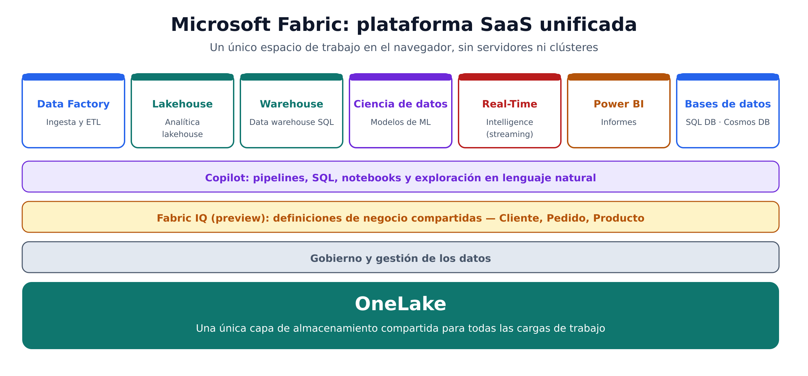

Capacidades integradas:

| Capacidad | Para qué |
| --- | --- |
| **Fabric Data Factory** | Ingesta y ETL |
| **Fabric Lakehouse** | Analítica de lakehouse |
| **Fabric Warehouse** | Analítica de data warehouse |
| Ciencia de datos y ML | Modelos predictivos |
| **Real-Time Intelligence** | Datos en streaming |
| **Power BI** | Visualización |
| Bases de datos | SQL database y Cosmos DB en Fabric |
| Gobierno y gestión | Control del dato |

> 💡 **Ejemplo — fabricante de automoción**: un único espacio de Fabric recibe datos del ERP y de sensores de la línea de montaje, los modela en un lakehouse y publica en Power BI los KPIs de calidad por turno, todo almacenado en OneLake.

**IA**: Copilot en Fabric ayuda a construir pipelines, escribir SQL, generar código de notebooks y explorar datos en lenguaje natural.

#### Microsoft Fabric IQ

Carga de trabajo de Fabric que aporta **contexto sobre entidades de negocio**. Se apoya en OneLake y en los modelos semánticos de Power BI para que **personas, herramientas y agentes de IA compartan las mismas definiciones** de conceptos como *Cliente*, *Pedido* o *Producto*.

> ⚠️ La carga de trabajo IQ y su elemento de **ontología** están **en preview**.

> 💡 Por qué importa: si “Cliente activo” significa “compra en los últimos 90 días” para Marketing y “con contrato vigente” para Finanzas, un agente de IA dará respuestas contradictorias. Fabric IQ unifica esa definición.

#### Power BI

Plataforma de **inteligencia de negocio y visualización** de Microsoft. Los **analistas de datos** la usan para conectarse a fuentes, construir **informes y dashboards interactivos** y compartirlos en la organización.

- Existe como servicio **independiente** y también **integrado en Microsoft Fabric**.
- En Fabric se conecta a los datos a través de **modelos semánticos**: capas analíticas que definen medidas, relaciones y lógica de negocio.
- **IA**: resume informes, sugiere visualizaciones, genera **medidas DAX** y redacta narrativas a partir de los datos.
#### Azure Databricks

Plataforma de analítica en la nube **basada en Apache Spark**, optimizada para **ingeniería de datos, ciencia de datos y analítica SQL a gran escala** sobre formatos abiertos de lakehouse, principalmente **Delta Lake**. Es un servicio gestionado en Azure y la opción habitual para equipos que trabajan **code-first** con Spark y **notebooks**.

- **Ingenieros de datos**: aprovechan conocimientos de Spark y Databricks para crear almacenes analíticos.
- **Analistas**: usan los notebooks web para consultar y visualizar datos.
- **IA**: escribir código Spark, generar SQL y explicar la lógica de notebooks complejos.
#### Azure Stream Analytics

Motor de **procesamiento de streams en tiempo real**: captura un flujo de datos de una **entrada**, aplica una **consulta** para extraer y manipular los datos y escribe los resultados en una **salida** para análisis o procesamiento posterior.

> 💡 **Ejemplo — empresa de energía**: lecturas de contadores inteligentes cada pocos segundos; Stream Analytics detecta picos de consumo anómalos y los envía a un dashboard en tiempo real.

#### Azure Data Explorer

Plataforma de analítica de big data **totalmente gestionada e independiente**, con consultas de alto rendimiento sobre **logs y telemetría**. Los analistas la usan con datos que incluyen un **atributo de marca temporal**: archivos de log y telemetría **IoT**.

> 💡 **Ejemplo — plataforma de streaming de vídeo**: analizar millones de eventos de reproducción por minuto para detectar en qué región se están produciendo cortes.

#### Microsoft Purview

Solución de **gobierno y descubrimiento de datos** a nivel empresa. Permite:

- Crear un **mapa** de los datos.
- Seguir el **linaje** (*data lineage*) a través de múltiples orígenes y sistemas.
- Encontrar **datos fiables** para análisis e informes.
Los ingenieros de datos lo usan para **aplicar el gobierno del dato** en toda la empresa y asegurar la integridad de los datos de las cargas analíticas.

> 💡 **Ejemplo — banco ante una auditoría**: Purview muestra de qué tabla de origen sale cada cifra del informe regulatorio y qué columnas contienen datos personales.

#### Microsoft Foundry

**Plataforma PaaS unificada de Azure para IA empresarial**: operaciones de IA, creación de modelos y desarrollo de aplicaciones. Ofrece herramientas, acceso a modelos e infraestructura para que **ingenieros de IA** y desarrolladores diseñen, prueben y desplieguen soluciones inteligentes: aplicaciones de **chat sobre tus datos**, **flujos multiagente** y **pipelines de IA automatizados** integrados con los servicios de datos de Azure.

---

### Sección 9: Mapa rol ↔︎ servicio

Mapa de servicios de datos e IA de Microsoft

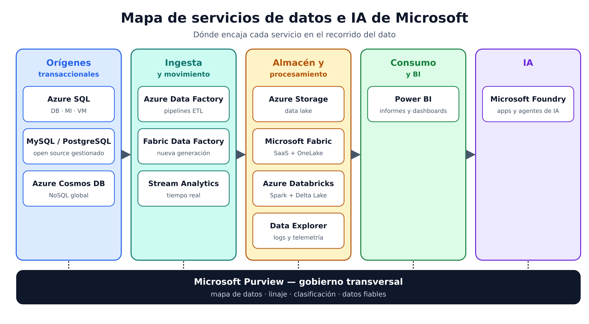

| Servicio | DBA | Ingeniero de datos | Analista de datos | Ingeniero de IA |
| --- | --- | --- | --- | --- |
| Azure SQL (DB, MI, VM) | ⭐ Gestiona | Origen de pipelines | Consulta directa | — |
| Azure Database for MySQL / PostgreSQL | ⭐ Gestiona | Origen de pipelines | Consulta directa | — |
| Azure Cosmos DB | A veces (también desarrolladores) | Integra en analítica | — | Fuente de datos |
| Azure Storage / Data Lake | — | ⭐ Aloja el data lake | — | Fuente de datos |
| Azure Data Factory / Fabric Data Factory | — | ⭐ Pipelines ETL | — | — |
| Microsoft Fabric | — | ⭐ Solución unificada | ✅ | ✅ |
| Power BI | — | — | ⭐ Informes y dashboards | Muestra resultados de IA |
| Azure Databricks | — | ⭐ Spark / Delta Lake | ✅ Notebooks | ✅ |
| Azure Stream Analytics | — | ⭐ Streaming | — | — |
| Azure Data Explorer | — | — | ⭐ Logs y telemetría | — |
| Microsoft Purview | — | ⭐ Gobierno | Encuentra datos fiables | — |
| Microsoft Foundry | — | Colabora | — | ⭐ Construye soluciones de IA |

⭐ = uso principal del rol según el temario.

---

### Sección 10: Caso integrado — cadena de tiendas de electrónica

Veamos cómo encajan roles y servicios en un único escenario.

Caso integrado: cadena de tiendas de electrónica

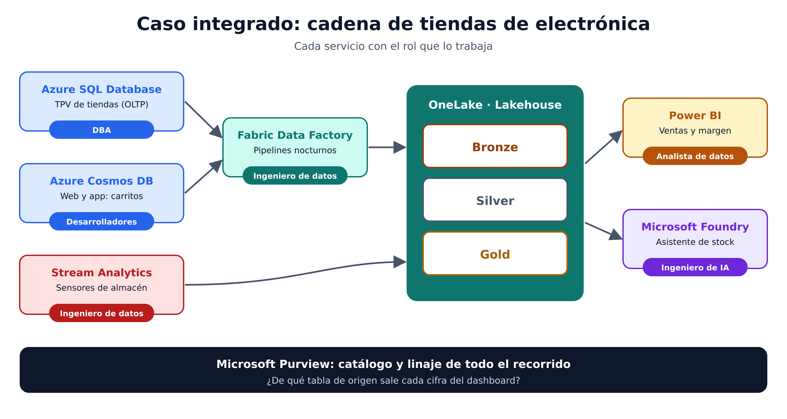

1. El **DBA** gestiona **Azure SQL Database**, donde los TPV registran cada venta (OLTP con ACID). Configura backups y permisos.
2. Los **desarrolladores** guardan carritos y perfiles de la web en **Azure Cosmos DB**.
3. El **ingeniero de datos** crea pipelines con **Fabric Data Factory** que llevan ventas y pedidos online a un **lakehouse** en **OneLake** (Bronze → Silver → Gold), y usa **Stream Analytics** para el stock en tiempo real del almacén.
4. **Microsoft Purview** cataloga los datos y muestra su linaje.
5. La **analista de datos** construye en **Power BI** el dashboard de ventas y margen por tienda y categoría.
6. El **ingeniero de IA** usa **Microsoft Foundry** para crear un asistente que responde a los jefes de tienda: “¿Qué productos de la categoría portátiles se están quedando sin stock en mi zona?”.
---

### Sección 11: Prompts para practicar con un asistente de IA

**Identificar roles**

```plain text
Actúa como evaluador de la certificación DP-900. Te describo 8 tareas de una empresa de logística
(ej.: restaurar una base de datos tras un borrado accidental, crear un dashboard de entregas a tiempo,
construir un pipeline nocturno de pedidos, desplegar un chatbot sobre contratos con clientes...).
Inventa las 8 tareas, asígnalas a DBA, ingeniero de datos, analista de datos o ingeniero de IA y
justifica cada asignación.
```

**Elegir entre las opciones de Azure SQL**

```plain text
Una aseguradora quiere migrar a Azure una aplicación de pólizas que hoy corre en SQL Server
on-premises y usa funciones a nivel de instancia (SQL Agent, consultas entre bases de datos).
Compara Azure SQL Database, Azure SQL Managed Instance y SQL Server en VM para este caso,
indicando el modelo (IaaS/PaaS), el nivel de control y la carga de administración. Recomienda uno.
```

**Elegir servicio para cada necesidad**

```plain text
Para cada necesidad, indica qué servicio de Azure o Microsoft encaja mejor según el temario DP-900 y
por qué: (1) consultar logs de telemetría IoT con marca temporal, (2) detectar en tiempo real
transacciones anómalas con tarjeta, (3) catalogar y ver el linaje de los datos de toda la empresa,
(4) construir pipelines ETL programados, (5) informes interactivos para dirección, (6) app de chat
sobre documentos internos.
```

**Diseñar una arquitectura con Fabric**

```plain text
Diseña a alto nivel una solución en Microsoft Fabric para una cadena de gimnasios que quiere unificar
datos de su CRM (Azure SQL), lecturas de tornos de acceso (streaming) y encuestas de satisfacción (CSV).
Indica qué elementos de Fabric usarías (Data Factory, Lakehouse, Warehouse, Real-Time Intelligence,
Power BI), qué rol se encarga de cada parte y cómo encaja OneLake.
```

**Generar preguntas de repaso**

```plain text
Genera 10 preguntas tipo test estilo DP-900 sobre roles de datos (DBA, ingeniero de datos, analista,
ingeniero de IA) y servicios de Azure (Azure SQL, Cosmos DB, Azure Storage, Data Factory, Fabric,
Power BI, Databricks, Stream Analytics, Data Explorer, Purview, Foundry). Cuatro opciones por
pregunta, indica la correcta y explica por qué las demás no lo son.
```

---

### Sección 12: Claves para el examen

- **DBA** → disponibilidad, rendimiento, **backups/recuperación** y **permisos**.
- **Ingeniero de datos** → **pipelines**, limpieza y transformación, almacenes analíticos, privacidad, gobierno.
- **Analista de datos** → exploración, **modelos analíticos**, **informes y visualizaciones**.
- **Ingeniero de IA** → LLM, pipelines de ML, chat sobre datos; plataforma **Microsoft Foundry**.
- Un **rol** no es una **persona**: alguien puede desempeñar varios.
- **PaaS** = Microsoft gestiona la infraestructura; **SaaS** = producto listo para usar.
- **Azure SQL Database** (PaaS, mínima administración) · **Managed Instance** (más configurable, más administración) · **SQL en VM** (máximo control, administración total).
- **MySQL** → stack **LAMP**. **PostgreSQL** → **híbrido relacional-objeto** con tipos personalizados.
- **Cosmos DB** → NoSQL **global** con **varias API**: documentos, clave-valor, familias de columnas y grafos.
- **Azure Storage** → **blobs**, **file shares** y **tablas** (clave-valor). Data lake = blob + **espacio de nombres jerárquico**.
- **Data Factory** → pipelines **ETL**; su evolución en Fabric es **Fabric Data Factory**.
- **Fabric** → **SaaS** unificado sobre **OneLake**; incluye Data Factory, Lakehouse, Warehouse, Real-Time Intelligence y Power BI.
- **Power BI** → BI y visualización; en Fabric trabaja con **modelos semánticos**.
- **Databricks** → **Apache Spark** + **Delta Lake**, enfoque code-first con notebooks.
- **Stream Analytics** → entrada → consulta → salida, **en tiempo real**.
- **Data Explorer** → **logs y telemetría** con marca temporal.
- **Purview** → **gobierno**, mapa de datos y **linaje**.
