# 🔖Clase 04 - Explorar Azure Storage para datos no relacionales

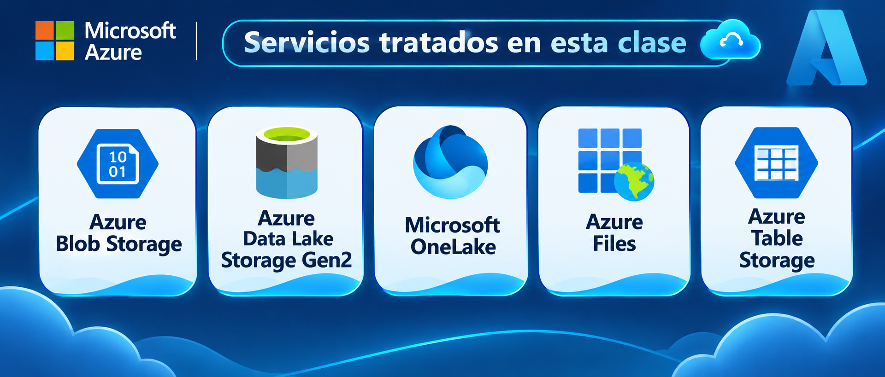

---

> La mayoría de las aplicaciones necesitan guardar datos. Durante décadas, la opción por defecto fue una base de datos relacional: tablas relacionadas entre sí, esquema rígido y consultas en SQL. Pero una parte enorme de los datos que genera hoy una empresa **no encaja en ese molde**: facturas en PDF, fotos de producto, vídeos de formación, logs de servidores, ficheros CSV que llegan de proveedores, telemetría de sensores o catálogos de producto en los que cada artículo tiene atributos distintos.

---

> Para estos casos usamos almacenamiento **no relacional** (a menudo llamado *NoSQL*). En Azure, la base de casi todo este almacenamiento es **Azure Storage**, y sobre ella se construye también **Microsoft OneLake**, el lago de datos de Microsoft Fabric.

---

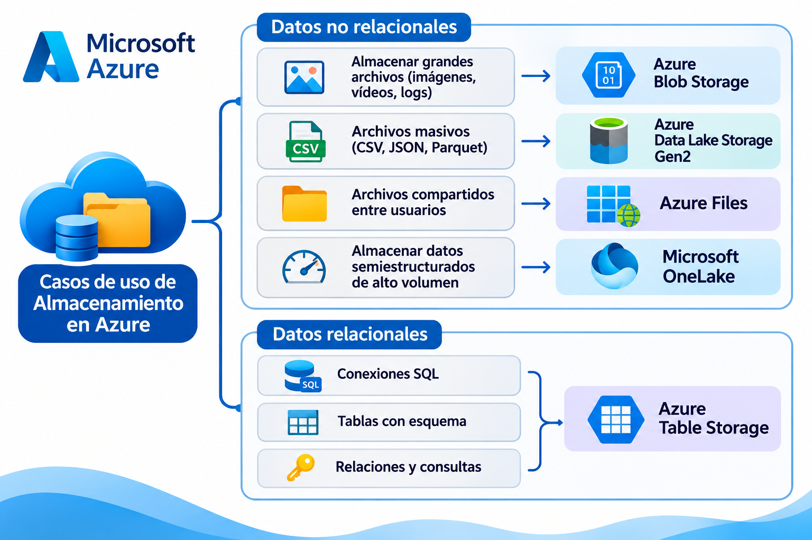

---

### Sección 1: La cuenta de almacenamiento de Azure como punto de partida

>  C**asi todo lo que veremos en esta clase vive dentro de una *****cuenta de almacenamiento***** (storage account)**.

---

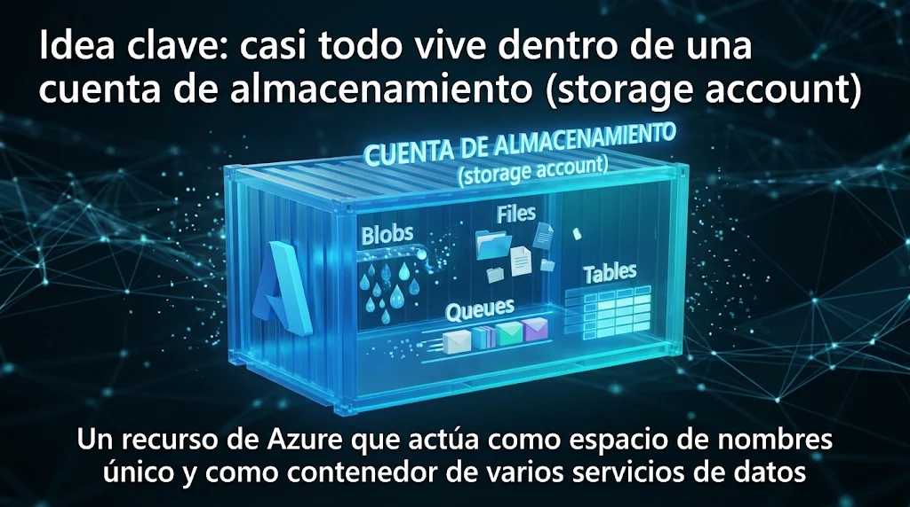

---

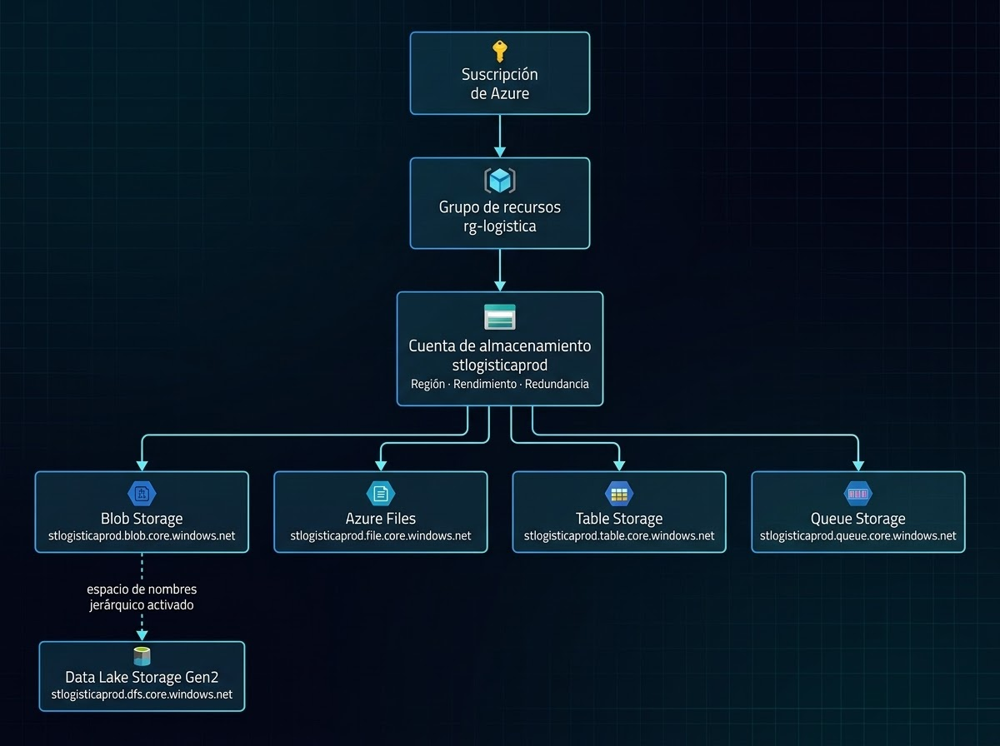

---

> 
- **El nombre de la cuenta es global** en todo Azure (3-24 caracteres, minúsculas y números), porque forma parte de la URL pública de cada servicio.
- **Las decisiones que tomas al crear la cuenta afectan a todos sus servicios**: región, rendimiento (Standard/Premium), redundancia y si se activa el espacio de nombres jerárquico.
- Queue Storage (colas de mensajes) existe en la cuenta, pero **no forma parte de este módulo**; lo mencionamos solo para completar el mapa.

---

> 💡 **Idea para retener:** “Azure Storage” no es un único servicio, es una **familia de servicios** que comparten una cuenta, una facturación y unas opciones de seguridad y redundancia.

---

### Sección 2: Azure Blob Storage

#### 2.1 ¿Qué es un blob?

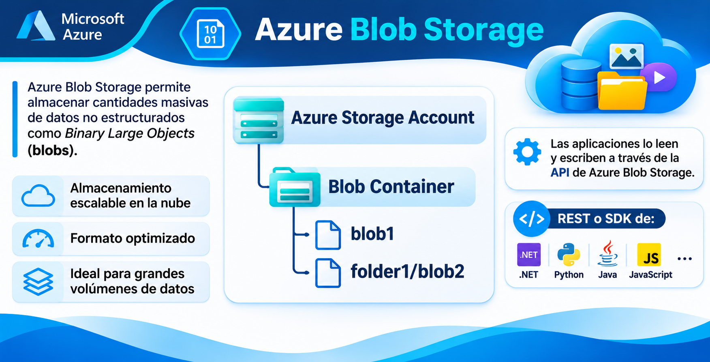

---

Ejemplos típicos de contenido en Blob Storage:

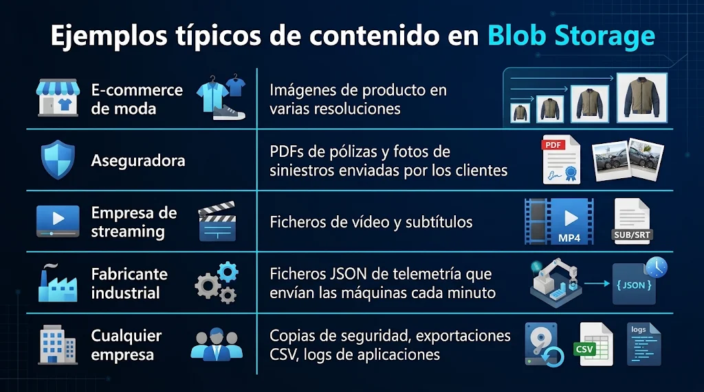

---

#### 2.2 Contenedores y carpetas virtuales

> Dentro de una cuenta de almacenamiento, los blobs se guardan en **contenedores**. Un contenedor agrupa blobs relacionados y es **el nivel en el que se controla quién puede leer y escribir**.

---

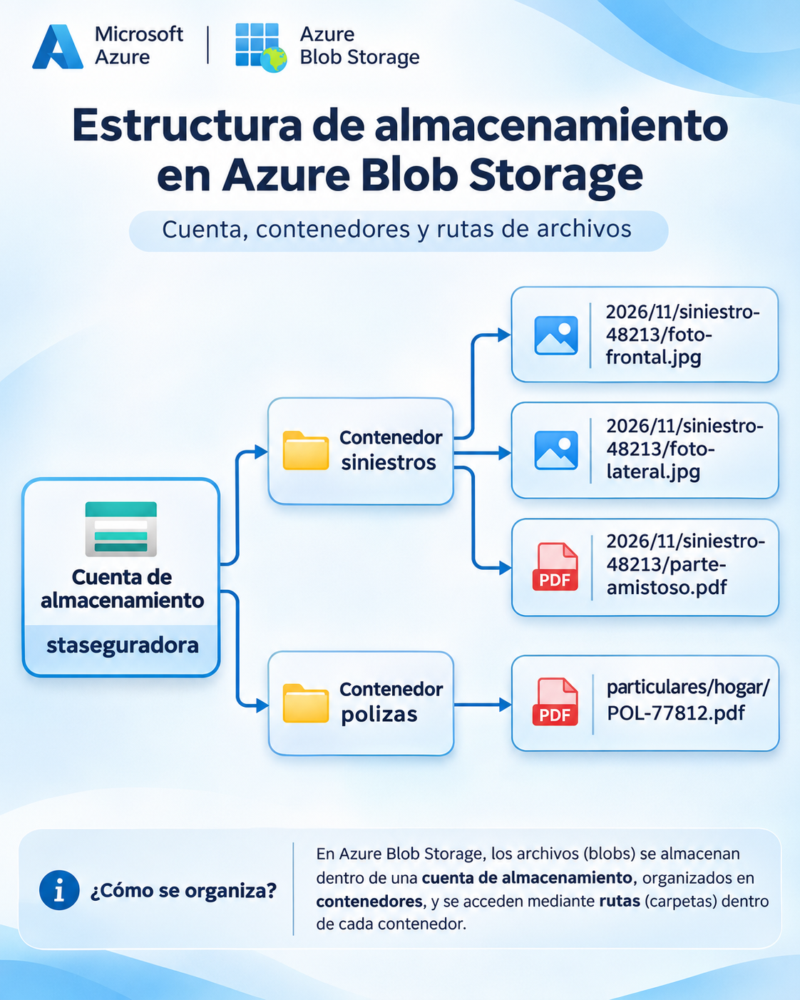

---

> Aunque parezca que hay carpetas `2026/11/siniestro-48213/`, **por defecto esas carpetas no existen**: son **virtuales**. El blob se llama literalmente `2026/11/siniestro-48213/foto-frontal.jpg` y el carácter `/` solo sirve para organizar los nombres en espacios de nombres.

---

Esto tiene consecuencias importantes:

- ❌ No puedes asignar permisos a una “carpeta”.
- ❌ No puedes renombrar o mover una “carpeta” en una sola operación: habría que copiar y borrar cada blob uno a uno.
- ✅ Para tener carpetas reales necesitas **Data Lake Storage Gen2** (Sección 3).
---

#### 2.3 Autenticación y control de acceso

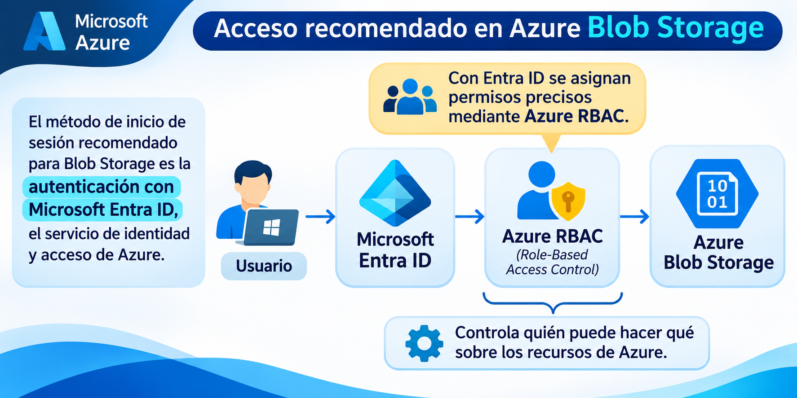

---

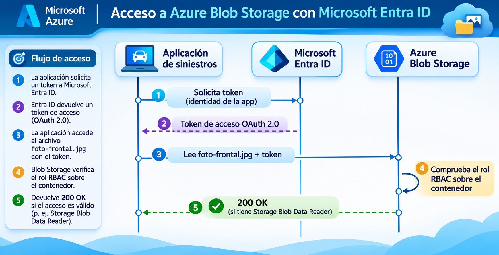

---

Roles habituales para datos de blobs:

| Rol | Qué permite |
| --- | --- |
| **Storage Blob Data Reader** | Leer y listar blobs |
| **Storage Blob Data Contributor** | Leer, escribir y borrar blobs |
| **Storage Blob Data Owner** | Control total, incluida la gestión de ACL en Data Lake Gen2 |

> ACL: significa **Access Control List** (Lista de Control de Acceso). En el contexto de Azure Data Lake Storage Gen2, es un mecanismo de seguridad que permite asignar permisos de forma **granular** (al estilo POSIX de Linux) directamente sobre carpetas y archivos individuales, en lugar de aplicarlos a todo el contenedor.

---

> ⚠️ Existen también las **claves de acceso de la cuenta** y los **tokens SAS** (*Shared Access Signature*). Funcionan, pero una clave de cuenta da acceso total; por eso la recomendación es Entra ID + RBAC siempre que sea posible.

#### 2.4 Los tres tipos de blob

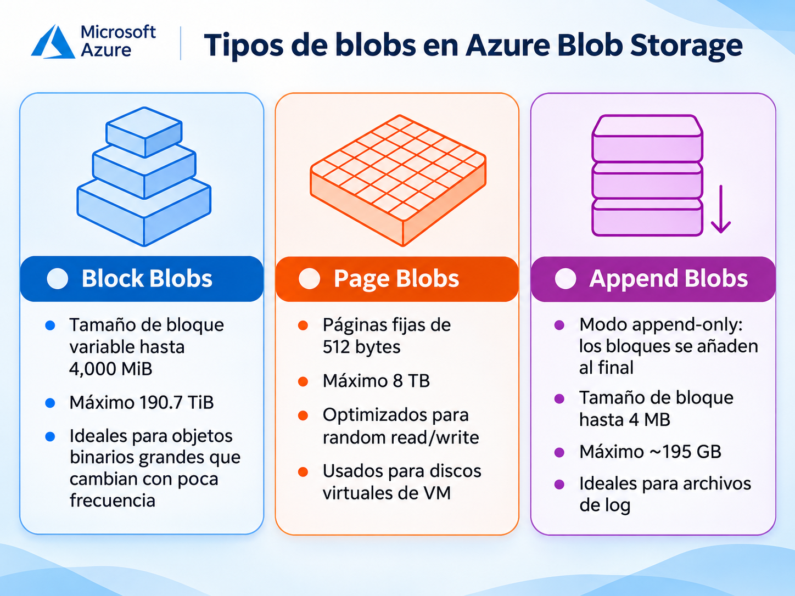

*Fuente: Microsoft Learn*

---

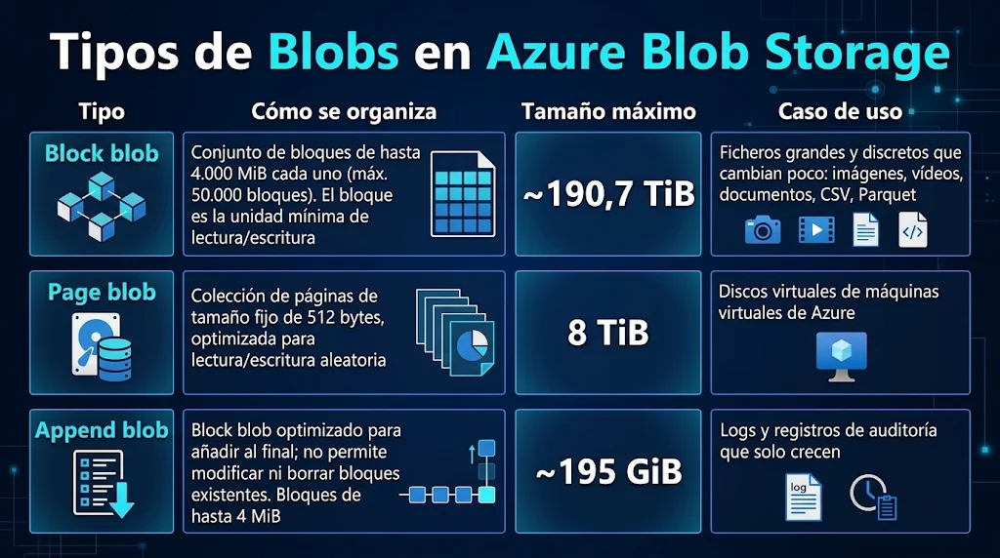

---

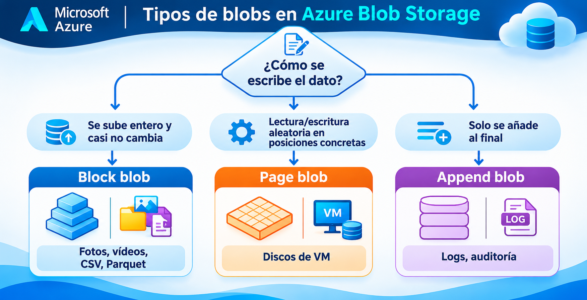

---

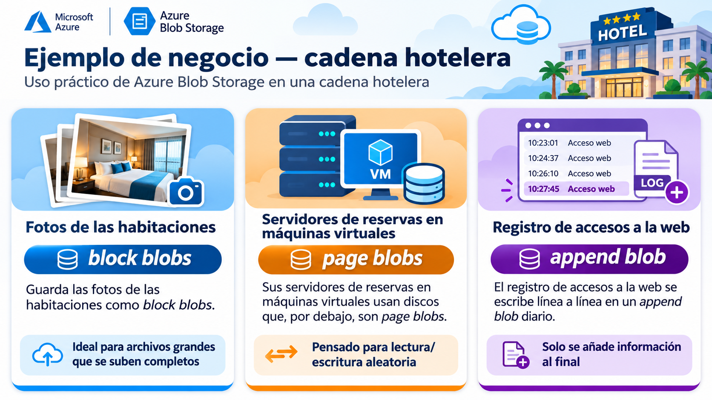

---

#### 2.5 Niveles de acceso (access tiers)

> Blob Storage ofrece **cuatro niveles de acceso** que equilibran **coste de almacenamiento** frente a **coste y latencia de acceso**:

---

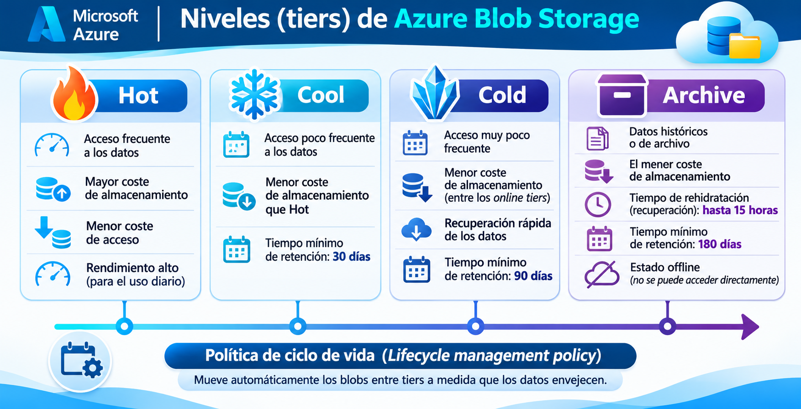

---

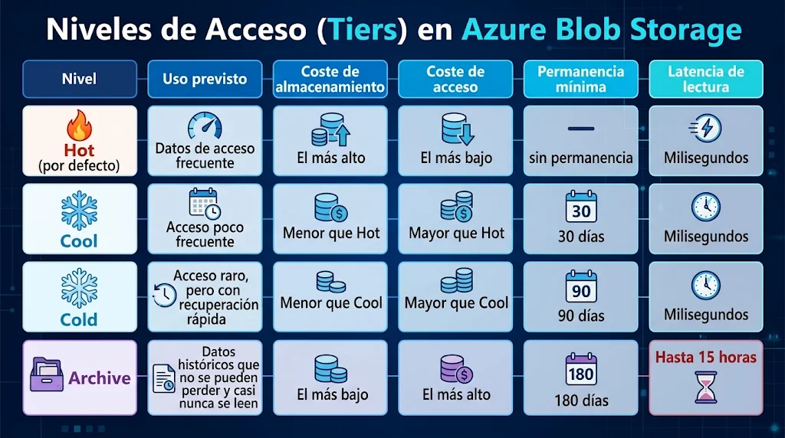

---

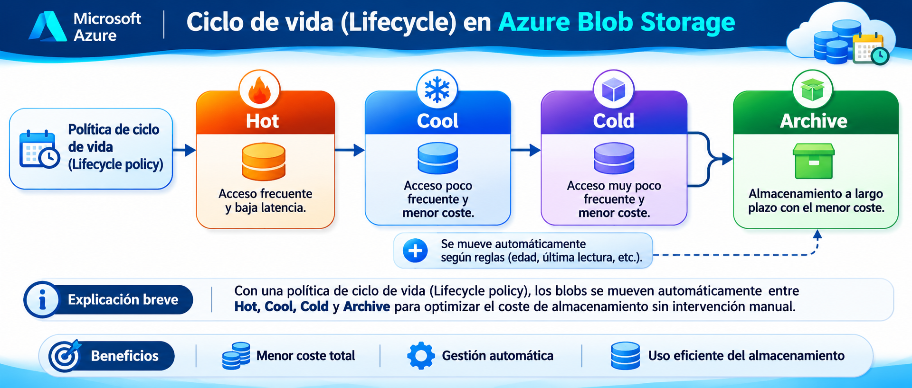

---

Puntos clave:

> 
- La **permanencia mínima** existe para evitar **penalizaciones por borrado anticipado**: si mueves o borras un blob de Cool antes de 30 días, pagas igualmente esos días.
- Un blob en **Archive** está, a efectos prácticos, **offline**. Para leerlo hay que cambiar su nivel a Hot, Cool o Cold y esperar a que termine la **rehidratación** (*rehydration*). Solo entonces se puede leer.
- Un blob puede moverse en ambos sentidos: de Hot a Cool y de Cool de vuelta a Hot.

---

El proceso de rehidratación, paso a paso:

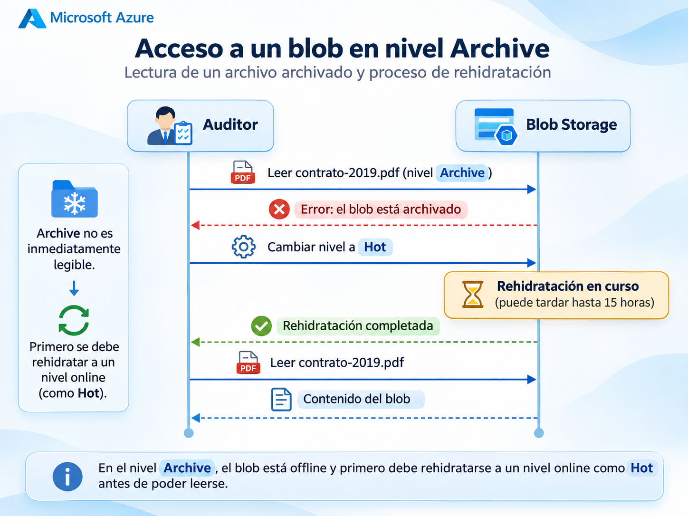

---

**Ejemplo de negocio — una gestoría fiscal:**

| Documento | Nivel adecuado | Por qué |
| --- | --- | --- |
| Facturas del trimestre en curso | Hot | Se consultan y modifican a diario |
| Facturas del año pasado | Cool | Se consultan ocasionalmente |
| Copias de seguridad semanales | Cold | Casi nunca se leen, pero si hay un desastre se necesitan ya |
| Documentación de hace 6 años (obligación legal de conservación) | Archive | Solo se leería ante una inspección de Hacienda |

---

#### 2.6 Políticas de administración del ciclo de vida

> Es muy habitual que un blob se use mucho al principio y casi nada después. En lugar de moverlo a mano, se crean **políticas de administración del ciclo de vida** (*lifecycle management policies*) en la cuenta de almacenamiento. Una política puede:
- Mover automáticamente blobs de **Hot → Cool → Cold → Archive** según los **días transcurridos desde la última modificación**.
- **Eliminar** blobs obsoletos.

---

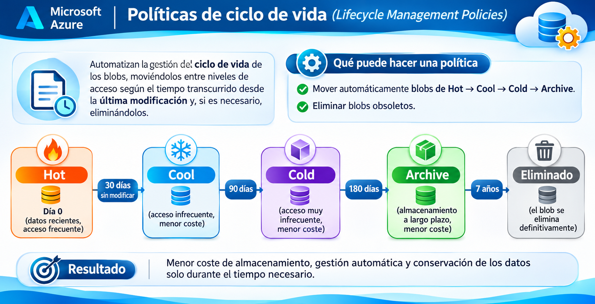

---

Las políticas se definen en JSON. Ejemplo para el contenedor de facturas de la gestoría:

```json
{
  "rules": [
    {
      "enabled": true,
      "name": "ciclo-vida-facturas",
      "type": "Lifecycle",
      "definition": {
        "filters": {
          "blobTypes": [ "blockBlob" ],
          "prefixMatch": [ "facturas/" ]
        },
        "actions": {
          "baseBlob": {
            "tierToCool":    { "daysAfterModificationGreaterThan": 30 },
            "tierToCold":    { "daysAfterModificationGreaterThan": 90 },
            "tierToArchive": { "daysAfterModificationGreaterThan": 180 },
            "delete":        { "daysAfterModificationGreaterThan": 2555 }
          }
        }
      }
    }
  ]
}
```

---

> 💡 2.555 días ≈ 7 años. Fíjate en que los umbrales respetan las permanencias mínimas de cada nivel.

---

#### 2.7 Redundancia

> Azure Storage mantiene siempre **varias copias** de los datos. La opción de redundancia elegida determina **dónde** están esas copias y frente a qué tipo de fallo te protegen:

---

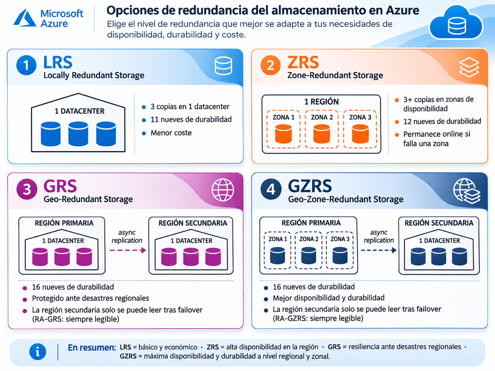

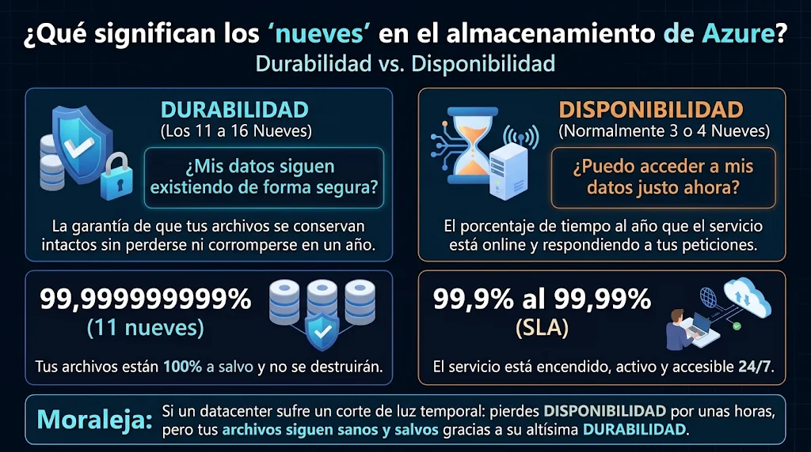

---

| Opción | Copias y ubicación | Protege frente a… |
| --- | --- | --- |
| **LRS** – Locally redundant storage | 3 copias dentro de **un solo centro de datos** | Fallo de un disco o de un servidor |
| **ZRS** – Zone-redundant storage | Copias repartidas en **3 zonas de disponibilidad** de la región primaria | Caída de una zona (un centro de datos completo) |
| **GRS** – Geo-redundant storage | LRS en la región primaria + réplica **asíncrona** a una región secundaria a cientos de km | Desastre en toda la región |
| **GZRS** – Geo-zone-redundant storage | ZRS en la región primaria + réplica asíncrona a una región secundaria | Caída de zona **y** desastre regional |
| **RA-GRS / RA-GZRS** | Igual que GRS/GZRS, pero con **acceso de lectura** a la región secundaria | Permite leer desde la secundaria **antes** de que se produzca una conmutación por error |

---

Así se reparten las copias en el caso más completo, **GZRS**:

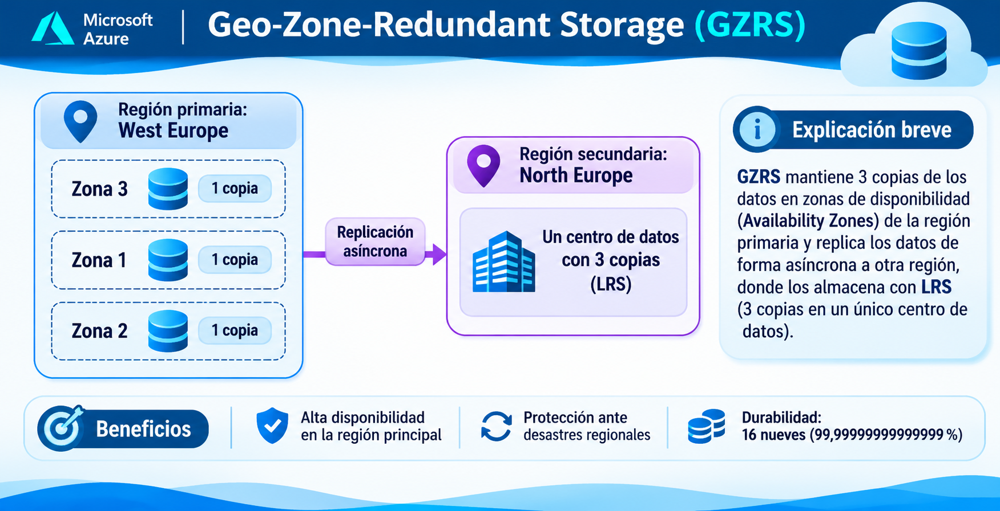

---

Y una escala de protección de menor a mayor:

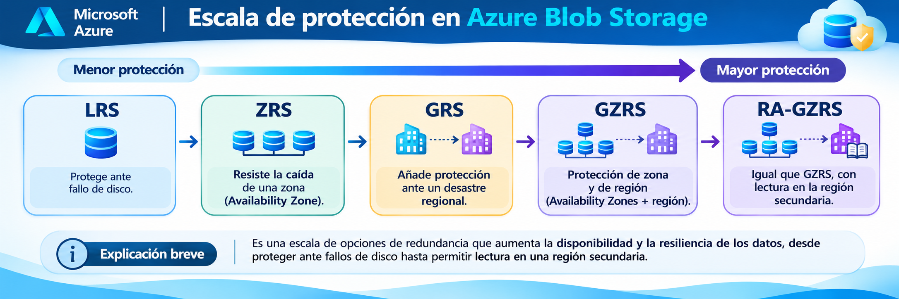

---

**Cómo elegir en un caso real:**

> 
- Entorno de **pruebas** de un equipo de desarrollo → **LRS** (lo más barato; si se pierde, se regenera).
- Plataforma de **reservas online** que no puede caerse si falla un centro de datos → **ZRS**.
- **Historial contable** de un banco que debe sobrevivir a un desastre regional → **GZRS** o **RA-GZRS**.

---

### Sección 3: Azure Data Lake Storage Gen2

#### 3.1 Qué aporta

> **Azure Data Lake Storage Gen2** (ADLS Gen2) es una solución de **data lake a escala cloud integrada en Azure Storage**. No es un servicio aparte: es **Blob Storage con un sistema de archivos jerárquico activado**.

---

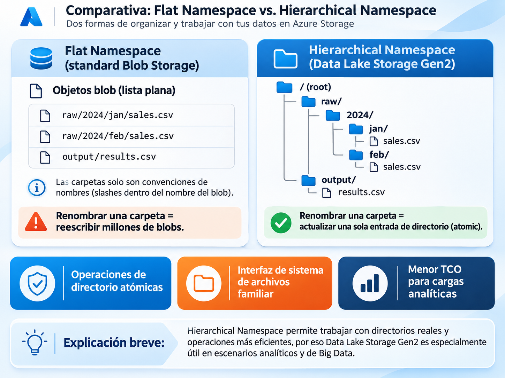

---

Combina lo mejor de dos mundos:

| De Blob Storage hereda | Añade |
| --- | --- |
| Escalabilidad prácticamente ilimitada | **Espacio de nombres jerárquico**: carpetas reales |
| Bajo coste | Compatibilidad con los grandes motores analíticos |
| Niveles de acceso y políticas de ciclo de vida | **ACL compatibles con POSIX** por archivo y carpeta |
| Opciones de redundancia | Operaciones de carpeta atómicas (renombrar, mover, borrar) |

---

#### 3.2 Espacio de nombres plano vs. jerárquico

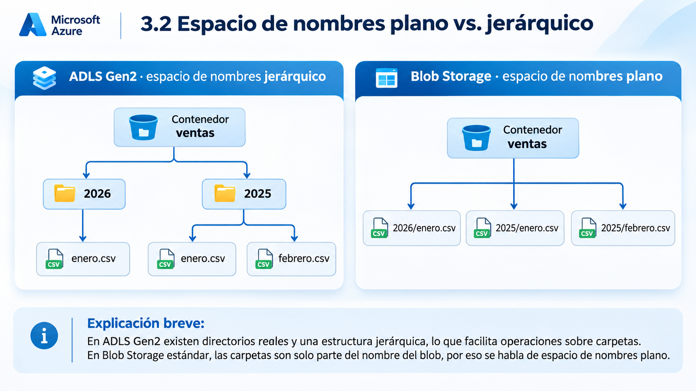

En el lado plano, `2025/` es solo parte del nombre de cada blob; en el lado jerárquico, `📁 2025` es un **directorio real** con sus propios permisos.

---

| Operación | Blob Storage (plano) | ADLS Gen2 (jerárquico) |
| --- | --- | --- |
| Renombrar la carpeta `ventas/2025/` con 2 millones de ficheros | Copiar y borrar 2 millones de blobs | **Una única operación** de metadatos |
| Dar acceso de lectura al equipo de Finanzas solo a `ventas/` | No es posible a nivel de carpeta | ACL sobre la carpeta |
| Rendimiento con Spark/Databricks | Correcto | Optimizado (driver ABFS, endpoint `dfs`) |

---

Por eso ADLS Gen2 es la base habitual de las arquitecturas analíticas:

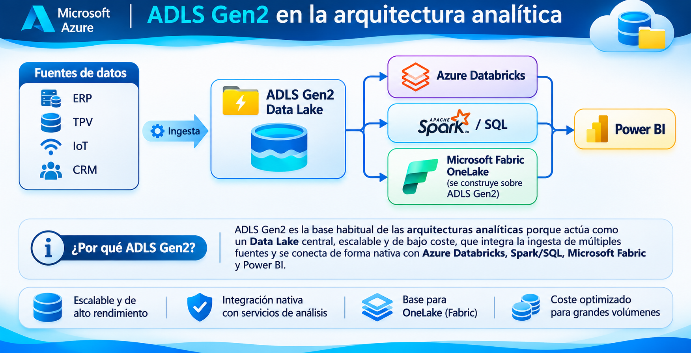

---

#### 3.3 Seguridad en dos capas: RBAC + ACL

> El espacio de nombres jerárquico habilita **listas de control de acceso (ACL) compatibles con POSIX**, con permisos de **lectura (r), escritura (w) y ejecución (x)** sobre archivos y carpetas concretos, independientes del modelo general de RBAC.

| Capa | Granularidad | Ejemplo |
| --- | --- | --- |
| **RBAC** | Cuenta o contenedor | El equipo de ingeniería de datos es *Storage Blob Data Contributor* de todo el contenedor `datalake` |
| **ACL POSIX** | Carpeta o archivo | Los analistas de RR. HH. tienen `r-x` solo en `/curated/rrhh/` y nada en `/curated/finanzas/` |

---

Cómo se evalúa una petición de acceso:

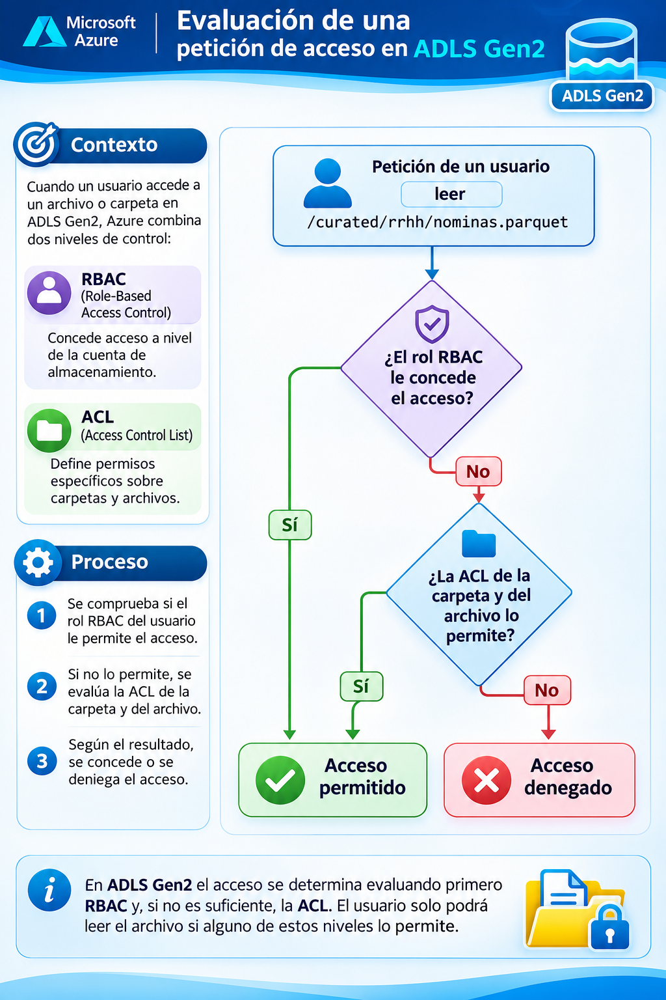

---

**Ejemplo de negocio — distribuidora alimentaria:**

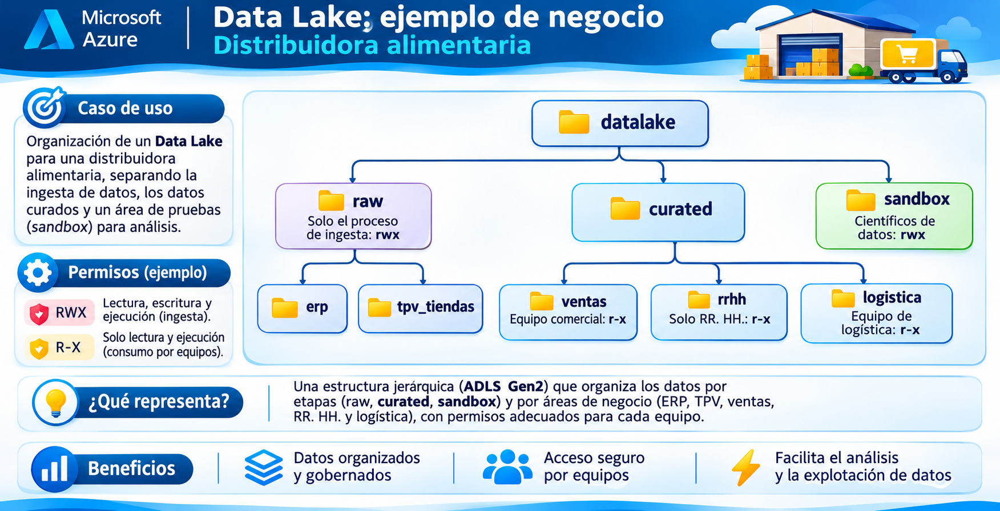

---

#### 3.4 Cómo se crea

> Para tener un sistema de archivos ADLS Gen2 hay que **activar la opción “Hierarchical namespace”** de la cuenta de almacenamiento:
- Al **crear** la cuenta (pestaña *Advanced* del portal), o
- **Actualizando** una cuenta existente.

---

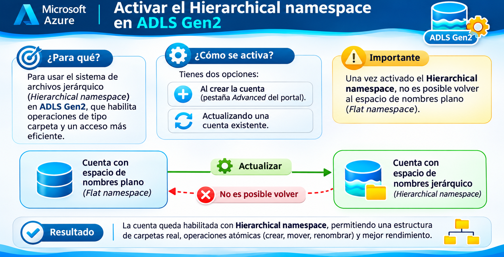

---

> ⚠️ **La actualización es de un solo sentido.** Una vez activado el espacio de nombres jerárquico, **no se puede volver** a un espacio de nombres plano. Es una pregunta frecuente de examen.

---

### Sección 4: Microsoft OneLake en Fabric

#### 4.1 Qué es OneLake

> **OneLake** es un **lago de datos único, unificado y lógico para toda la organización**. Se aprovisiona **automáticamente con cada tenant de Microsoft Fabric** (no hay que crearlo ni configurarlo) y es el repositorio central de todos los datos analíticos.

---


---

> 
- Admite **cualquier tipo de archivo**, estructurado o no estructurado.
- Permite que **varios motores analíticos usen los mismos datos sin moverlos ni duplicarlos** (Spark, SQL, Power BI…).
- Está **construido sobre Azure Data Lake Storage Gen2**.

---

> Se suele describir como **“el OneDrive de los datos”**: igual que una organización tiene un único OneDrive corporativo, tiene un único OneLake.

---

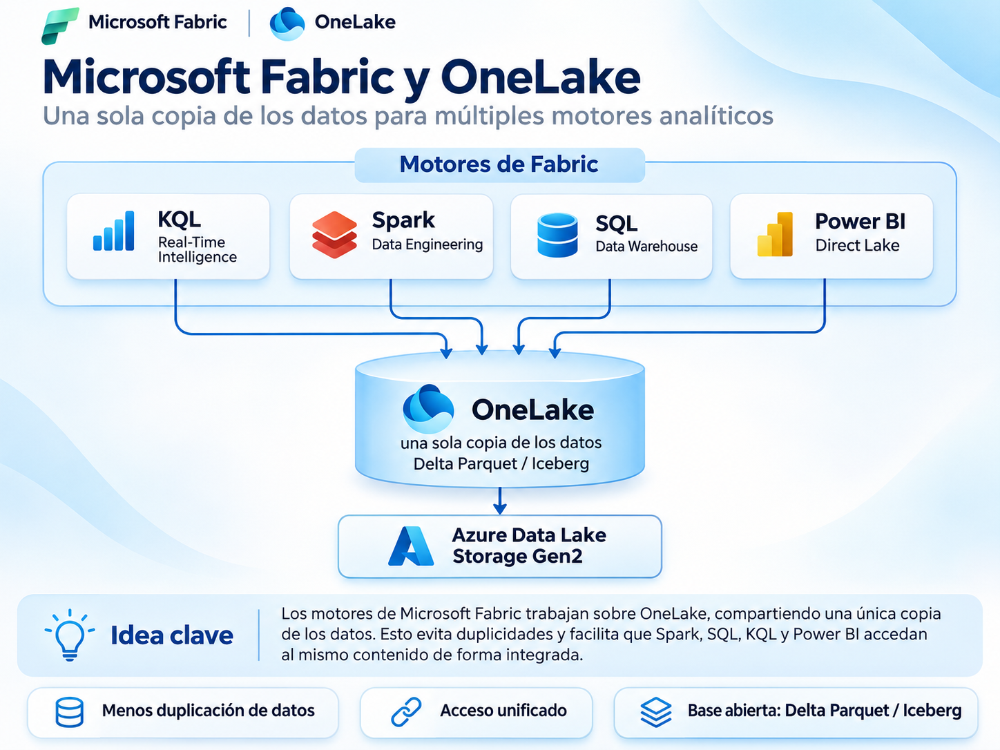

---

#### 4.2 Estructura

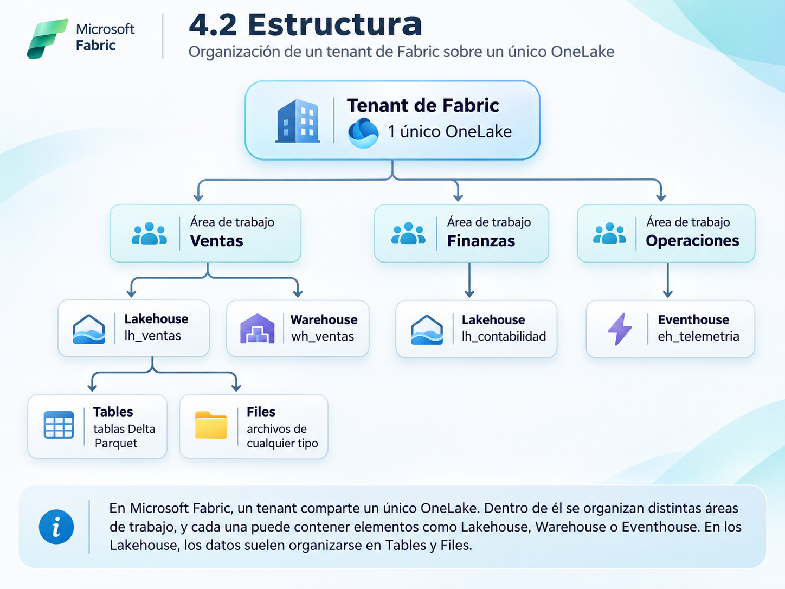

---

Las rutas siguen la misma lógica que ADLS Gen2:

```plain text
https://onelake.dfs.fabric.microsoft.com/<área-de-trabajo>/<elemento>.<tipo>/Files/...
```

---

#### 4.3 Beneficios clave

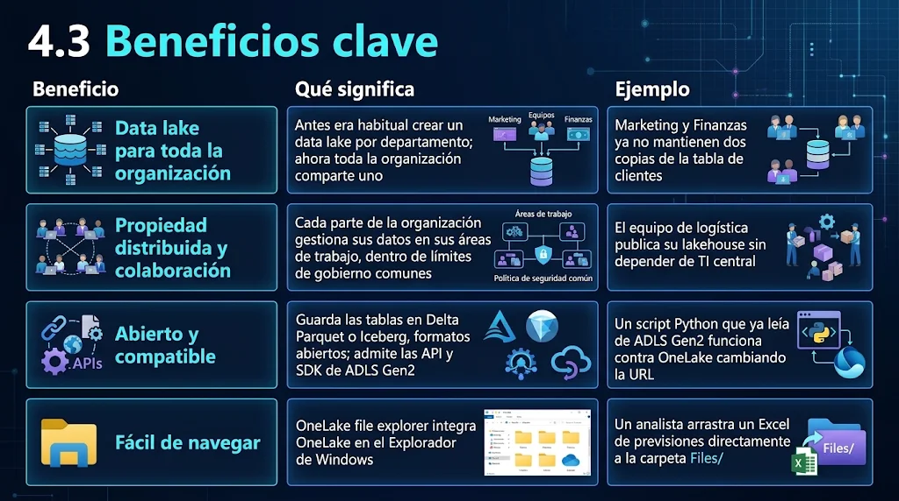

---

El cambio que supone OneLake frente al modelo anterior:

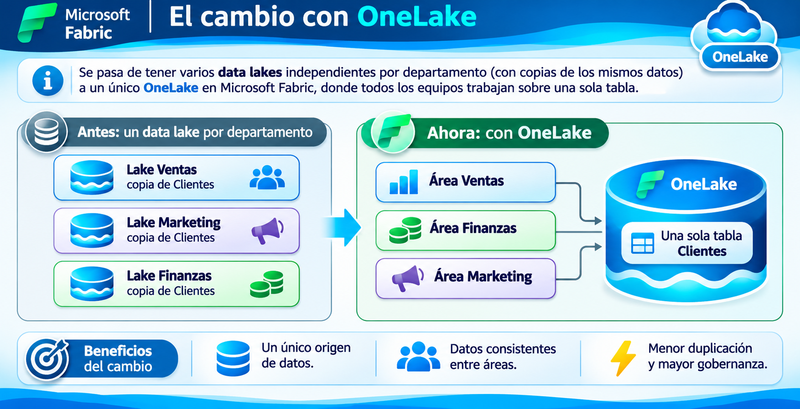

---

#### 4.4 ADLS Gen2 vs. OneLake

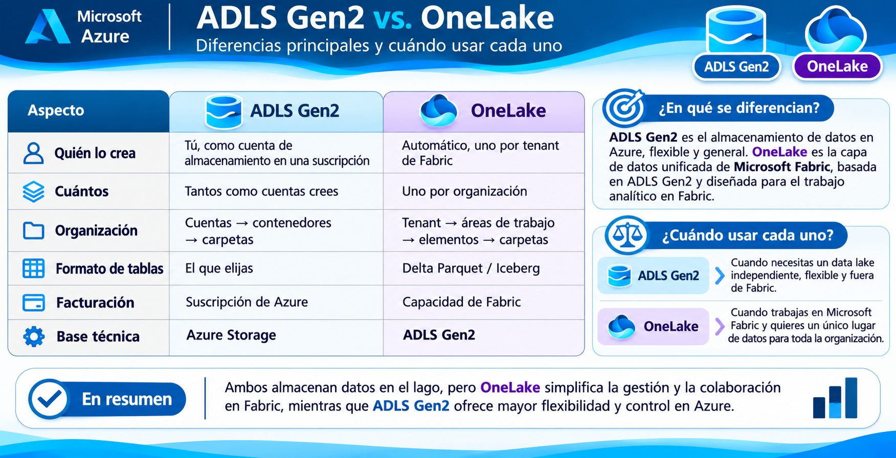

---

### Sección 5: Azure Files

#### 5.1 El problema que resuelve

> Muchas organizaciones con infraestructura propia usan **recursos compartidos de archivos** (*file shares*): un fichero se guarda en un servidor y otros equipos y aplicaciones de la red acceden a él (la típica unidad `Z:\Compartido`). Funciona bien en una misma red local, pero **no escala** cuando crece el número de usuarios o cuando están en sedes distintas, y exige comprar y mantener servidores.

---

> **Azure Files** permite crear **recursos compartidos de red en la nube**. La organización elimina el coste de hardware y mantenimiento y obtiene alta disponibilidad y almacenamiento escalable.

---

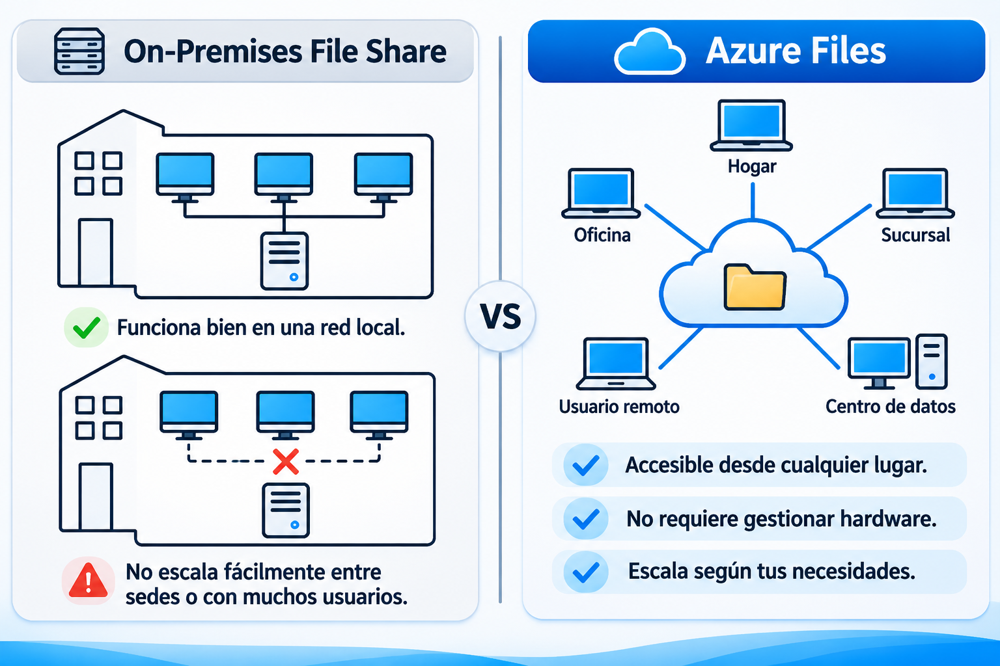

---

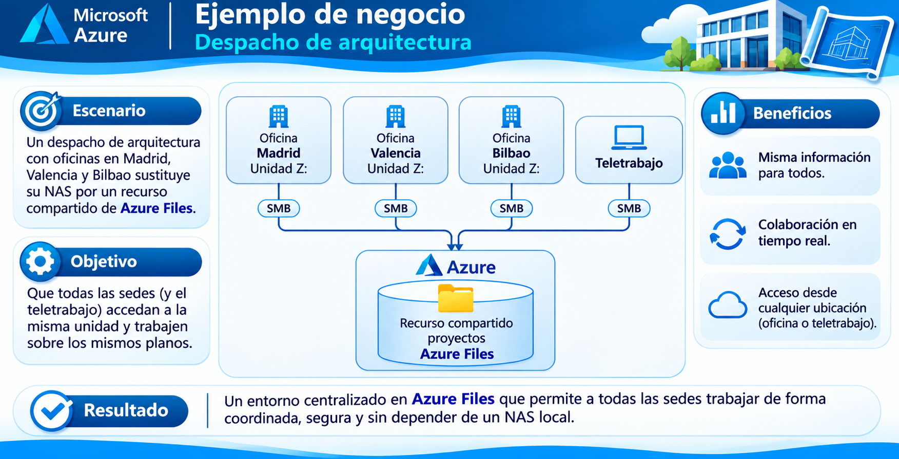

---

#### 5.2 Capacidad y límites

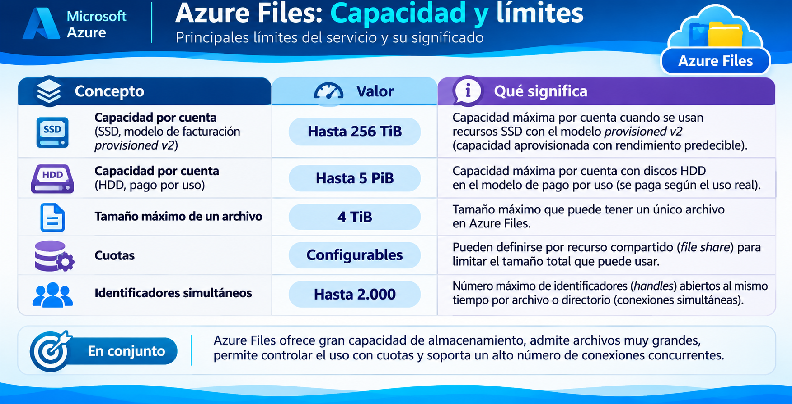

---

#### 5.3 Cómo se cargan y sincronizan los datos

> 
- **Portal de Azure**: carga manual de archivos.
- **AzCopy**: utilidad de línea de comandos para copias masivas.
- **Azure File Sync**: sincroniza **copias en caché local** (en un Windows Server de la oficina) con los datos de Azure Files. Los usuarios trabajan con la rapidez de un servidor local y la nube actúa como almacén central.

---


---

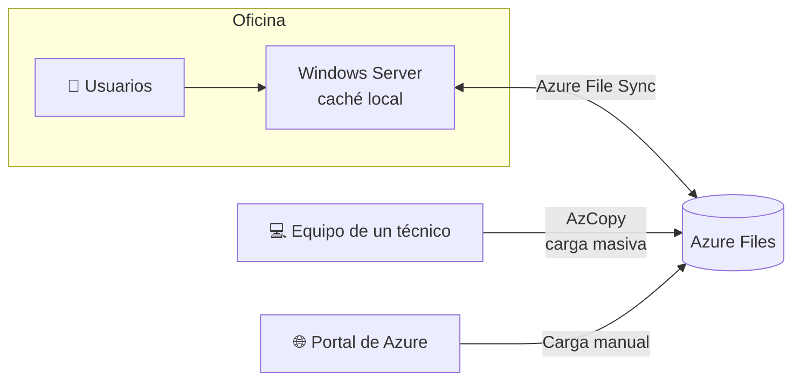

---

```bash
# Copiar una carpeta local a un recurso compartido de Azure Files con AzCopy
azcopy copy "C:\Proyectos\Obra-Castellana" \
  "https://starquitectura.file.core.windows.net/proyectos?<token-SAS>" \
  --recursive
```

---

#### 5.4 Niveles de medios y protocolos

| Nivel | Hardware | Rendimiento | Precio |
| --- | --- | --- | --- |
| **HDD** | Discos duros | Estándar | Menor |
| **SSD** | Discos de estado sólido | Mayor rendimiento | Mayor |

| Protocolo | Clientes | Requisitos |
| --- | --- | --- |
| **SMB** (*Server Message Block*) | Windows, Linux y macOS | — |
| **NFS** (*Network File System*) | Linux (no compatible con Windows) | Nivel **SSD** obligatorio y acceso mediante **punto de conexión privado** o **punto de conexión de servicio** de una red virtual |

---

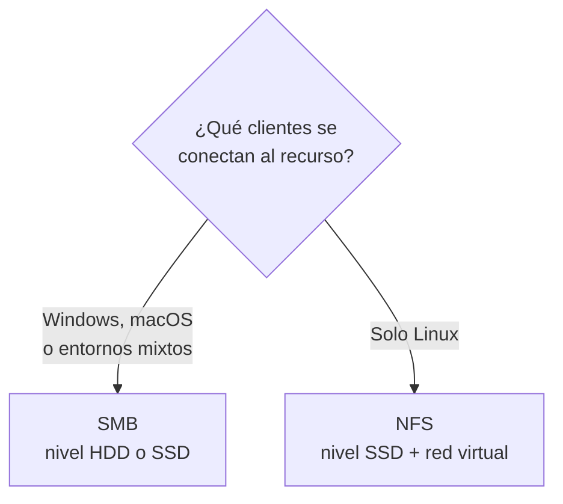

---

### Sección 6: Azure Table Storage

#### 6.1 Qué es (y qué no es)

> **Azure Table Storage** es una solución de almacenamiento **NoSQL** basada en tablas que contienen elementos **clave/valor**. Cada elemento es una fila con columnas para los campos que haya que guardar.

---

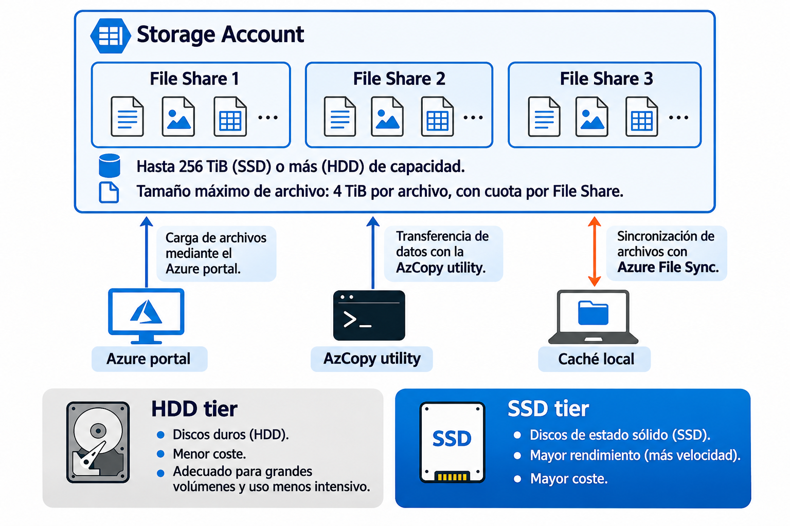

---

> ⚠️ **No confundir con una tabla relacional.** Una tabla de Azure Table Storage guarda **datos semiestructurados**:
- Cada fila tiene una **clave única** formada por **PartitionKey + RowKey**.
- Una columna **Timestamp** registra la fecha y hora de la última modificación.
- **El resto de columnas puede variar de una fila a otra.**
- No hay claves externas, relaciones, procedimientos almacenados, vistas ni otros objetos relacionales.

---

> 📌 Todo lo que veremos aquí se aplica también a **Azure Cosmos DB for Table**, un servicio más reciente con el mismo modelo clave/valor que ofrece mayor rendimiento y disponibilidad, distribución global e índices secundarios automáticos.

---

#### 6.2 Datos desnormalizados

> En Table Storage los datos suelen estar **desnormalizados**: cada fila contiene todos los datos de una entidad lógica. En un modelo relacional, la información de un cliente se repartiría en varias tablas; aquí va en una sola fila, y cada fila puede tener un número de columnas distinto.

---

**Modelo relacional** (normalizado):

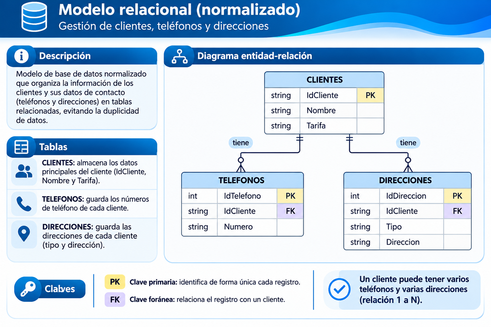

---

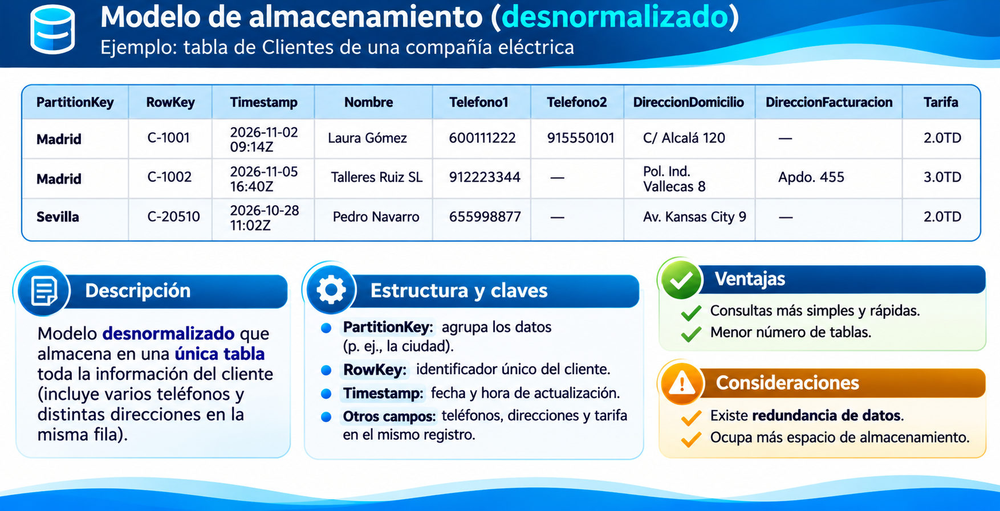

---

#### 6.3 Particiones

> Para garantizar un acceso rápido, Table Storage divide cada tabla en **particiones**. Una partición agrupa las filas relacionadas según la **PartitionKey**, un valor que eliges tú para reflejar una propiedad común. Las filas con la misma PartitionKey se almacenan juntas.

---

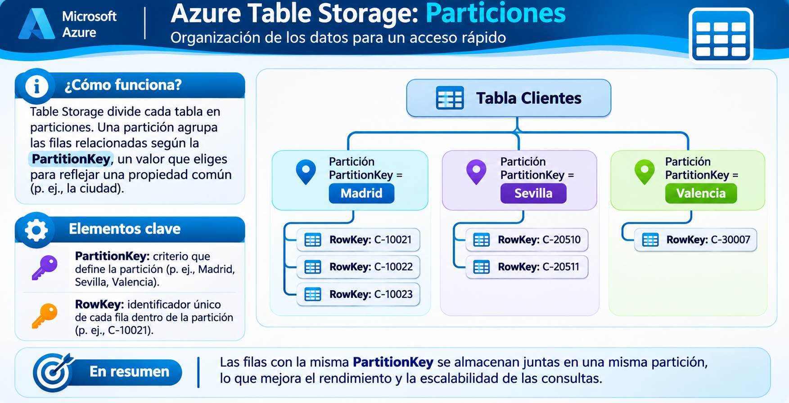

---

Ventajas del particionado:

> 
- **Escalabilidad:** las particiones son independientes y crecen o se reducen al añadir o eliminar filas. Una tabla puede tener cualquier número de particiones.
- **Rendimiento:** si incluyes la PartitionKey en la búsqueda, se reduce el volumen de datos que hay que examinar y, por tanto, las operaciones de E/S (lecturas y escrituras).
Dentro de cada partición, las filas se guardan **ordenadas por RowKey**, y Azure coloca cada nueva fila en su posición correcta.

---

#### 6.4 Tipos de consulta

| Tipo | Qué hace | Ejemplo con la tabla anterior |
| --- | --- | --- |
| **Consulta puntual** (*point query*) | Localiza una única fila indicando PartitionKey **y** RowKey. Es la más eficiente | `PartitionKey = 'Madrid' AND RowKey = 'C-10022'` |
| **Consulta por rango** (*range query*) | Recupera un bloque contiguo de filas dentro de una partición | `PartitionKey = 'Madrid' AND RowKey >= 'C-10000' AND RowKey < 'C-11000'` |

---

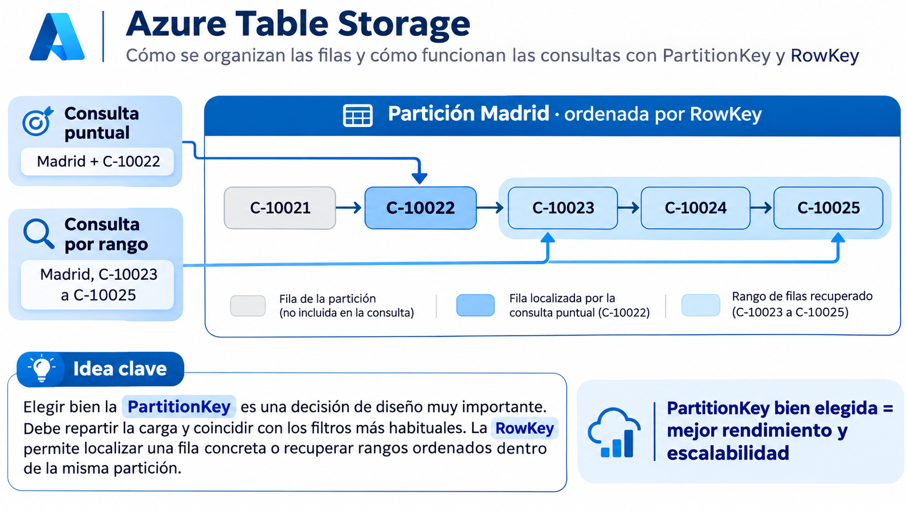

---

### Sección 7: ¿Qué servicio elijo?

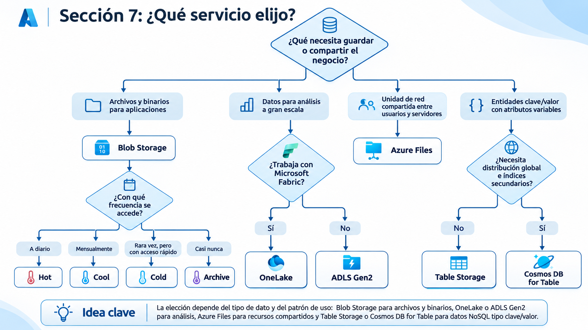

---

| Necesidad del negocio | Servicio |
| --- | --- |
| Guardar millones de imágenes de producto y servirlas a una web | **Blob Storage** (block blobs, nivel Hot) |
| Conservar 10 años de grabaciones de llamadas del call center por obligación legal | **Blob Storage** en nivel **Archive** con política de ciclo de vida |
| Crear el data lake corporativo para procesar ventas con Spark en Databricks | **ADLS Gen2** |
| Dar a cada departamento su espacio analítico dentro de un único lago, con tablas Delta listas para Power BI | **OneLake** (Microsoft Fabric) |
| Sustituir el servidor de archivos de la oficina y mantener la unidad de red `Z:` | **Azure Files** (SMB) + Azure File Sync |
| Compartir archivos de configuración entre servidores Linux | **Azure Files** (NFS, nivel SSD) |
| Guardar perfiles de dispositivos IoT con atributos distintos por modelo y consultar por ID | **Table Storage** (o Cosmos DB for Table si hace falta distribución global) |
| Guardar los discos de las máquinas virtuales | **Page blobs** |
| Escribir un log de auditoría que solo crece | **Append blobs** |

---

### Sección 8: Claves para el examen DP-900

| Si la pregunta menciona… | Piensa en… |
| --- | --- |
| Datos no estructurados, imágenes, vídeos, binarios | **Blob Storage** |
| Discos de máquinas virtuales | **Page blob** |
| Logs que solo se añaden | **Append blob** |
| Menor coste, datos que casi nunca se leen, latencia de horas | **Archive** (rehidratación de hasta 15 h) |
| Permanencia mínima de 30 / 90 / 180 días | **Cool / Cold / Archive** |
| Mover blobs automáticamente según su antigüedad | **Política de ciclo de vida** |
| 3 copias en un centro de datos | **LRS** |
| 3 zonas de disponibilidad | **ZRS** |
| Réplica en otra región | **GRS / GZRS** |
| Leer de la región secundaria sin conmutación por error | **RA-GRS / RA-GZRS** |
| Carpetas reales, ACL POSIX, Databricks/Spark | **ADLS Gen2** (espacio de nombres jerárquico) |
| ¿Se puede desactivar el espacio de nombres jerárquico? | **No**, es irreversible |
| Un único lago para toda la organización, automático con Fabric | **OneLake** |
| Formatos de tabla de OneLake | **Delta Parquet o Iceberg** |
| Recursos compartidos de red, SMB, sustituir un servidor de archivos | **Azure Files** |
| NFS | Solo Linux, nivel SSD, red virtual |
| Clave/valor, PartitionKey + RowKey, filas con columnas distintas | **Table Storage** |
| Table con distribución global e índices secundarios automáticos | **Cosmos DB for Table** |
