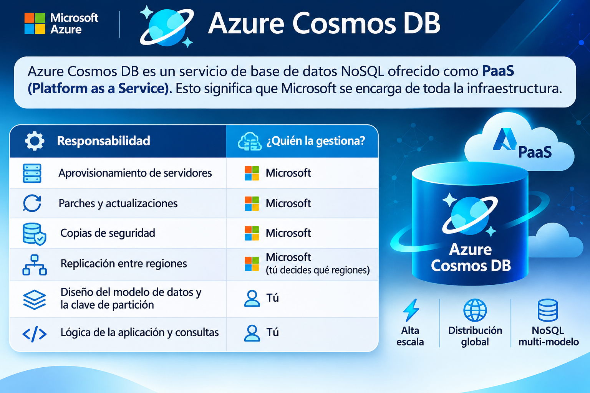
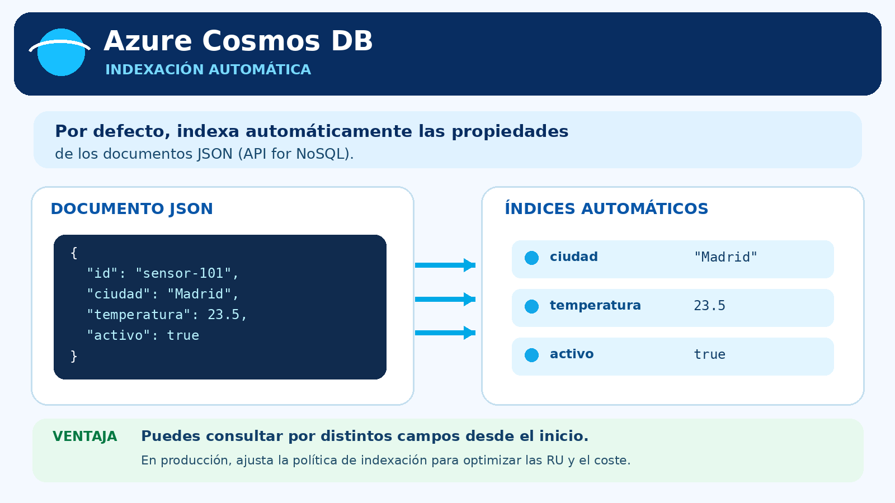
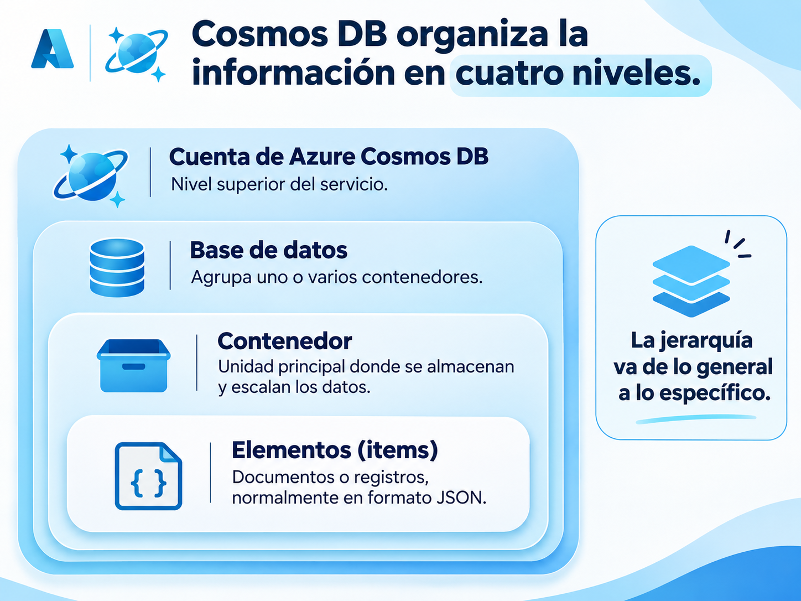
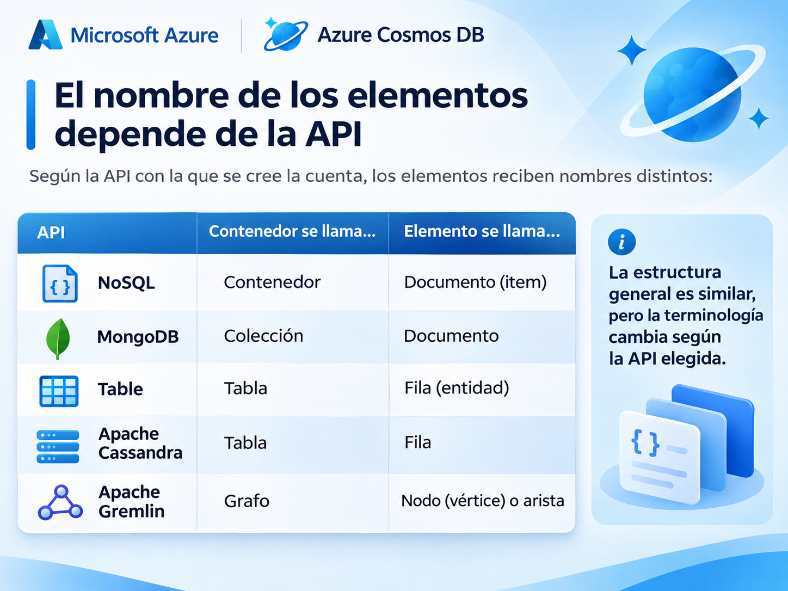
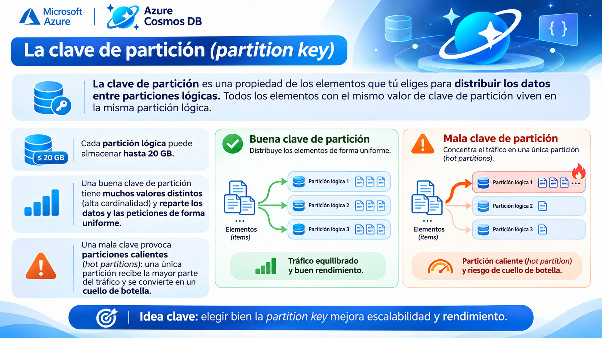
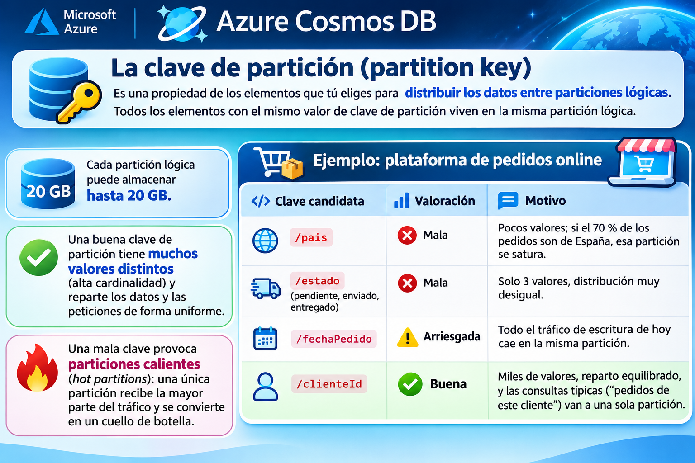
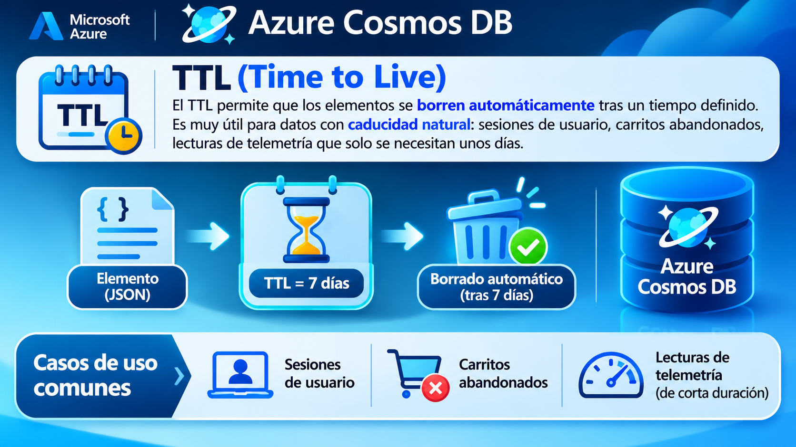

# 🔖Clase 05 - Explore Azure Cosmos DB

---

### Sección 1. Del modelo relacional al no relacional: por qué existe Cosmos DB

Existen escenarios en los que el modelo relacional se queda corto:

- **La forma de los datos cambia constantemente.** Un catálogo de productos donde un portátil tiene 30 atributos técnicos y una camiseta tiene 4.
- **El volumen y la velocidad de escritura son enormes.** Miles de sensores enviando lecturas cada segundo.
- **Los usuarios están repartidos por todo el mundo** y esperan respuestas en milisegundos, estén en Madrid, Ciudad de México o Singapur.
---

> **Azure Cosmos DB** es la respuesta de Azure a estos escenarios: una base de datos **NoSQL**, **totalmente gestionada**, **distribuida globalmente** y con **latencia garantizada**.

> 💡 **Claves para el examen:** Cosmos DB no sustituye a Azure SQL Database. Son herramientas para problemas distintos. Si la aplicación depende de `JOIN` complejos entre muchas tablas, Azure SQL es mejor opción. Si el problema es escala, flexibilidad de esquema y baja latencia global, Cosmos DB encaja.

---

### Sección 2. ¿Qué es Azure Cosmos DB?



---

#### Schema-agnostic: esquema flexible

> Cosmos DB es **independiente del esquema** (*schema-agnostic*). Los elementos guardados en un mismo contenedor **no necesitan compartir la misma estructura**. Un elemento puede tener 5 propiedades y otro, en el mismo contenedor, 15 propiedades completamente diferentes.

---

**Ejemplo: catálogo de un e-commerce de electrónica y moda:**

```json
{
  "id": "PRD-1001",
  "categoria": "portatiles",
  "nombre": "UltraBook Pro 14",
  "precio": 1299.00,
  "procesador": "8 núcleos",
  "ram_gb": 32,
  "almacenamiento": { "tipo": "SSD", "capacidad_gb": 1024 },
  "puertos": ["USB-C", "HDMI", "Thunderbolt"]
}
```

```json
{
  "id": "PRD-2045",
  "categoria": "moda",
  "nombre": "Camiseta básica algodón",
  "precio": 14.95,
  "tallas": ["S", "M", "L", "XL"],
  "color": "azul marino"
}
```

---

> Ambos documentos conviven en el mismo contenedor `productos`. En una base relacional tendríamos que diseñar tablas de atributos, columnas nulas o un modelo EAV (entidad-atributo-valor) bastante incómodo de consultar.

---

#### Indexación automática

> Por defecto, Cosmos DB **crea y mantiene índices sobre todas las propiedades** de todos los elementos. No hay que definir un esquema previo ni gestionar índices manualmente: el servicio lo hace solo. Esto permite consultar por cualquier campo desde el primer momento (aunque, en producción, se puede ajustar la política de indexación para ahorrar coste).

---



---

### Sección 3. Jerarquía de recursos: cómo organiza los datos

Cosmos DB organiza la información en **cuatro niveles**:



---

| Nivel | Qué es | Qué se configura aquí |
| --- | --- | --- |
| **Cuenta** | Recurso de Azure de nivel superior. Puede gestionar una cantidad ilimitada de datos y de rendimiento aprovisionado. | API elegida, regiones, nivel de consistencia por defecto, modo de capacidad |
| **Base de datos** | Espacio de nombres lógico que agrupa contenedores relacionados. | Opcionalmente, rendimiento compartido |
| **Contenedor** | **Unidad principal de almacenamiento y de escalado.** | Clave de partición, rendimiento, política de indexación, TTL opcional |
| **Elemento** | Cada entidad de datos individual. | — |

---

#### El nombre de los elementos depende de la API



---

#### La clave de partición (partition key)



---

**Ejemplo:  plataforma de pedidos online:**



---

#### TTL (Time to Live)



---

### Sección 4. Distribución global y rendimiento

> Cosmos DB está diseñado desde el origen para ser **distribuido globalmente**:
- Puedes **añadir regiones de Azure** a tu cuenta en cualquier momento.
- El servicio **replica los datos automáticamente** en cada región.
- Los usuarios **leen desde la réplica más cercana**.
- Con **escrituras multirregión** (*multi-region writes*) habilitadas, los usuarios también **escriben en la región más cercana**.

---

#### Garantías de servicio (SLA)

| Métrica | Valor |
| --- | --- |
| Disponibilidad con escrituras multirregión | **99,999 %** |
| Lecturas y escrituras (percentil 99) | **< 10 ms** |
| Latencia media de lectura (percentil 50) | **≤ 4 ms** (típico) |
| Latencia media de escritura (percentil 50) | **≤ 5 ms** (típico) |

> 💡 99,999 % de disponibilidad equivale a poco más de **5 minutos de caída al año**.

---

**Ejemplo. Cadena hotelera internacional:** el motor de reservas tiene la cuenta replicada en West Europe, East US y Southeast Asia. Un cliente en Tokio que reserva una habitación en Barcelona escribe en la región asiática con latencia mínima; la reserva se replica al resto de regiones. Si la región europea sufre una incidencia, las otras dos siguen dando servicio.

---

#### Niveles de consistencia

Cuando hay réplicas en varias regiones aparece una pregunta inevitable: **¿qué ocurre si un usuario lee justo después de que otro haya escrito en otra región?** ¿Ve el dato nuevo o el antiguo?

Cosmos DB ofrece **cinco niveles de consistencia** para elegir el equilibrio entre **consistencia**, **disponibilidad**, **latencia** y **rendimiento**. Van del más estricto al más relajado:

---

| Nivel | Qué garantiza | Ejemplo de uso empresarial |
| --- | --- | --- |
| **Strong** (Fuerte) | Toda lectura refleja la escritura más reciente. | Saldo de una cuenta bancaria, stock de entradas para un concierto |
| **Bounded staleness** (Obsolescencia limitada) | Las lecturas pueden ir por detrás de las escrituras, pero como máximo un intervalo configurable (tiempo o número de versiones). | Cotizaciones con retraso aceptable de pocos segundos |
| **Session** (Sesión) | Consistencia garantizada **dentro de la sesión de un cliente**: el usuario siempre ve sus propias escrituras. | Carrito de la compra, perfil de usuario. **Es el nivel más utilizado.** |
| **Consistent prefix** (Prefijo coherente) | Nunca se ven escrituras desordenadas, aunque los datos puedan estar desactualizados. | Historial de estados de un envío (creado → enviado → entregado, nunca al revés) |
| **Eventual** (Final) | Las réplicas convergen con el tiempo. Garantía más débil, pero máxima disponibilidad y menor latencia. | Contador de “me gusta”, número de visualizaciones de un producto |

---

```plain text
Más consistencia                                    Más disponibilidad y menor latencia
◄──────────────────────────────────────────────────────────────────────────────────►
Strong   →   Bounded staleness   →   Session   →   Consistent prefix   →   Eventual
```

> 💡 **Para el examen:** recuerda los cinco nombres y su orden, y que **Session** es el nivel más utilizado tanto en aplicaciones de una región como globales.

---

### Sección 5. Unidades de solicitud (RU) y modos de rendimiento

#### ¿Qué es una Request Unit?

Cosmos DB mide la capacidad en **Request Units por segundo (RU/s)**. Una **RU** es, aproximadamente, el coste de **leer un único elemento de 1 KB por su ID y su clave de partición** (lo que se conoce como *point read*).

Todas las operaciones (lecturas, escrituras, consultas, borrados) consumen RU. Así se obtiene **una única métrica** para razonar tanto sobre el **rendimiento** como sobre el **coste**, sin pensar en CPU, memoria o IOPS por separado.

---

Como orientación:

| Operación | Coste relativo |
| --- | --- |
| Lectura puntual de 1 KB por ID + clave de partición | ~1 RU (la más barata) |
| Escritura de un elemento | Varias RU (más que una lectura) |
| Consulta que filtra dentro de una partición | Moderado |
| Consulta que recorre todas las particiones (*cross-partition*) | Más costosa |

---

#### Opciones de rendimiento

| Opción | Cómo funciona | Cuándo usarla |
| --- | --- | --- |
| **Dedicado** | El rendimiento aprovisionado se reserva **en exclusiva para un contenedor**. | Contenedores críticos con carga predecible y alta |
| **Compartido** | El rendimiento se define a **nivel de base de datos** y se comparte entre **hasta 25 contenedores**. | Muchos contenedores pequeños, entornos de desarrollo, aplicaciones multi-tenant |
| **Serverless** | No se aprovisiona nada; **pagas por las RU que consumen tus peticiones**. | Tráfico intermitente e impredecible, prototipos, aplicaciones internas de poco uso |

> ⚠️ **Limitación importante:** las cuentas **serverless están limitadas a una única región de Azure**. Si la aplicación necesita distribución global multirregión, hay que usar **rendimiento aprovisionado**.

---

#### Autoscale (escalado automático)

Con **autoscale** defines un **máximo de RU/s** y Cosmos DB ajusta la capacidad automáticamente dentro de ese rango según la demanda real (escalando hasta un mínimo del 10 % del máximo).

**Ejemplo de negocio — tienda online en Black Friday:** con autoscale configurado a 40.000 RU/s máximo, la tienda funciona a ~4.000 RU/s durante el año y escala automáticamente cuando llega el pico de tráfico, sin intervención del equipo de operaciones.

---

### Sección 6. Cuándo usar (y cuándo no) Azure Cosmos DB

#### Escenarios ideales

| Sector / escenario | Por qué encaja Cosmos DB |
| --- | --- |
| **IoT y telemetría** | Ingesta rápida de datos de alta frecuencia procedentes de dispositivos, disponibles para procesamiento casi en tiempo real. Ej.: flota de camiones refrigerados enviando temperatura cada 5 segundos. |
| **Videojuegos** | Perfiles de jugador, clasificaciones (*leaderboards*) y estadísticas que requieren lecturas y escrituras de muy baja latencia. |
| **Retail y e-commerce** | Catálogos de producto con atributos variables, carritos de la compra y flujos de pedidos a cualquier escala. |
| **Aplicaciones web y móviles** | Experiencias personalizadas, funcionalidades sociales e integraciones con terceros. |

---

#### Cuándo NO es la mejor opción

| Necesidad | Servicio más adecuado |
| --- | --- |
| Consultas con `JOIN` complejos entre muchas tablas, integridad referencial estricta | **Azure SQL Database** |
| Cargas analíticas a gran escala (agregaciones sobre millones de registros, BI) | **Microsoft Fabric** |
| Almacenar ficheros (imágenes, vídeos, PDF) | **Azure Blob Storage** |

---

### Sección 7. Las APIs de Azure Cosmos DB

#### ¿Por qué varias APIs?

Al crear una cuenta de Cosmos DB **eliges una API**. Esa elección determina:

- El **formato de datos** que envía la aplicación.
- El **lenguaje de consulta**.
- Las **librerías cliente** compatibles.
---

Internamente, Cosmos DB guarda los datos en su propio formato; la API es una **capa de abstracción** por encima. Las APIs son **compatibles a nivel de protocolo de red** (*wire-protocol compatible*), así que un equipo que ya tiene una aplicación en MongoDB o Apache Cassandra puede apuntarla a Cosmos DB con **cambios mínimos de código**, y ganar distribución global, rendimiento gestionado y disponibilidad respaldada por SLA.

---

Las **cinco APIs** soportadas son:

```plain text
                    ┌──────────────┐
                    │    NoSQL     │  ← nativa
                    └──────┬───────┘
   ┌──────────┐     ┌──────┴───────┐     ┌──────────┐
   │ MongoDB  │─────│  COSMOS DB   │─────│  Table   │
   └──────────┘     └──────┬───────┘     └──────────┘
             ┌─────────────┴─────────────┐
     ┌───────┴────────┐          ┌───────┴────────┐
     │Apache Cassandra│          │ Apache Gremlin │
     └────────────────┘          └────────────────┘
```

---

> ℹ️ **Azure Cosmos DB for PostgreSQL** es una oferta separada que está en **proceso de retirada** y **no se recomienda para proyectos nuevos**.

---

#### Tabla resumen de las APIs

| API | Modelo de datos | Formato | Lenguaje de consulta | Caso típico |
| --- | --- | --- | --- | --- |
| **NoSQL** | Documentos | JSON | Sintaxis tipo SQL | Aplicaciones nuevas nativas en Cosmos DB |
| **MongoDB** | Documentos | BSON | MQL (MongoDB Query Language) | Equipos con experiencia en MongoDB |
| **Table** | Clave-valor | Entidades con PartitionKey + RowKey | API de Table Storage / OData | Migrar desde Azure Table Storage |
| **Apache Cassandra** | Familia de columnas | Filas con columnas variables | CQL | Migrar cargas Cassandra a un servicio gestionado |
| **Apache Gremlin** | Grafo | Vértices y aristas | Gremlin | Redes sociales, recomendaciones, detección de fraude |

---

### Sección 8. Azure Cosmos DB for NoSQL

Es la **API nativa** de Cosmos DB. Guarda los datos como **documentos JSON** y se consulta con una **sintaxis similar a SQL**.

> ℹ️ Esta API se llamaba antes **SQL API**. Si en documentación antigua aparece “SQL API”, se refiere al mismo servicio.

Microsoft la recomienda para escenarios de alta escala que necesitan **SLA de disponibilidad del 99,999 %**, **autoscale instantáneo** y **conmutación por error automática** entre regiones.

---

#### Ejemplo: base de datos de clientes de una aseguradora

Documento almacenado:

```json
{
  "id": "C-48211",
  "nombre": "Laura Méndez",
  "email": "laura.mendez@correo.com",
  "provincia": "Valencia",
  "polizas": [
    { "tipo": "hogar", "prima": 320.50, "activa": true },
    { "tipo": "auto", "prima": 610.00, "activa": true }
  ],
  "direccion": {
    "calle": "Av. del Puerto 12",
    "ciudad": "Valencia",
    "cp": "46023"
  }
}
```

---

Consultas listas para copiar en el **Data Explorer** del portal:

```sql
-- Cliente concreto por id
SELECT * FROM c WHERE c.id = "C-48211"

```

---

```sql
-- Nombre y ciudad de los clientes de Valencia (acceso a propiedades anidadas)
SELECT c.nombre, c.direccion.ciudad
FROM c
WHERE c.provincia = "Valencia"
```

---

```sql
-- Desanidar el array de pólizas: una fila por póliza de auto
SELECT c.nombre, p.prima
FROM c
JOIN p IN c.polizas
WHERE p.tipo = "auto"
```

---

```sql
-- Número de clientes por provincia
SELECT c.provincia, COUNT(1) AS total
FROM c
GROUP BY c.provincia
```

> ⚠️ **Ojo con el ****`JOIN`****:** en Cosmos DB for NoSQL, `JOIN` **no une contenedores distintos**; sirve para recorrer arrays **dentro del mismo documento**. Por eso Cosmos DB no es buena opción si necesitas `JOIN` entre muchas entidades.

---

#### Fabric mirroring

Cosmos DB for NoSQL admite **Fabric mirroring**, que replica los datos operacionales en **Microsoft Fabric** **sin construir ni mantener pipelines ETL**. Permite hacer analítica sobre datos casi en tiempo real **sin consumir RU** y **sin afectar a la carga transaccional**.

**Ejemplo de negocio:** el equipo de BI de la aseguradora analiza en Power BI (sobre Fabric) la evolución de primas por provincia, mientras la aplicación de clientes sigue funcionando a pleno rendimiento contra Cosmos DB.

---

### Sección 9. Azure Cosmos DB for MongoDB

Compatible con los **drivers y librerías cliente de MongoDB**: las aplicaciones existentes pueden conectarse a Cosmos DB sin cambios significativos de código.

- Los datos se almacenan en **BSON** (*Binary JSON*, una codificación binaria de JSON).
- Las consultas usan **MQL (MongoDB Query Language)**, una sintaxis orientada a objetos donde se llaman métodos sobre las colecciones.
---

#### Ejemplo: inventario de una ferretería online

```javascript
// Buscar un producto por id
db.products.find({ id: 123 })
```

Resultado:

```json
{
  "id": 123,
  "name": "Martillo",
  "price": 2.99
}
```

---

Otras consultas MQL habituales:

```javascript
// Productos con precio inferior a 10 €
db.products.find({ price: { $lt: 10 } })

// Insertar un nuevo producto
db.products.insertOne({ id: 124, name: "Destornillador", price: 4.50 })
```

**Cuándo elegirla:** cuando el equipo tiene experiencia en MongoDB y quiere usar sus drivers con el modelo de Cosmos DB, distribuido globalmente y basado en RU.

---

> ℹ️ Para **migrar una aplicación MongoDB existente** o usar el **conjunto completo de funcionalidades de MQL**, Microsoft recomienda **Azure DocumentDB**, un servicio separado con compatibilidad con el protocolo de MongoDB.

---

### Sección 10. Azure Cosmos DB for Table

Almacena los datos como **pares clave-valor en tablas**, usando el **mismo modelo de programación que Azure Table Storage**. Una aplicación que ya use Azure Table Storage puede conectarse a Cosmos DB for Table con cambios mínimos.

Cada fila se identifica por la combinación **PartitionKey + RowKey**:

| PartitionKey | RowKey | Name | Email |
| --- | --- | --- | --- |
| 1 | 123 | Joe Jones | [joe@litware.com](mailto:joe@litware.com) |
| 1 | 124 | Samir Nadoy | [samir@northwind.com](mailto:samir@northwind.com) |

---

Las filas se recuperan mediante un endpoint de estilo REST:

```plain text
https://endpoint/Customers(PartitionKey='1',RowKey='124')
```

---

#### Cosmos DB for Table vs Azure Table Storage

| Característica | Azure Table Storage | Cosmos DB for Table |
| --- | --- | --- |
| Modelo | Clave-valor | Clave-valor (mismo API) |
| Indexación | Solo PartitionKey y RowKey | **Automática en todas las propiedades** |
| Distribución global | Limitada | **Llave en mano, multirregión** |
| Rendimiento y disponibilidad | Estándar | **Mayor, con SLA de latencia** |
| Coste | Más bajo | Más alto |

---

> 💡 Azure Table Storage **sigue disponible**. Cosmos DB for Table tiene sentido cuando la carga clave-valor necesita mayor rendimiento, distribución global o índices secundarios automáticos.

**Ejemplo de negocio:** una empresa de logística guarda el registro de escaneos de paquetes con `PartitionKey = idAlmacén` y `RowKey = idPaquete`. Al expandirse a Latinoamérica, migra a Cosmos DB for Table para replicar los datos en una región americana.

---

### Sección 11. Azure Cosmos DB for Apache Cassandra

Compatible con **Apache Cassandra**, base de datos open source con modelo de **familia de columnas** (*column-family*). En este modelo, **las filas no tienen por qué contener las mismas columnas**, a diferencia de una tabla relacional con esquema fijo.

Tabla `Employees`:

| ID | Name | Manager |
| --- | --- | --- |
| 1 | Sue Smith |  |
| 2 | Ben Chan | Sue Smith |

---

Se consulta con **CQL (Cassandra Query Language)**, de sintaxis muy parecida a SQL:

```sql
SELECT * FROM Employees WHERE ID = 2
```

---

**Cuándo elegirla:** equipos que **migran una carga de Apache Cassandra** a una base de datos cloud totalmente gestionada, sin tener que administrar nodos, réplicas ni reparaciones del clúster.

**Ejemplo de negocio:** una operadora de telecomunicaciones registra eventos de red (llamadas, sesiones de datos) en un clúster Cassandra on-premises. Migrando a Cosmos DB for Cassandra mantiene su código CQL y elimina la administración del clúster.

---

### Sección 12. Azure Cosmos DB for Apache Gremlin

Diseñada para **datos de grafo**: las entidades son **vértices** (nodos) y las relaciones son **aristas** (*edges*). Los grafos son útiles cuando **las conexiones entre los datos son tan importantes como los propios datos**:

- Redes sociales (quién sigue a quién).
- Motores de recomendación (clientes que compraron X también compraron Y).
- **Detección de fraude** (cuentas que comparten dispositivo, dirección o tarjeta).
- Jerarquías organizativas (quién reporta a quién).
---

```plain text
   (Sue) ◄──reports to── (Ben)
     │                     │
  member of            member of
     ▼                     ▼
       (Departamento Ventas)
```

---

Se usa el lenguaje **Gremlin** para recorrer y manipular el grafo:

```groovy
// Añadir un empleado y conectarlo con su responsable
g.addV('employee').property('id', '3').property('firstName', 'Alice')
g.V('3').addE('reports to').to(g.V('1'))
```

```groovy
// Recuperar todos los empleados ordenados por id
g.V().hasLabel('employee').order().by('id')
```

---

**Ejemplo de negocio: banca y fraude:** cada cliente, tarjeta, dispositivo y dirección IP es un vértice; cada uso (cliente *usa* dispositivo, tarjeta *pagó desde* IP) es una arista. Una consulta Gremlin detecta en milisegundos que 15 cuentas “independientes” comparten el mismo dispositivo, algo muy costoso de encontrar con `JOIN` relacionales encadenados.

---

### Sección 13. Cómo elegir la API adecuada

| Si tu situación es… | Elige |
| --- | --- |
| Aplicación nueva, datos JSON, quieres todas las capacidades de Cosmos DB | **NoSQL** |
| Tu equipo ya trabaja con MongoDB y sus drivers | **MongoDB** (o Azure DocumentDB para migraciones completas) |
| Tienes una aplicación en Azure Table Storage que necesita escalar globalmente | **Table** |
| Tienes un clúster Apache Cassandra y quieres dejar de administrarlo | **Apache Cassandra** |
| Las relaciones entre entidades son el núcleo del problema | **Apache Gremlin** |

---

> 💡 **La API se elige al crear la cuenta** y determina el modelo de datos, el lenguaje de consulta y las librerías cliente de esa cuenta.

---

### Sección 14. Conceptos clave para el examen DP-900

| Concepto | Lo que tienes que saber |
| --- | --- |
| Tipo de servicio | NoSQL totalmente gestionado (PaaS) |
| Esquema | *Schema-agnostic*: elementos con estructuras distintas en el mismo contenedor |
| Jerarquía | Cuenta → Base de datos → Contenedor → Elementos |
| Unidad de escalado | El **contenedor** |
| Partición lógica | Hasta **20 GB**; la clave debe tener alta cardinalidad y reparto uniforme |
| Indexación | Automática sobre todas las propiedades |
| SLA multirregión | **99,999 %** de disponibilidad, **< 10 ms** en el percentil 99 |
| Consistencia | Strong, Bounded staleness, **Session (la más usada)**, Consistent prefix, Eventual |
| Capacidad | **RU/s**; 1 RU ≈ lectura de 1 KB por ID + clave de partición |
| Modos de rendimiento | Dedicado, compartido (hasta 25 contenedores), serverless (una sola región) + autoscale |
| APIs | NoSQL (nativa, antes SQL API), MongoDB, Table, Apache Cassandra, Apache Gremlin |
| Analítica | Fabric mirroring sin ETL ni consumo de RU (API NoSQL) |
| No usar para | `JOIN` complejos (→ Azure SQL) y analítica a gran escala (→ Microsoft Fabric) |
