# 🔖Clase 05 - Explore Azure Cosmos DB

---

### Sección 1. Del modelo relacional al no relacional: por qué existe Cosmos DB

Existen escenarios en los que el modelo relacional se queda corto:

- **La forma de los datos cambia constantemente.** Un catálogo de productos donde un portátil tiene 30 atributos técnicos y una camiseta tiene 4.
- **El volumen y la velocidad de escritura son enormes.** Miles de sensores enviando lecturas cada segundo.
- **Los usuarios están repartidos por todo el mundo** y esperan respuestas en milisegundos, estén en Madrid, Ciudad de México o Singapur.
---

> **Azure Cosmos DB** es la respuesta de Azure a estos escenarios: una base de datos **NoSQL**, **totalmente gestionada**, **distribuida globalmente** y con **latencia garantizada**.

> 💡 **Claves para el examen:** Cosmos DB no sustituye a Azure SQL Database. Son herramientas para problemas distintos. Si la aplicación depende de `JOIN` complejos entre muchas tablas, Azure SQL es mejor opción. Si el problema es escala, flexibilidad de esquema y baja latencia global, Cosmos DB encaja.

---

### Sección 2. ¿Qué es Azure Cosmos DB?

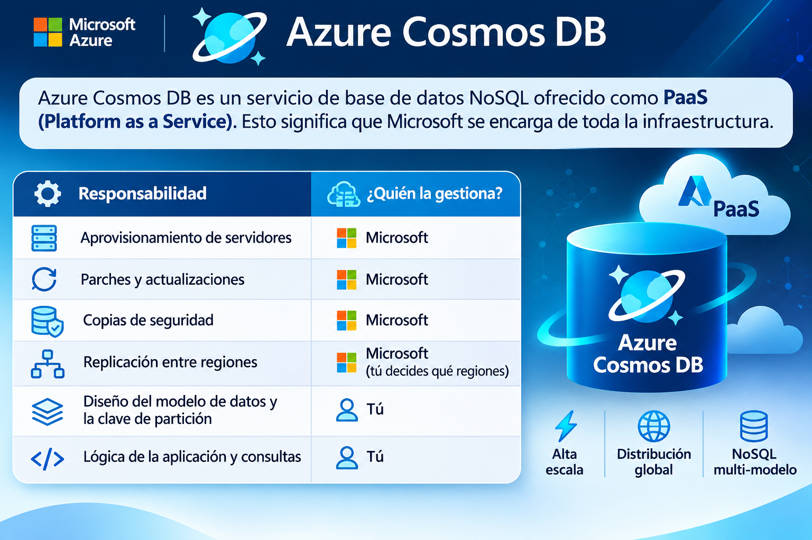

---

#### Schema-agnostic: esquema flexible

> Cosmos DB es **independiente del esquema** (*schema-agnostic*). Los elementos guardados en un mismo contenedor **no necesitan compartir la misma estructura**. Un elemento puede tener 5 propiedades y otro, en el mismo contenedor, 15 propiedades completamente diferentes.

---

**Ejemplo: catálogo de un e-commerce de electrónica y moda:**

```json
{
  "id": "PRD-1001",
  "categoria": "portatiles",
  "nombre": "UltraBook Pro 14",
  "precio": 1299.00,
  "procesador": "8 núcleos",
  "ram_gb": 32,
  "almacenamiento": { "tipo": "SSD", "capacidad_gb": 1024 },
  "puertos": ["USB-C", "HDMI", "Thunderbolt"]
}
```

```json
{
  "id": "PRD-2045",
  "categoria": "moda",
  "nombre": "Camiseta básica algodón",
  "precio": 14.95,
  "tallas": ["S", "M", "L", "XL"],
  "color": "azul marino"
}
```

---

> Ambos documentos conviven en el mismo contenedor `productos`. En una base relacional tendríamos que diseñar tablas de atributos, columnas nulas o un modelo EAV (entidad-atributo-valor) bastante incómodo de consultar.

---

#### Indexación automática

> Por defecto, Cosmos DB **crea y mantiene índices sobre todas las propiedades** de todos los elementos. No hay que definir un esquema previo ni gestionar índices manualmente: el servicio lo hace solo. Esto permite consultar por cualquier campo desde el primer momento (aunque, en producción, se puede ajustar la política de indexación para ahorrar coste).

---

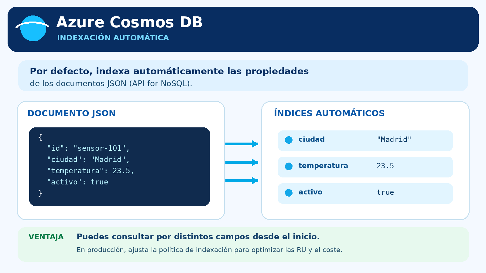

---

### Sección 3. Jerarquía de recursos: cómo organiza los datos

Cosmos DB organiza la información en **cuatro niveles**:

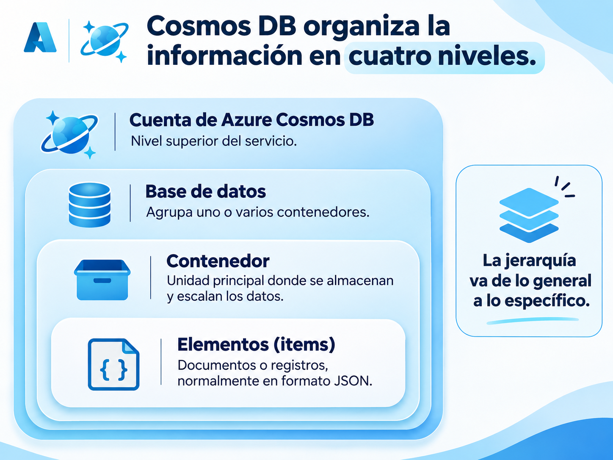

---

| Nivel | Qué es | Qué se configura aquí |
| --- | --- | --- |
| **Cuenta** | Recurso de Azure de nivel superior. Puede gestionar una cantidad ilimitada de datos y de rendimiento aprovisionado. | API elegida, regiones, nivel de consistencia por defecto, modo de capacidad |
| **Base de datos** | Espacio de nombres lógico que agrupa contenedores relacionados. | Opcionalmente, rendimiento compartido |
| **Contenedor** | **Unidad principal de almacenamiento y de escalado.** | Clave de partición, rendimiento, política de indexación, TTL opcional |
| **Elemento** | Cada entidad de datos individual. | — |

---

#### El nombre de los elementos depende de la API

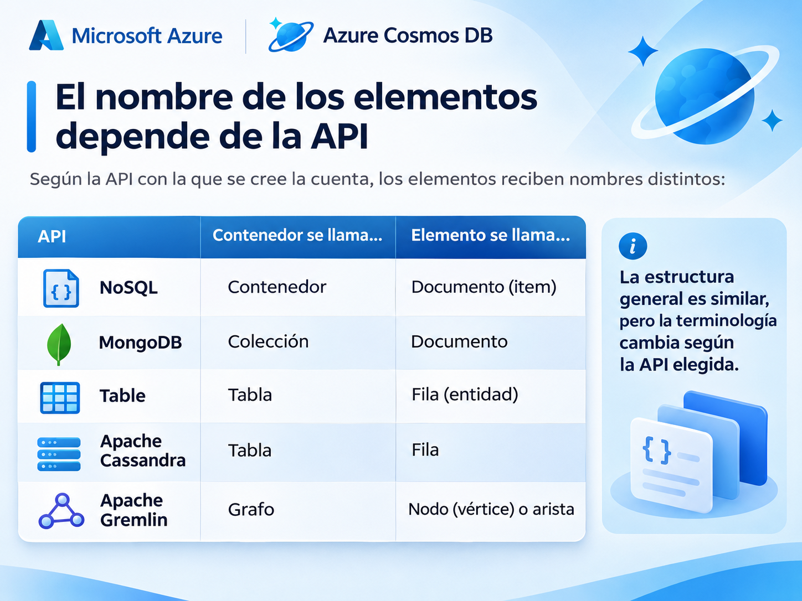

---

#### La clave de partición (partition key)

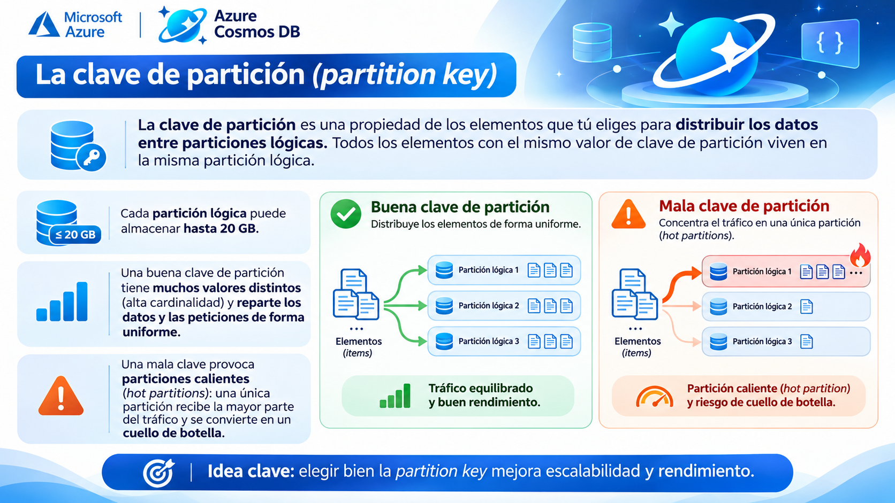

---

**Ejemplo:  plataforma de pedidos online:**

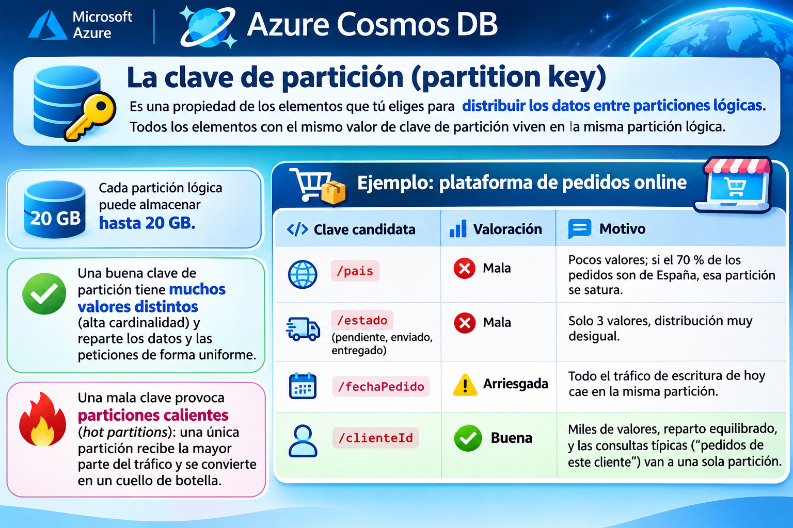

---

#### TTL (Time to Live)

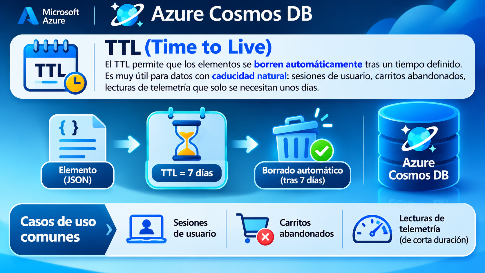

---

### Sección 4. Distribución global y rendimiento

> Cosmos DB está diseñado desde el origen para ser **distribuido globalmente**:
- Puedes **añadir regiones de Azure** a tu cuenta en cualquier momento.
- El servicio **replica los datos automáticamente** en cada región.
- Los usuarios **leen desde la réplica más cercana**.
- Con **escrituras multirregión** (*multi-region writes*) habilitadas, los usuarios también **escriben en la región más cercana**.

---

#### Garantías de servicio (SLA - **Service Level Agreement - Acuerdo de Nivel de Servicio**)

| Métrica | Valor |
| --- | --- |
| Disponibilidad con escrituras multirregión | **99,999 %** |
| Lecturas y escrituras (percentil 99) | **< 10 ms** |
| Latencia media de lectura (percentil 50) | **≤ 4 ms** (típico) |
| Latencia media de escritura (percentil 50) | **≤ 5 ms** (típico) |

> 💡 99,999 % de disponibilidad equivale a poco más de **5 minutos de caída al año**.

---

> **Ejemplo. Cadena hotelera internacional:** el motor de reservas tiene la cuenta replicada en West Europe, East US y Southeast Asia. Un cliente en Tokio que reserva una habitación en Barcelona escribe en la región asiática con latencia mínima; la reserva se replica al resto de regiones. Si la región europea sufre una incidencia, las otras dos siguen dando servicio.

---

#### Niveles de consistencia

Cuando hay réplicas en varias regiones aparece una pregunta inevitable: **¿qué ocurre si un usuario lee justo después de que otro haya escrito en otra región?** ¿Ve el dato nuevo o el antiguo?

Cosmos DB ofrece **cinco niveles de consistencia** para elegir el equilibrio entre **consistencia**, **disponibilidad**, **latencia** y **rendimiento**. Van del más estricto al más relajado:

---

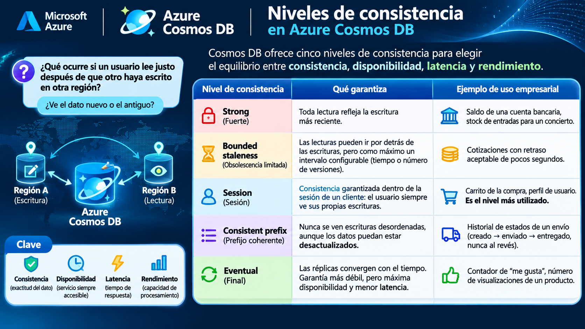

---

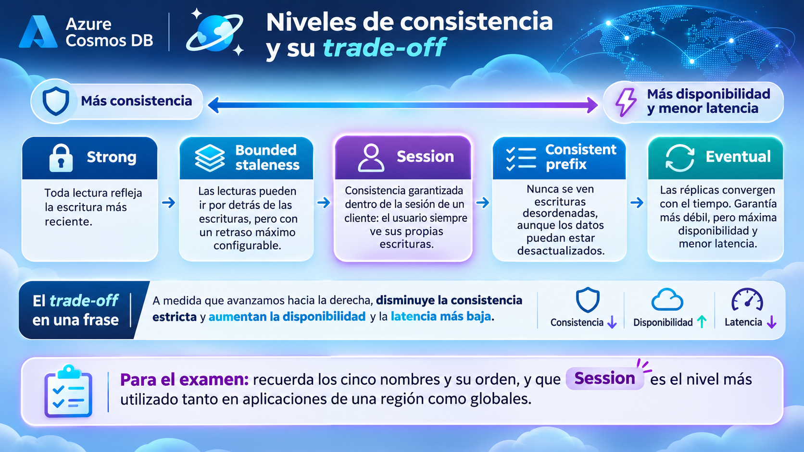

---

### Sección 5. Unidades de solicitud (RU) y modos de rendimiento

#### ¿Qué es una Request Unit?

> 📖 Cosmos DB mide la capacidad en **Request Units por segundo (RU/s)**. Una **RU** es, aproximadamente, el coste de **leer un único elemento de 1 KB por su ID y su clave de partición** (lo que se conoce como *point read*).

---

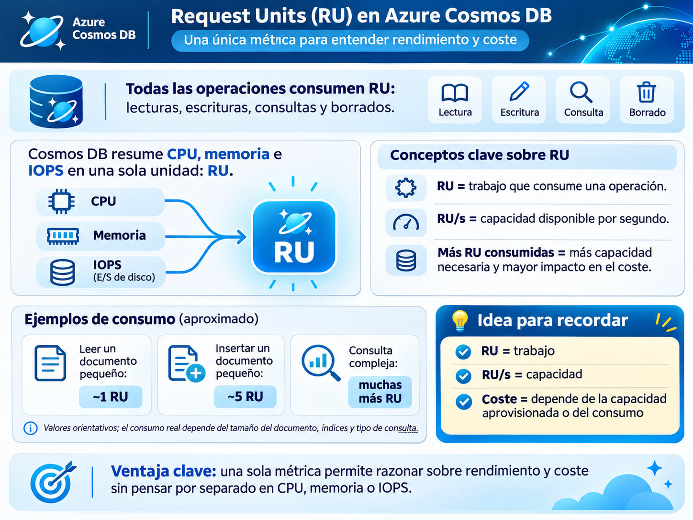

---

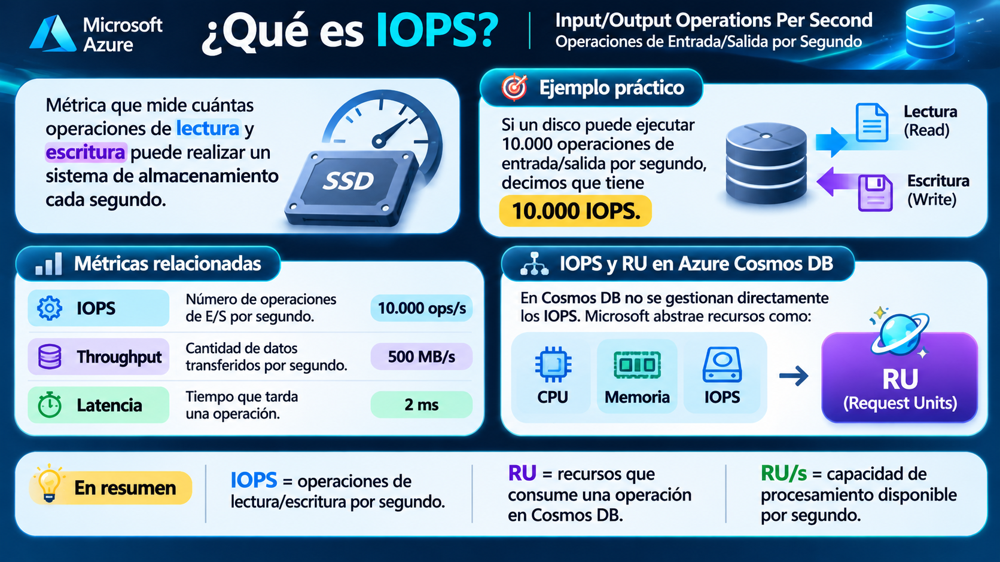

---

Como orientación:

| Operación | Coste relativo |
| --- | --- |
| Lectura puntual de 1 KB por ID + clave de partición | ~1 RU (la más barata) |
| Escritura de un elemento | Varias RU (más que una lectura) |
| Consulta que filtra dentro de una partición | Moderado |
| Consulta que recorre todas las particiones (*cross-partition*) | Más costosa |

---

#### Opciones de rendimiento

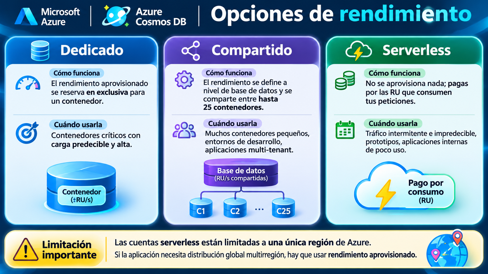

---

#### Autoscale (escalado automático)

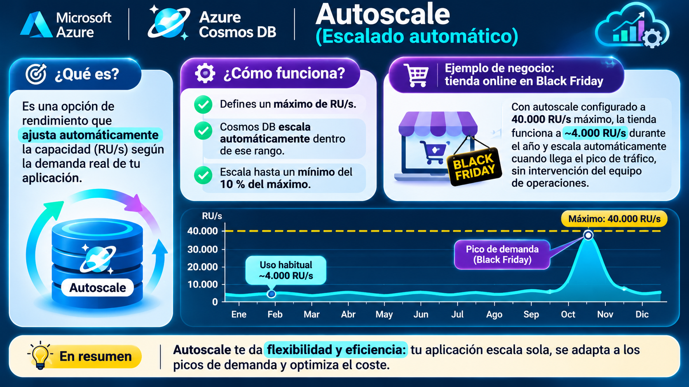

---

### Sección 6. Cuándo usar (y cuándo no) Azure Cosmos DB

#### Escenarios ideales

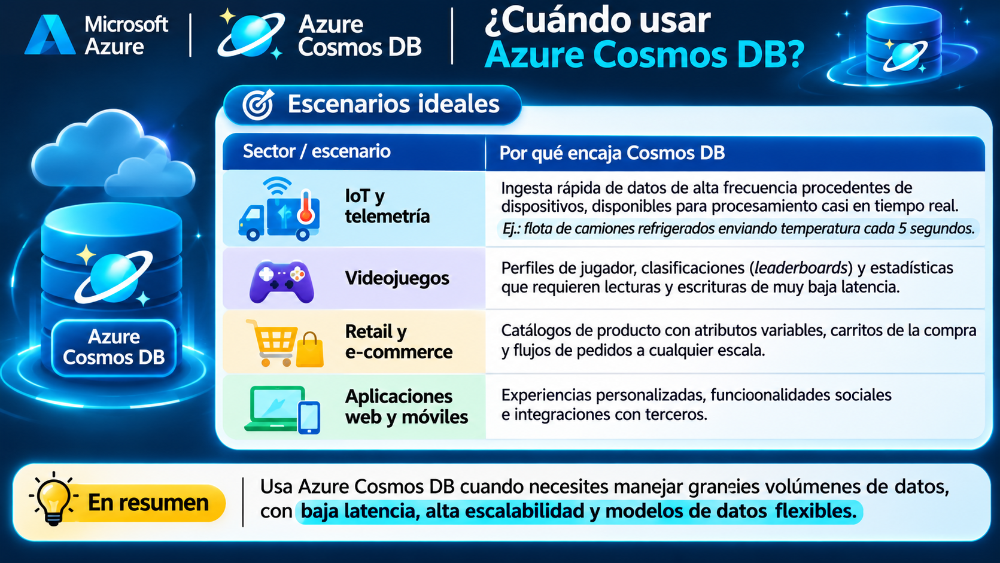

---

#### Cuándo NO es la mejor opción

| Necesidad | Servicio más adecuado |
| --- | --- |
| Consultas con `JOIN` complejos entre muchas tablas, integridad referencial estricta | **Azure SQL Database** |
| Cargas analíticas a gran escala (agregaciones sobre millones de registros, BI) | **Microsoft Fabric** |
| Almacenar ficheros (imágenes, vídeos, PDF) | **Azure Blob Storage** |

---

### Sección 7. Las APIs de Azure Cosmos DB

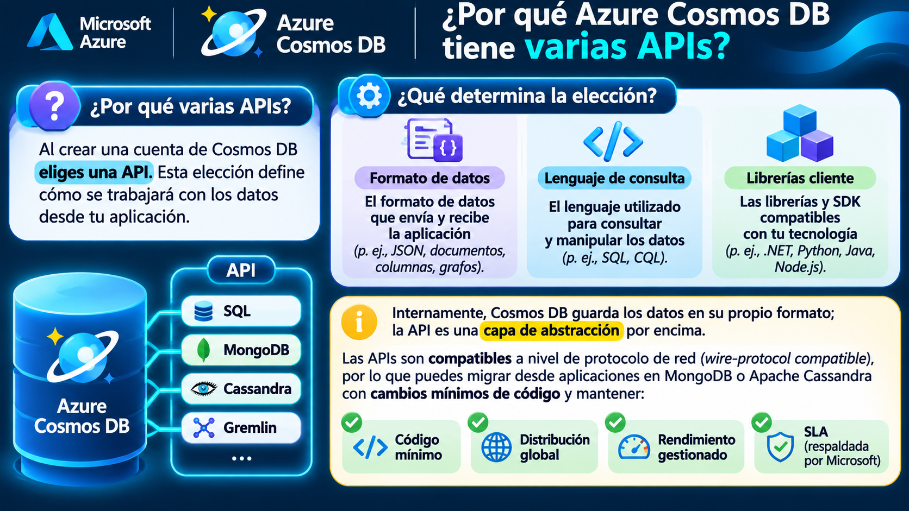

---

Las **cinco APIs** soportadas son:

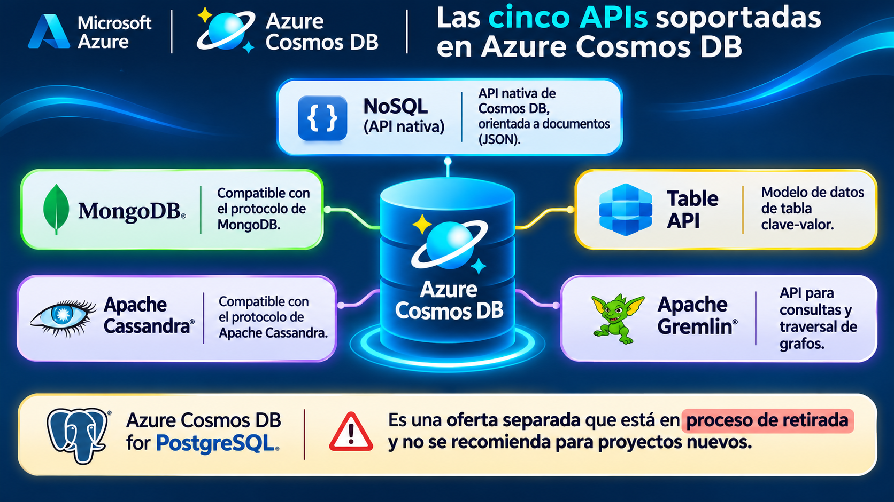

---

---

#### Tabla resumen de las APIs

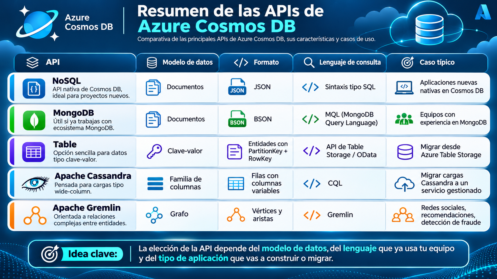

---

### Sección 8. Azure Cosmos DB for NoSQL

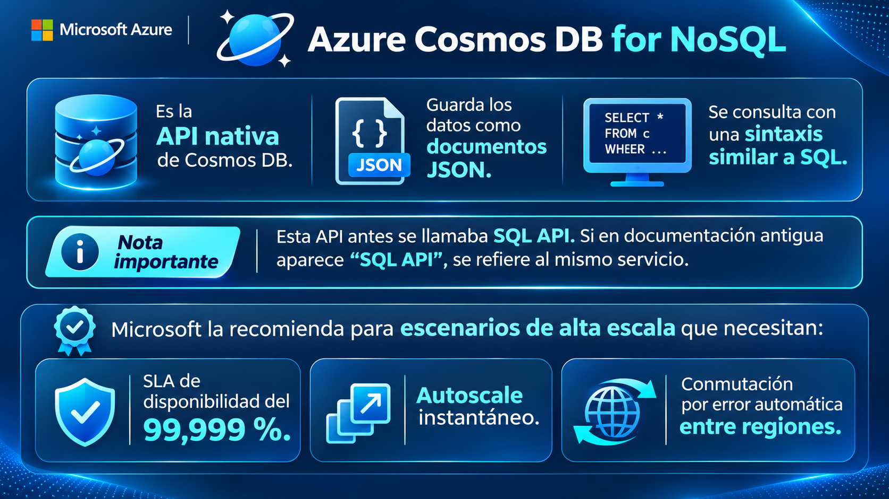

---

#### Ejemplo: base de datos de clientes de una aseguradora

Documento almacenado:

```json
{
  "id": "C-48211",
  "nombre": "Laura Méndez",
  "email": "laura.mendez@correo.com",
  "provincia": "Valencia",
  "polizas": [
    { "tipo": "hogar", "prima": 320.50, "activa": true },
    { "tipo": "auto", "prima": 610.00, "activa": true }
  ],
  "direccion": {
    "calle": "Av. del Puerto 12",
    "ciudad": "Valencia",
    "cp": "46023"
  }
}
```

---

Consultas listas para copiar en el **Data Explorer** del portal:

```sql
-- Cliente concreto por id
SELECT * FROM c WHERE c.id = "C-48211"

```

---

```sql
-- Nombre y ciudad de los clientes de Valencia (acceso a propiedades anidadas)
SELECT c.nombre, c.direccion.ciudad
FROM c
WHERE c.provincia = "Valencia"
```

---

```sql
-- Desanidar el array de pólizas: una fila por póliza de auto
SELECT c.nombre, p.prima
FROM c
JOIN p IN c.polizas
WHERE p.tipo = "auto"
```

---

```sql
-- Número de clientes por provincia
SELECT c.provincia, COUNT(1) AS total
FROM c
GROUP BY c.provincia
```

> ⚠️ **Ojo con el ****`JOIN`****:** en Cosmos DB for NoSQL, `JOIN` **no une contenedores distintos**; sirve para recorrer arrays **dentro del mismo documento**. Por eso Cosmos DB no es buena opción si necesitas `JOIN` entre muchas entidades.

---

#### Fabric mirroring

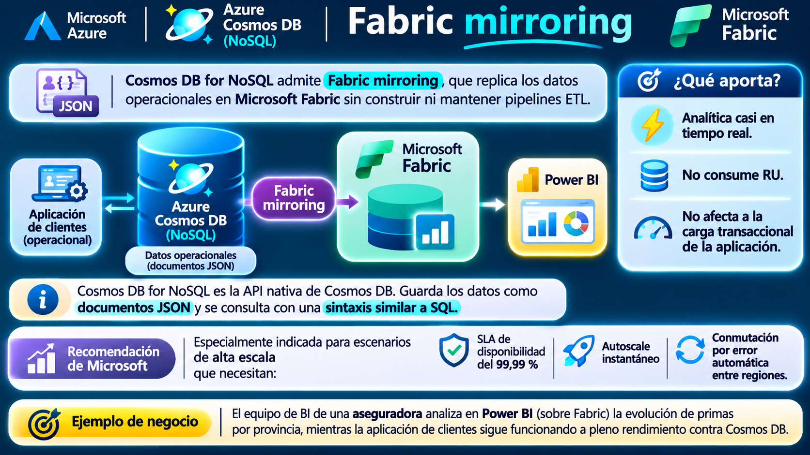

---

### Sección 9. Azure Cosmos DB for MongoDB

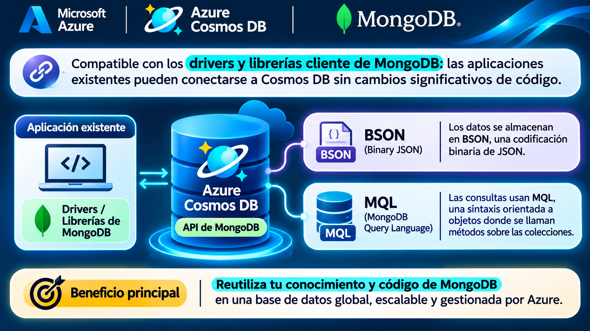

---

#### Ejemplo: inventario de una ferretería online

```javascript
// Buscar un producto por id
db.products.find({ id: 123 })
```

Resultado:

```json
{
  "id": 123,
  "name": "Martillo",
  "price": 2.99
}
```

---

Otras consultas MQL habituales:

```javascript
// Productos con precio inferior a 10 €
db.products.find({ price: { $lt: 10 } })

// Insertar un nuevo producto
db.products.insertOne({ id: 124, name: "Destornillador", price: 4.50 })
```

**Cuándo elegirla:** cuando el equipo tiene experiencia en MongoDB y quiere usar sus drivers con el modelo de Cosmos DB, distribuido globalmente y basado en RU.

---

---

### Sección 10. Azure Cosmos DB for Table

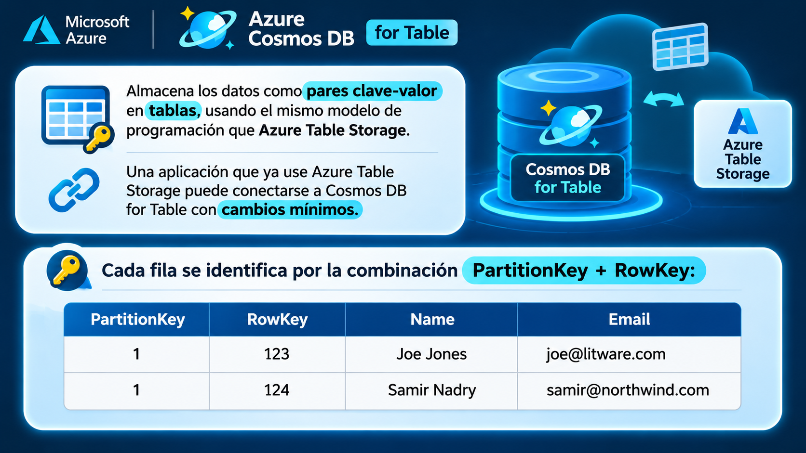

---

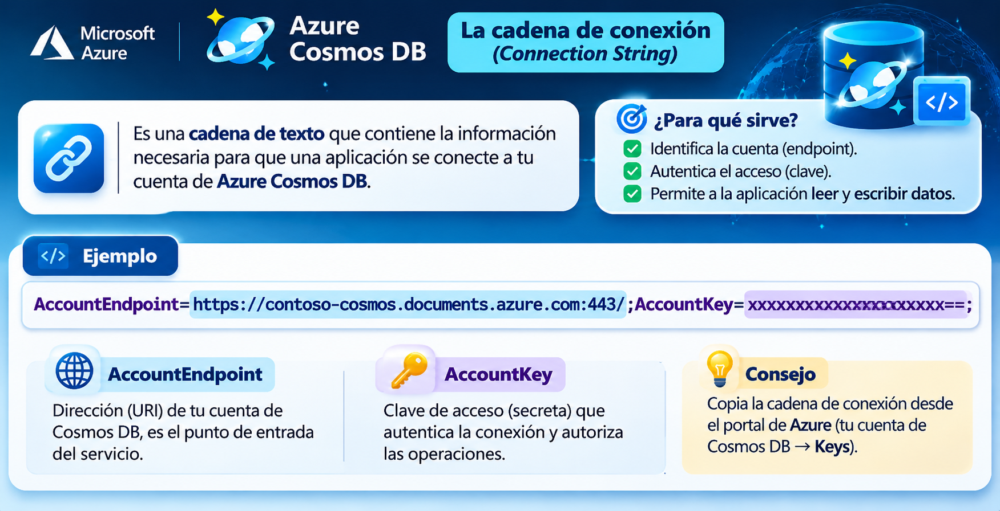

---

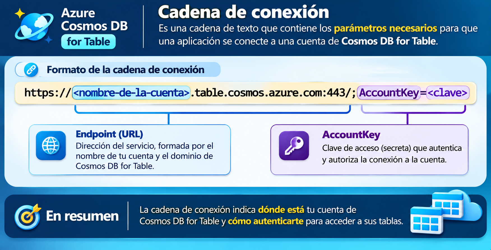

---

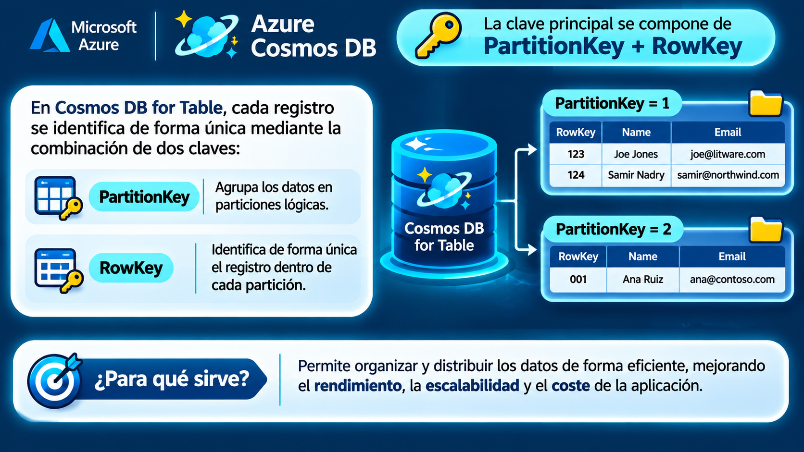

---

#### Cosmos DB for Table vs Azure Table Storage

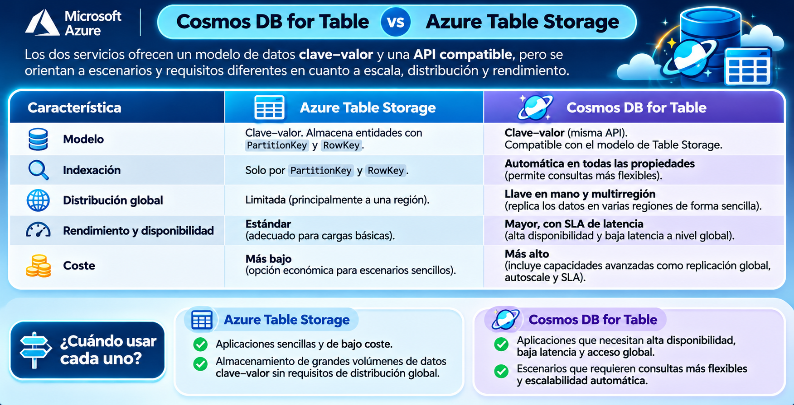

---

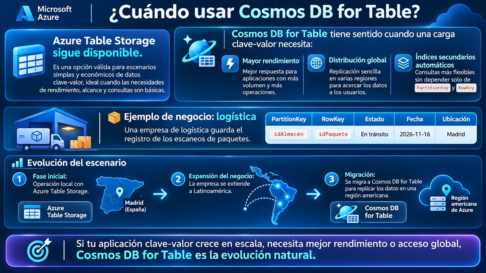

---

### Sección 11. Azure Cosmos DB for Apache Cassandra

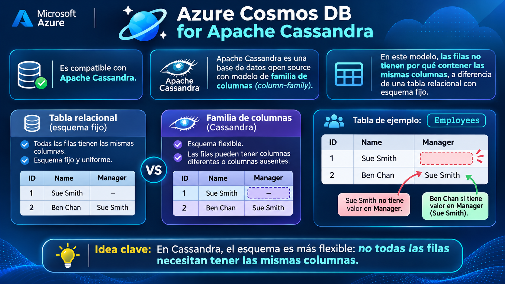

---

Se consulta con **CQL (Cassandra Query Language)**, de sintaxis muy parecida a SQL:

```sql
SELECT * FROM Employees WHERE ID = 2
```

---

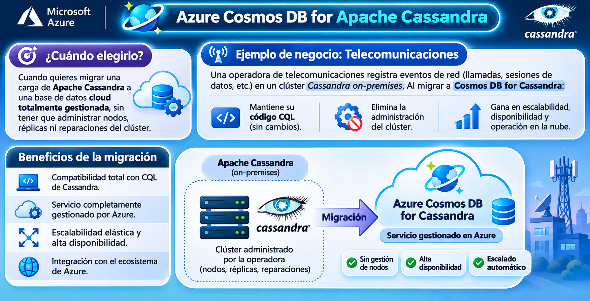

---

### Sección 12. Azure Cosmos DB for Apache Gremlin

---

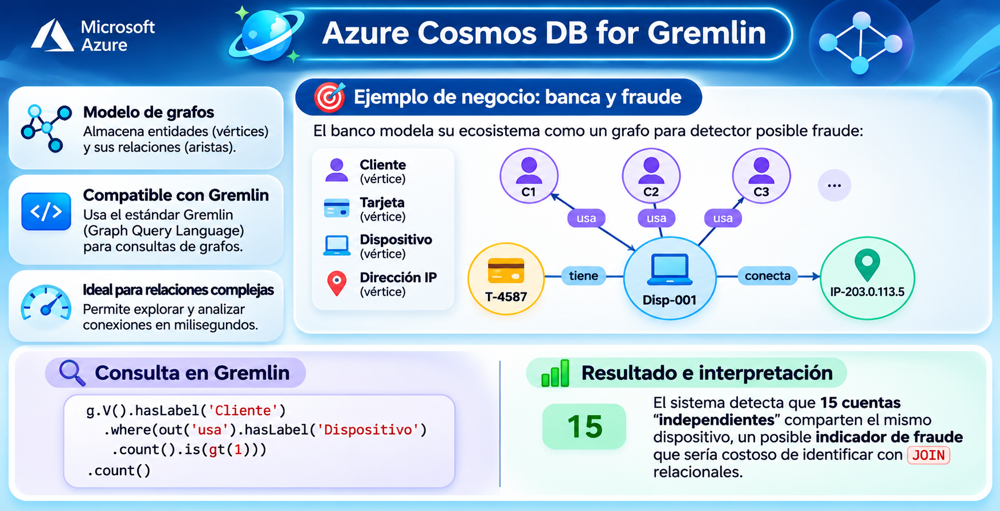

---

Se usa el lenguaje **Gremlin** para recorrer y manipular el grafo:

```groovy
// Añadir un empleado y conectarlo con su responsable
g.addV('employee').property('id', '3').property('firstName', 'Alice')
g.V('3').addE('reports to').to(g.V('1'))
```

```groovy
// Recuperar todos los empleados ordenados por id
g.V().hasLabel('employee').order().by('id')
```

---

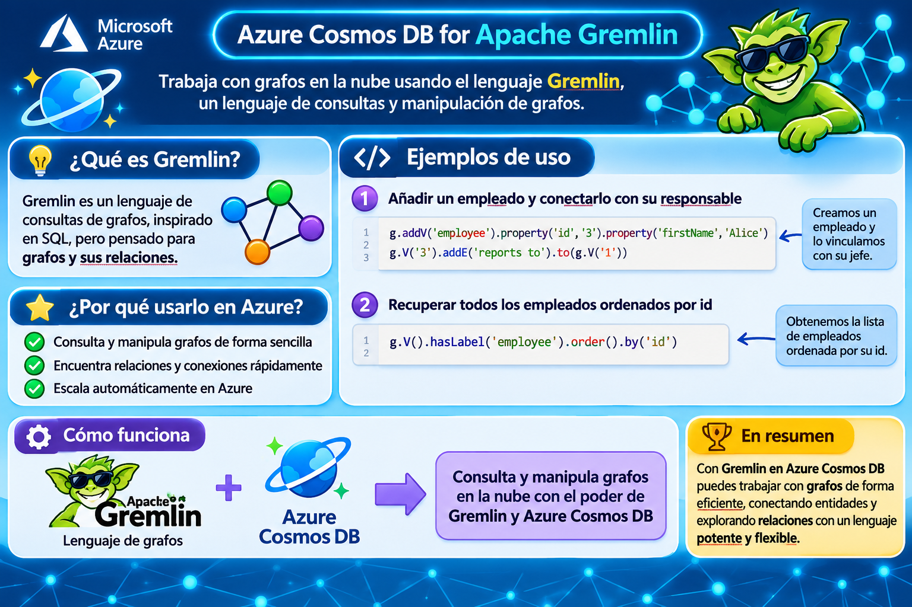

---

### Sección 13. Cómo elegir la API adecuada

| Si tu situación es… | Elige |
| --- | --- |
| Aplicación nueva, datos JSON, quieres todas las capacidades de Cosmos DB | **NoSQL** |
| Tu equipo ya trabaja con MongoDB y sus drivers | **MongoDB** (o Azure DocumentDB para migraciones completas) |
| Tienes una aplicación en Azure Table Storage que necesita escalar globalmente | **Table** |
| Tienes un clúster Apache Cassandra y quieres dejar de administrarlo | **Apache Cassandra** |
| Las relaciones entre entidades son el núcleo del problema | **Apache Gremlin** |

---

> 💡 **La API se elige al crear la cuenta** y determina el modelo de datos, el lenguaje de consulta y las librerías cliente de esa cuenta.

---

### Sección 14. Conceptos clave para el examen DP-900

| Concepto | Lo que tienes que saber |
| --- | --- |
| Tipo de servicio | NoSQL totalmente gestionado (PaaS) |
| Esquema | *Schema-agnostic*: elementos con estructuras distintas en el mismo contenedor |
| Jerarquía | Cuenta → Base de datos → Contenedor → Elementos |
| Unidad de escalado | El **contenedor** |
| Partición lógica | Hasta **20 GB**; la clave debe tener alta cardinalidad y reparto uniforme |
| Indexación | Automática sobre todas las propiedades |
| SLA multirregión | **99,999 %** de disponibilidad, **< 10 ms** en el percentil 99 |
| Consistencia | Strong, Bounded staleness, **Session (la más usada)**, Consistent prefix, Eventual |
| Capacidad | **RU/s**; 1 RU ≈ lectura de 1 KB por ID + clave de partición |
| Modos de rendimiento | Dedicado, compartido (hasta 25 contenedores), serverless (una sola región) + autoscale |
| APIs | NoSQL (nativa, antes SQL API), MongoDB, Table, Apache Cassandra, Apache Gremlin |
| Analítica | Fabric mirroring sin ETL ni consumo de RU (API NoSQL) |
| No usar para | `JOIN` complejos (→ Azure SQL) y analítica a gran escala (→ Microsoft Fabric) |
