# 🔖Clase 07 - Power BI

## **Describe Power BI tools and workflow**

---

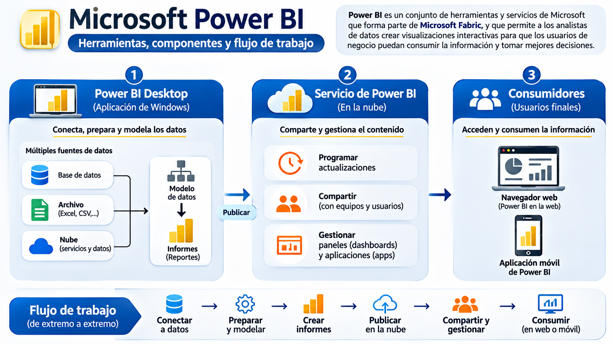

---

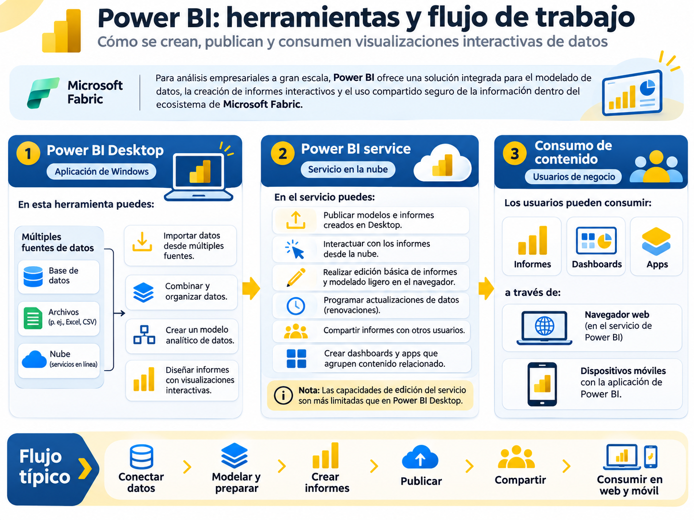

---

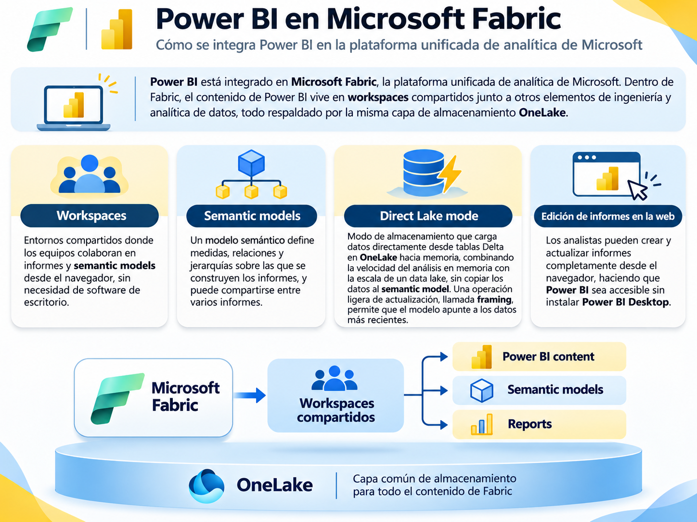

---

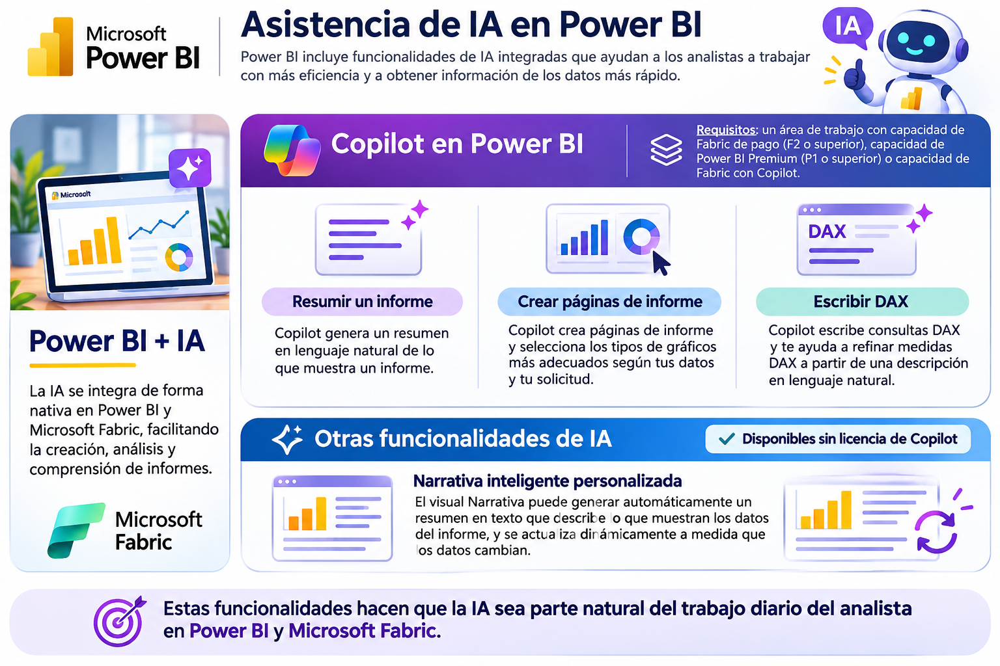

---

## **Describe core concepts of data modeling**

---

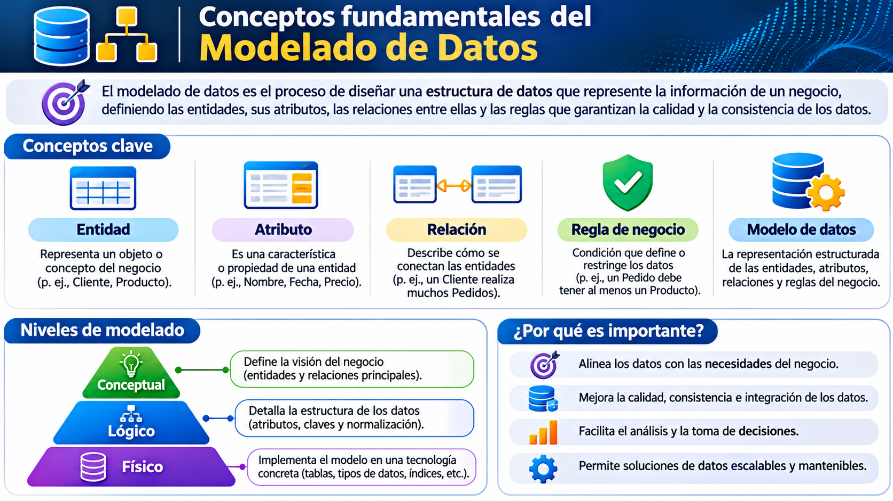

---

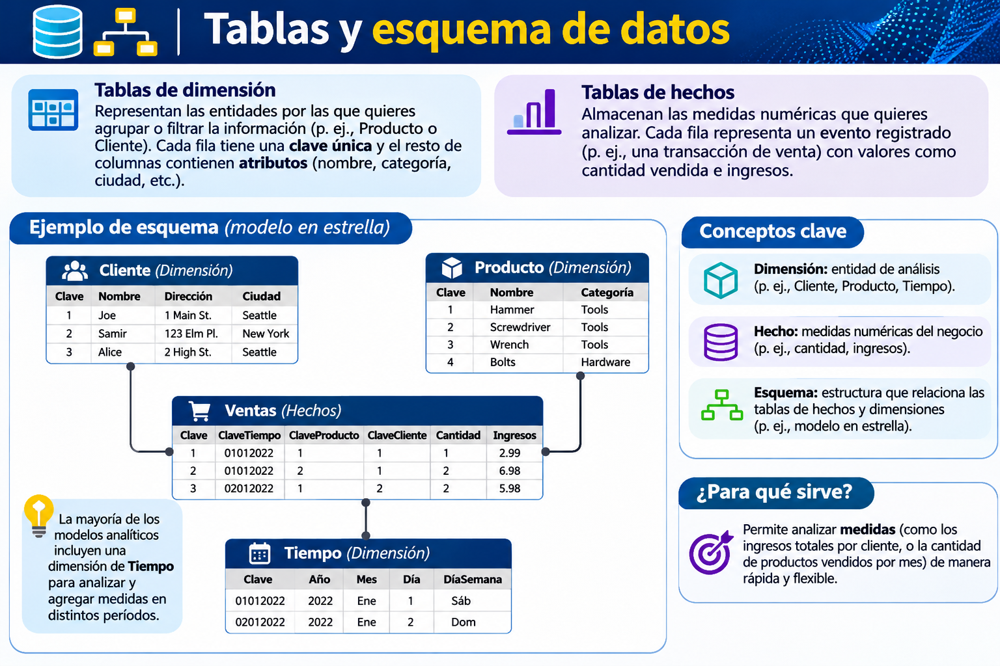

---

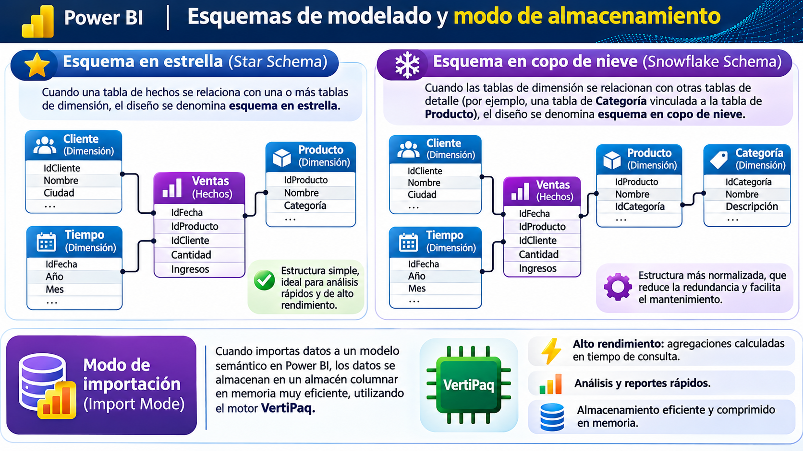

---

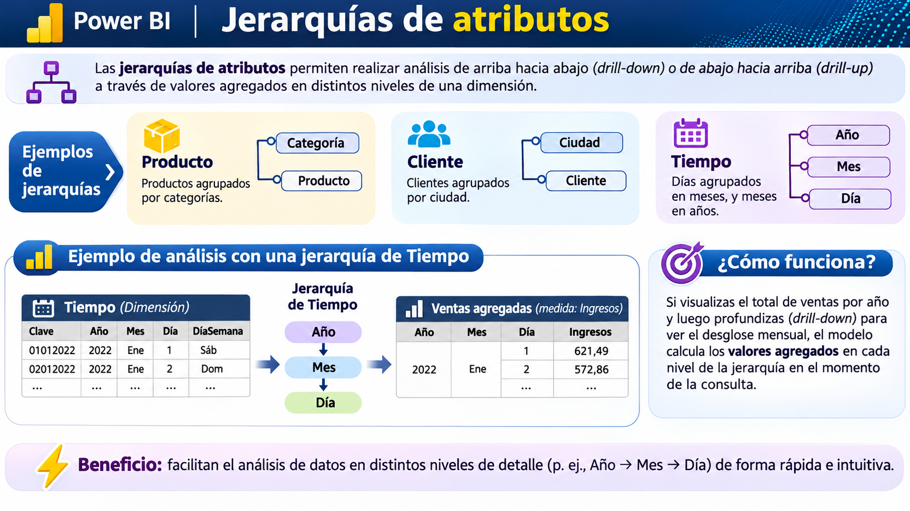

---

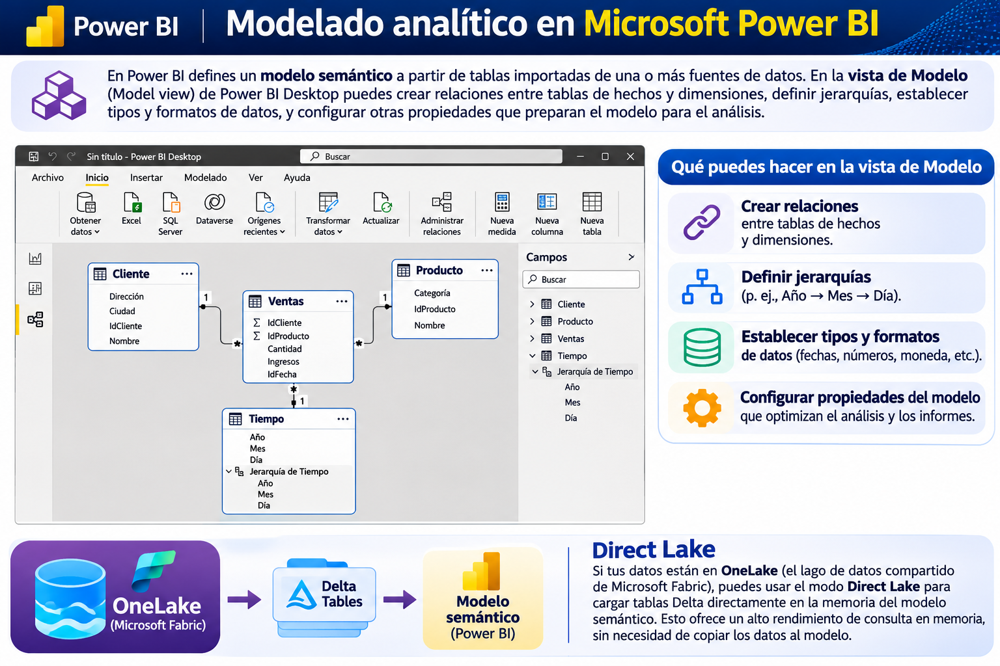

---

## **Describe considerations for data visualization**

---

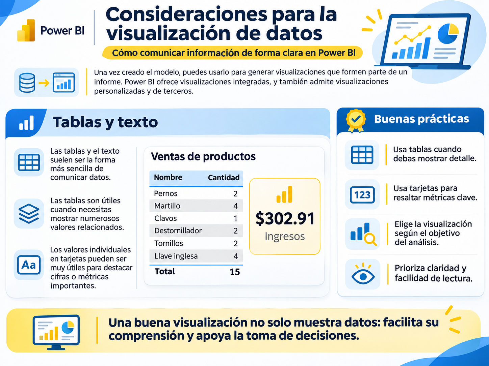

---

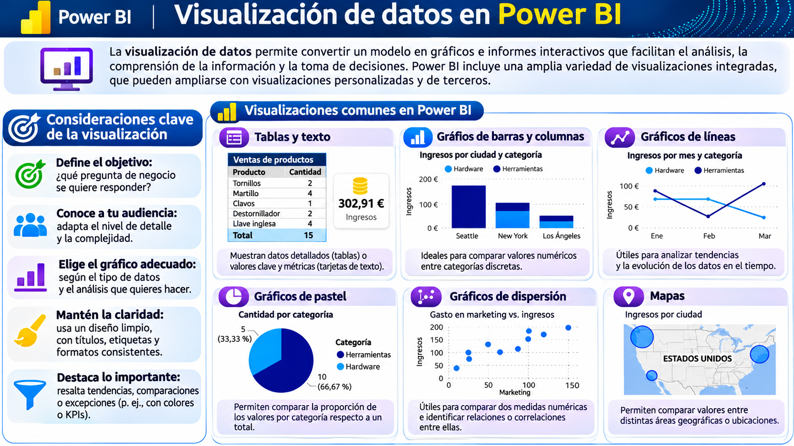

---

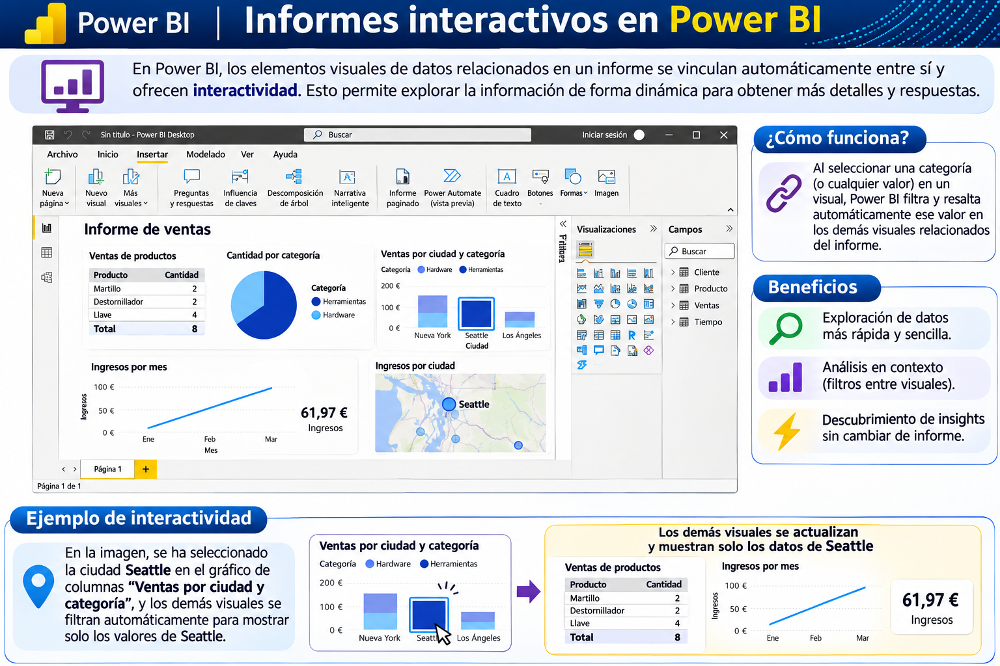

---

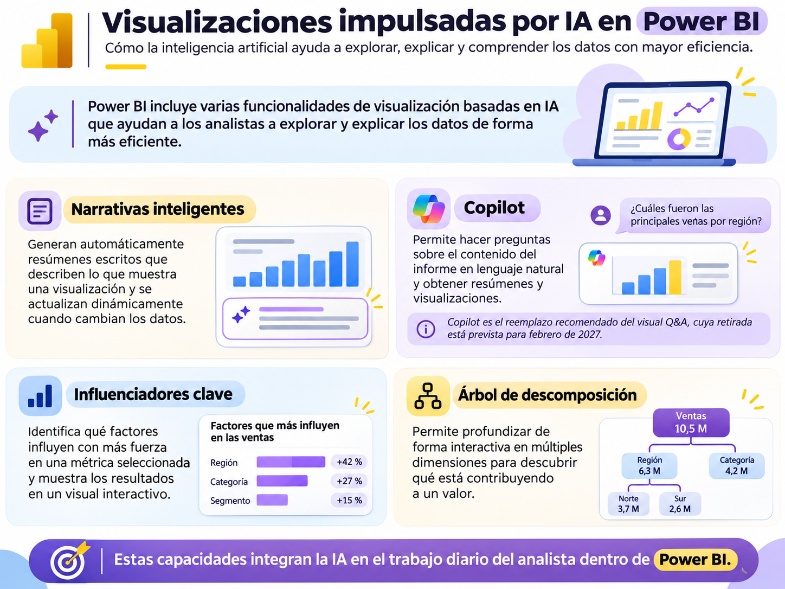
