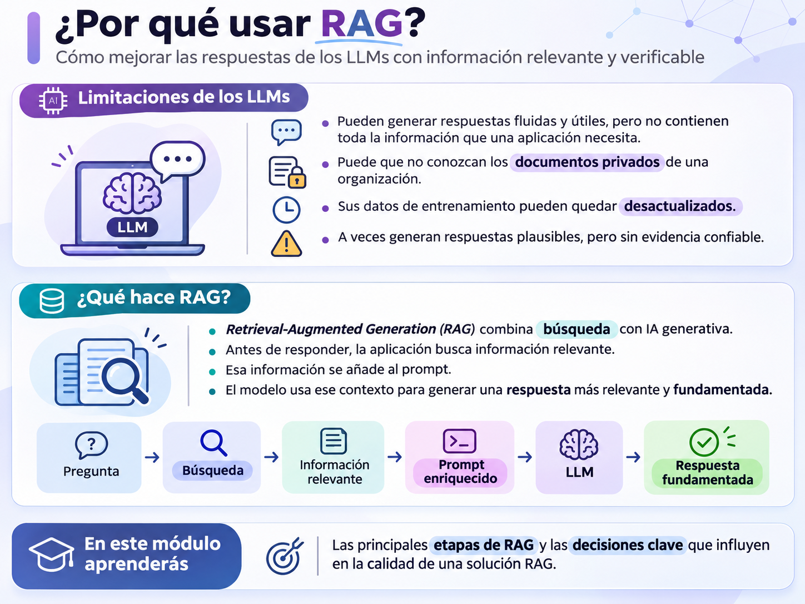
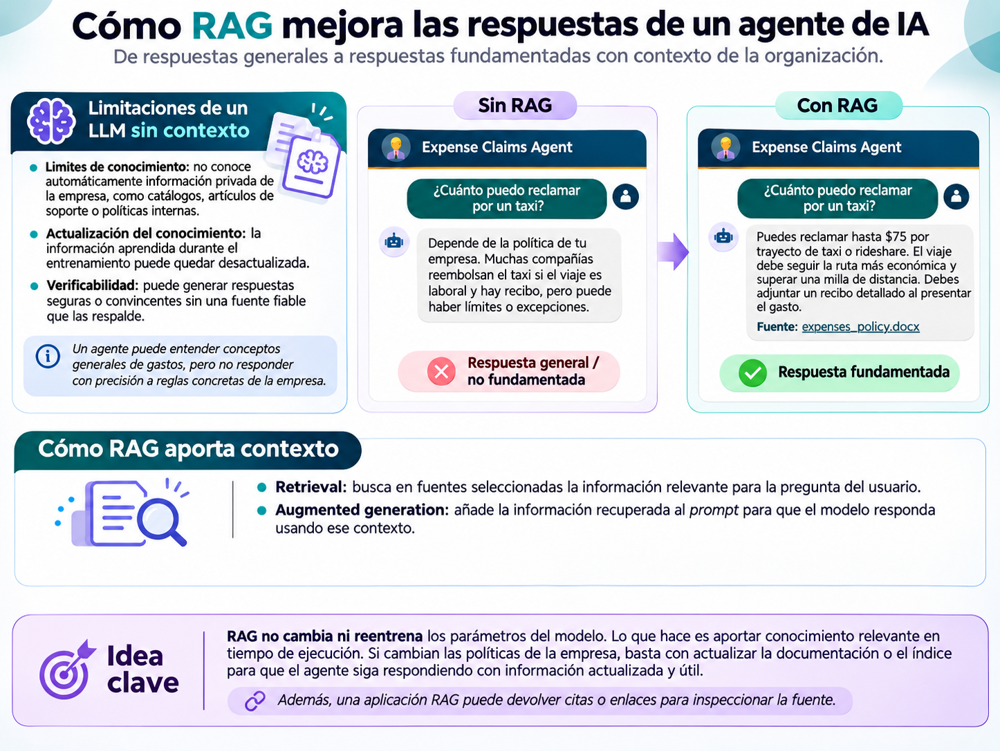
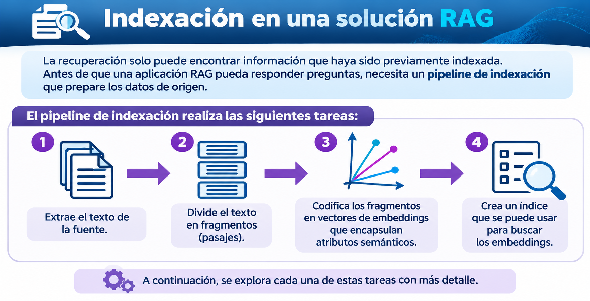
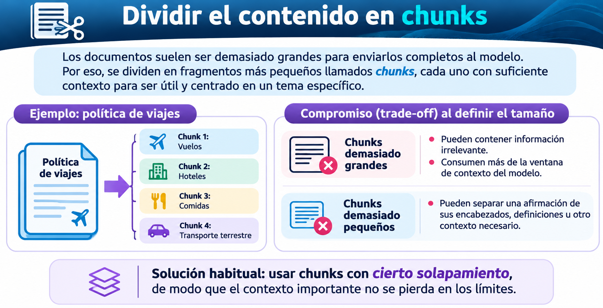
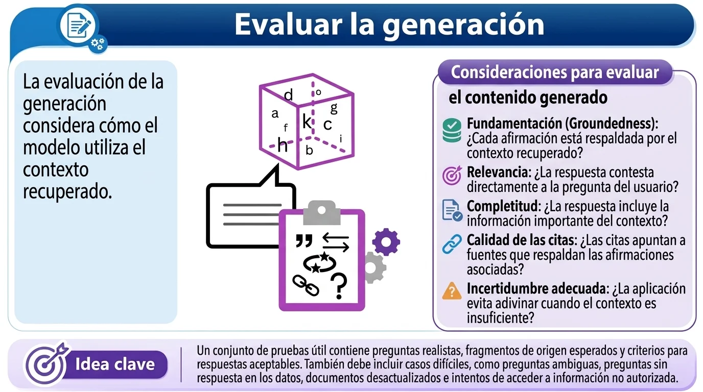
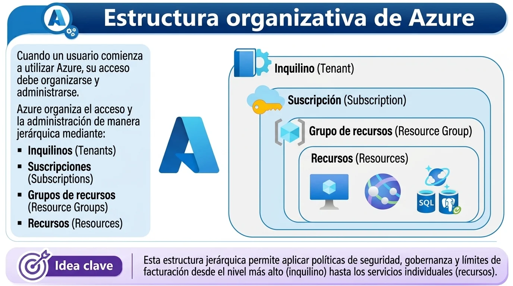
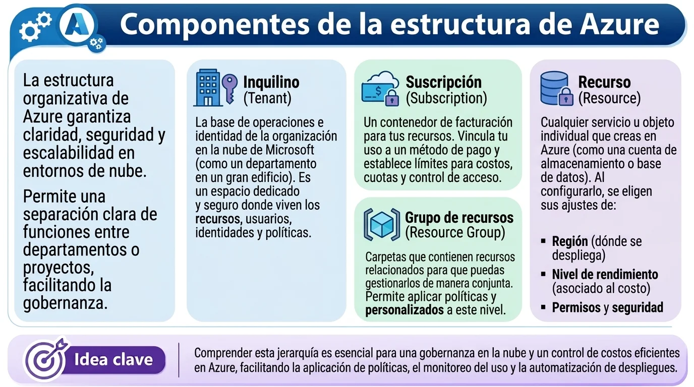
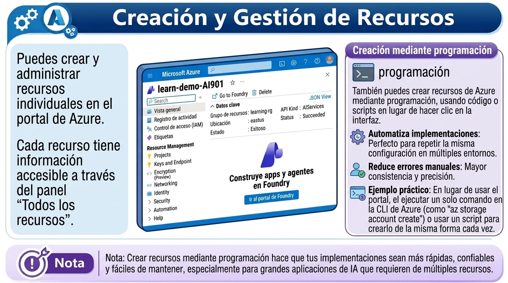

# 🔖Clase 11 - RAG y AI-Azure

## Resúmenes PDF

[https://github.com/rodbalza/Introduccion_Big_Data_IA_2026/tree/main/clases/clase-11-ai-901-labs-7-y-8-4121a81b/material%20complementario/pdf](https://github.com/rodbalza/Introduccion_Big_Data_IA_2026/tree/main/clases/clase-11-ai-901-labs-7-y-8-4121a81b/material%20complementario/pdf)

## Podcast

[https://github.com/rodbalza/Introduccion_Big_Data_IA_2026/tree/main/clases/clase-11-ai-901-labs-7-y-8-4121a81b/material%20complementario/audio](https://github.com/rodbalza/Introduccion_Big_Data_IA_2026/tree/main/clases/clase-11-ai-901-labs-7-y-8-4121a81b/material%20complementario/audio)

## Parte 1: RAG

## Introducción

## **Retrieval-Augmented Generation**

## **Preparar datos para RAG**

## Selección y procesamiento de los datos de origen

## Dividir contenido en “chunks”

## Creación de embeddings e indexación de los datos

## Recuperar información y generar una respuesta

## Recuperación de información relevante

## Aumentar el prompt

## Evaluar una solución RAG

## Evaluar la generación

## Equilibrar calidad, latencia y costo

## Parte 2: IA en Azure

## Entender Azure

## Estructura Organizativa

## Componentes

## Portal

## Creación y Gestión de Recursos

