# 💻Lab 09 - **Get started with generative AI and agents in Microsoft Foundry**

**Certificación:** AI-901

## Clases relacionadas

- [🔖Clase 12 - Agentes y análisis de textos](../../../clases/clase-12-ai-901-labs-9-y-10-4121a81b/README.md)

### Módulo:

[Get started with generative AI and agents in Azure](https://learn.microsoft.com/en-us/training/modules/get-started-with-generative-ai-and-agents/)

### Ejercicio:

[Get started with generative AI and agents in Microsoft Foundry](https://microsoftlearning.github.io/mslearn-ai-fundamentals/Instructions/Exercises/02a-generative-ai.html)

## Catálogo de Foundry

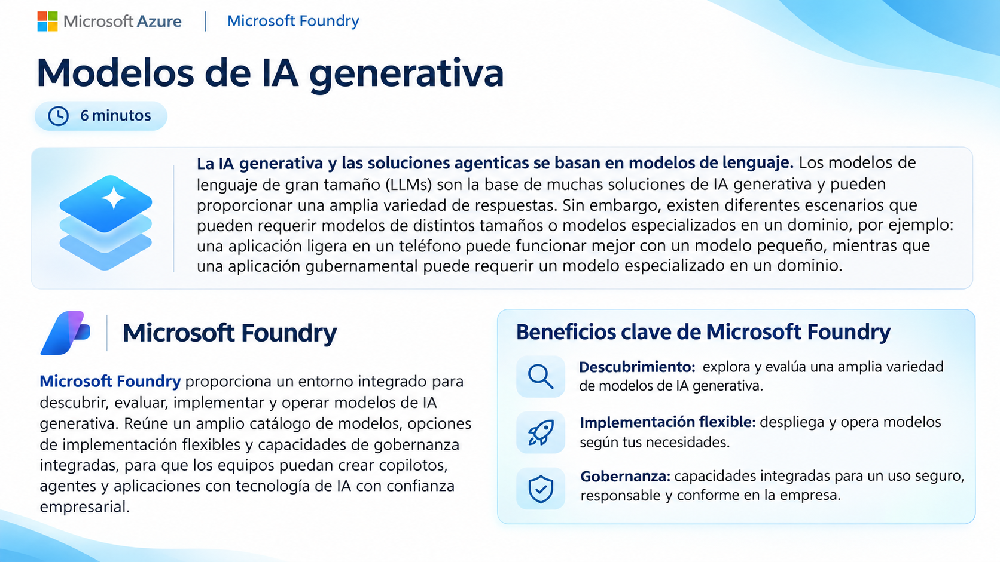

---

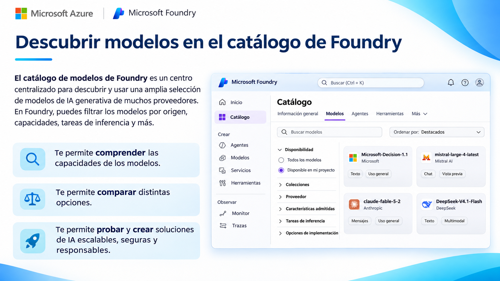

---

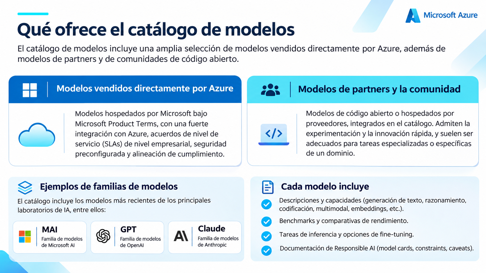

---

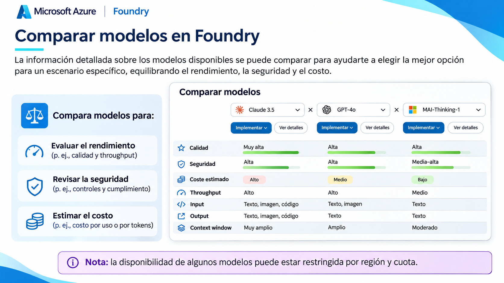

---

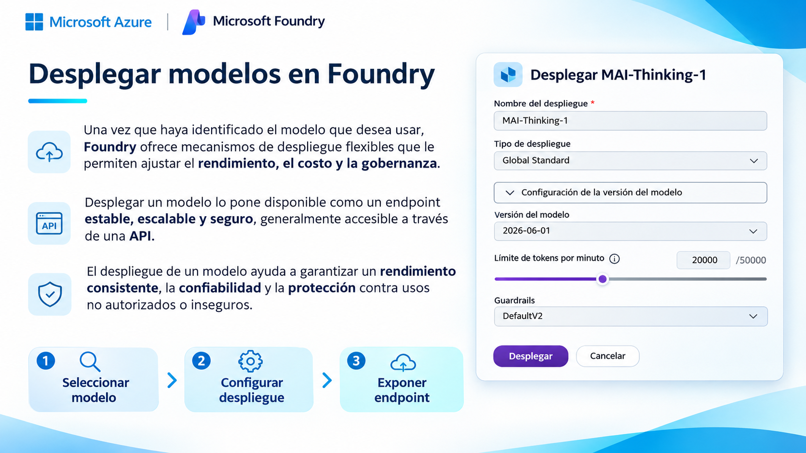

---

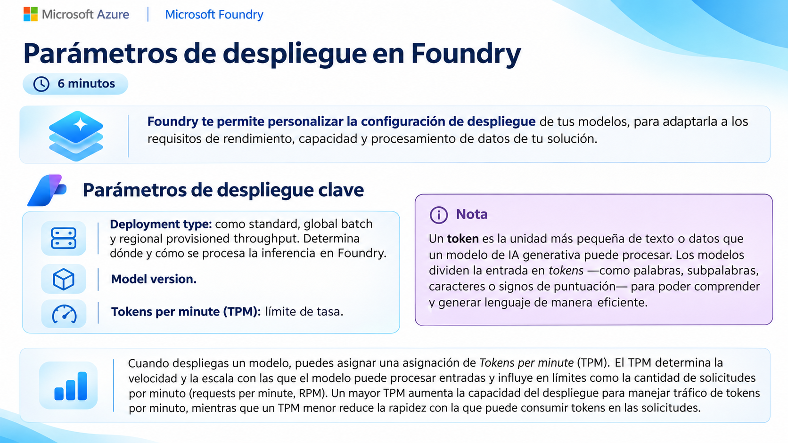

---

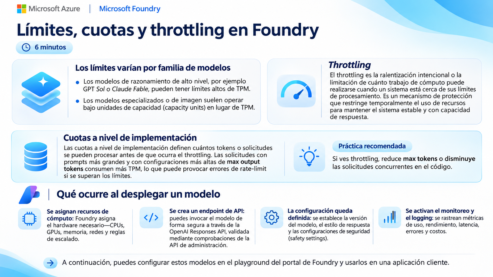

---

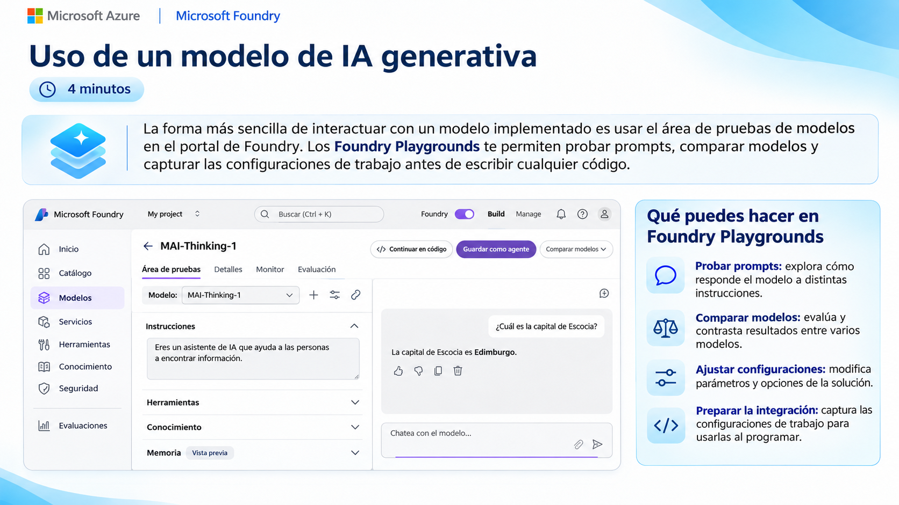

---

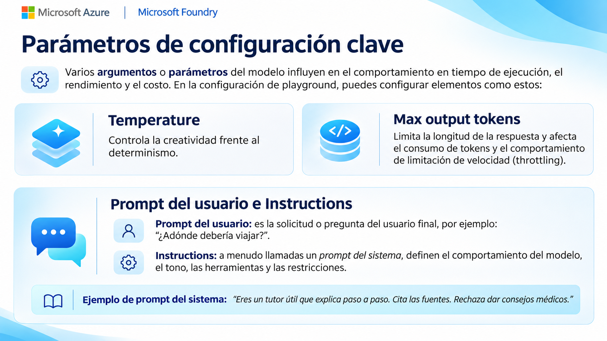

---

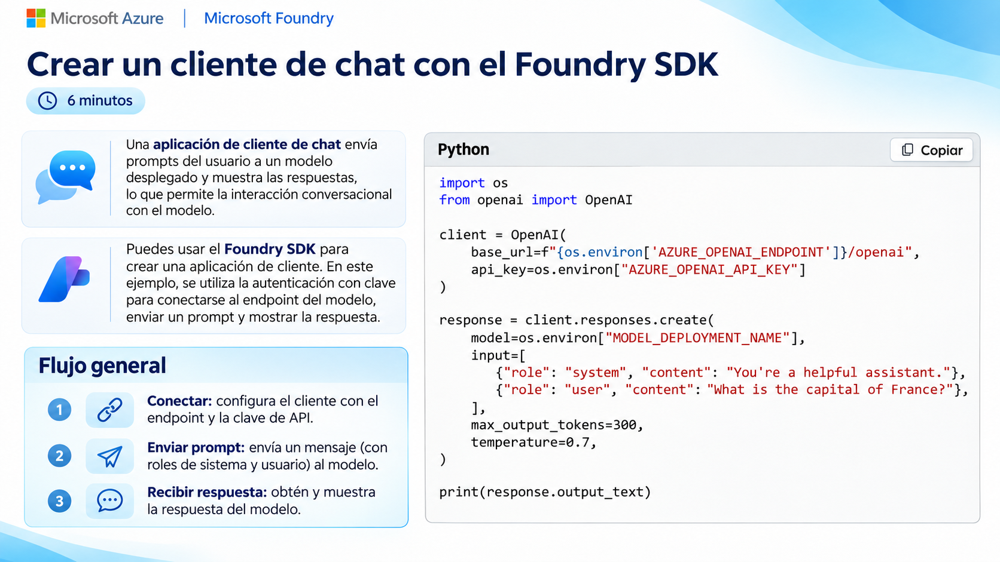

---

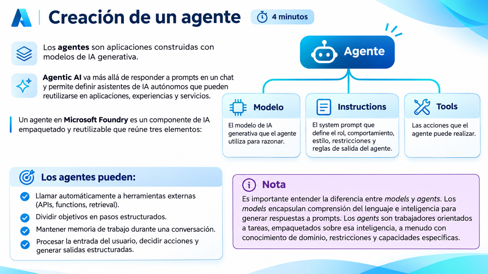

---

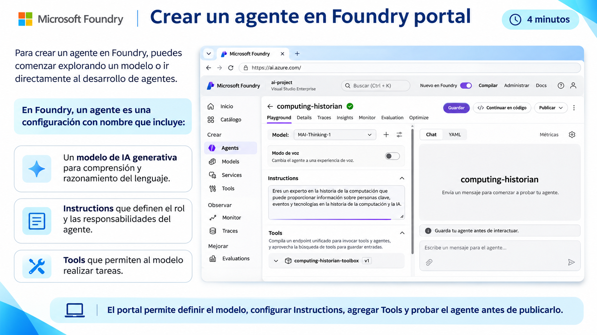

---

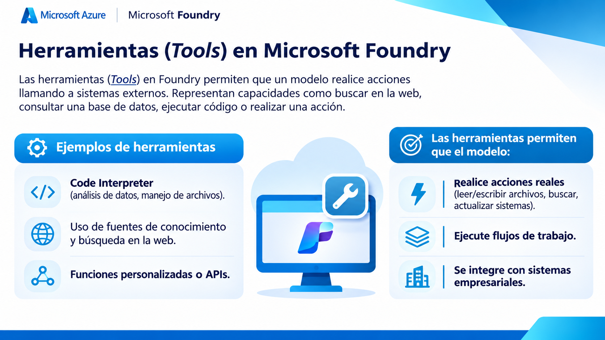

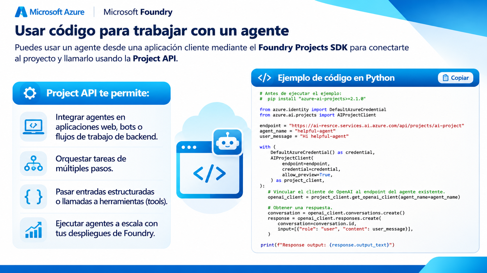
