# 📋Caso practico: Ingestas con Azure Data Factory

**Certificación:** DP-900

---

### Ejercicio 1: Azure SQL Database hacia ADLS Gen2

<details>
<summary>**Pasos**</summary>

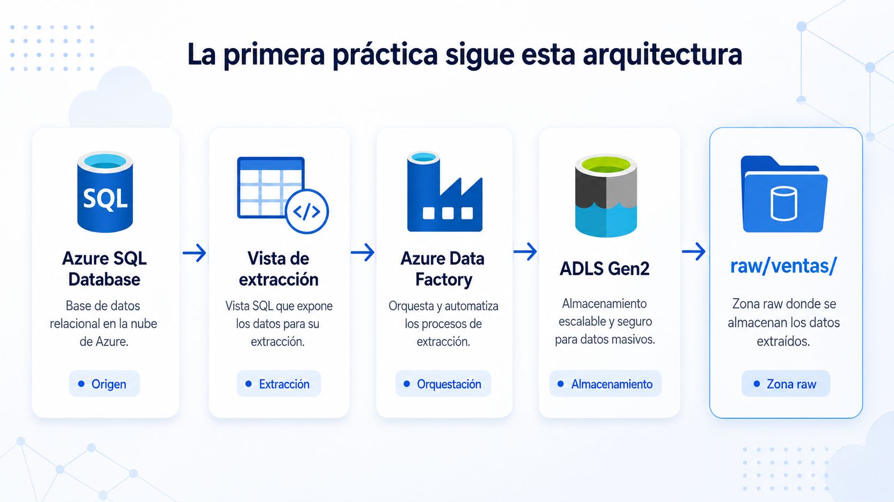

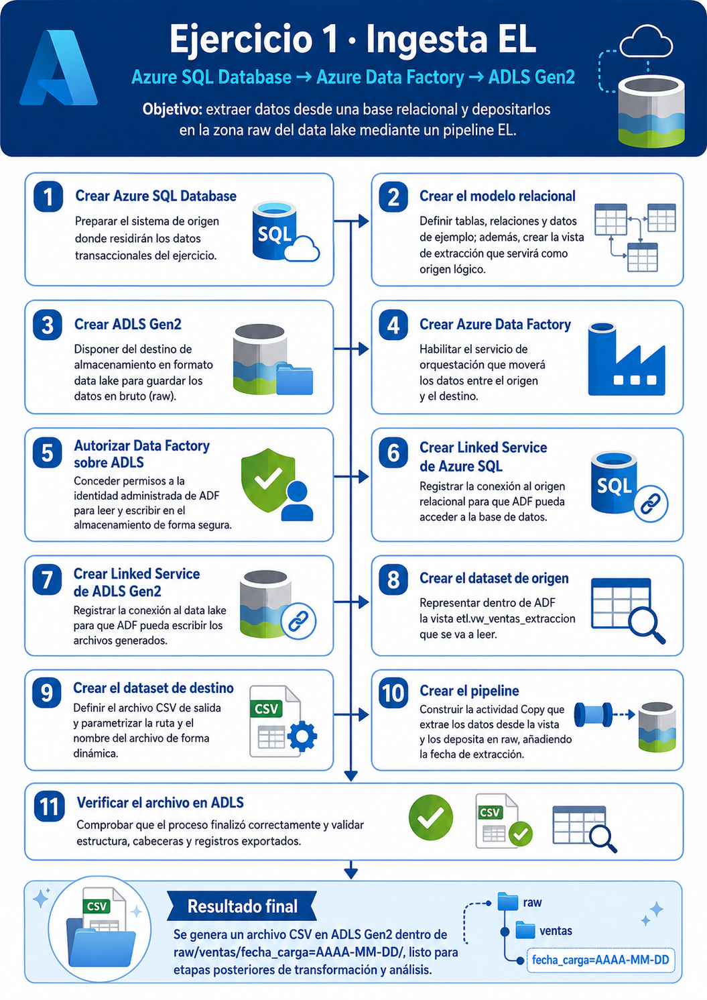

### Fase 1. Crear Azure SQL Database

#### Paso 1. Crear el grupo de recursos

1. Acceder a Azure Portal.
2. Buscar **Grupos de recursos**.
3. Seleccionar **Crear**.
4. Indicar:
```plain text
Nombre: rg-practica1
Región: la región disponible
```
5. Seleccionar **Revisar y crear**.
6. Seleccionar **Crear**.
#### Paso 2. Crear la base de datos

1. Buscar **SQL database**
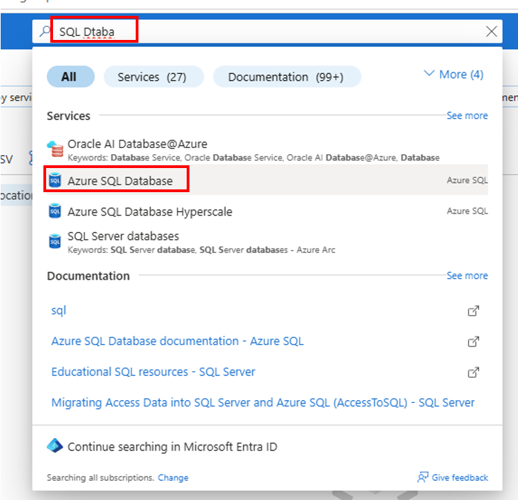
2. Seleccionar **Crear**.
3. Selecciona Free offer
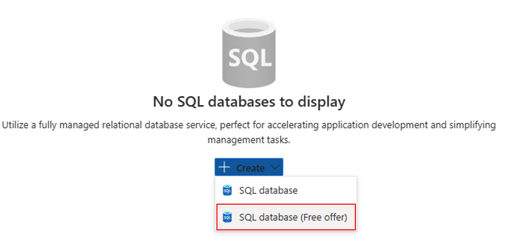
4. Configurar:
```plain text
Grupo de recursos: rg-practica1
Nombre de base de datos: sqldb-ventas
```
5. En **Servidor**, seleccionar **Crear nuevo**.
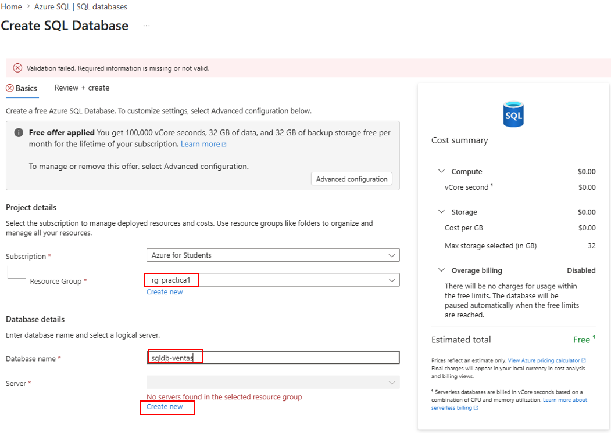
6. Indicar:
```plain text
Nombre del servidor: server-practica1
Ubicación: la misma región
Método de autenticación: autenticación SQL
Usuario administrador: practica
Contraseña: Azure12345
```

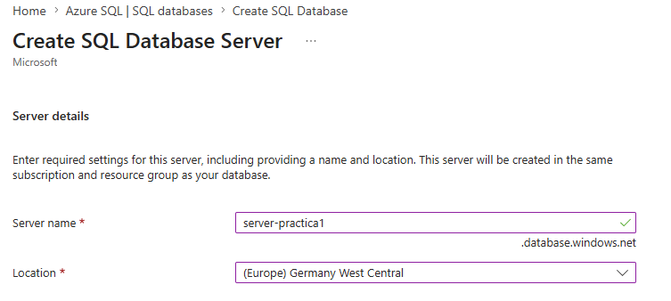

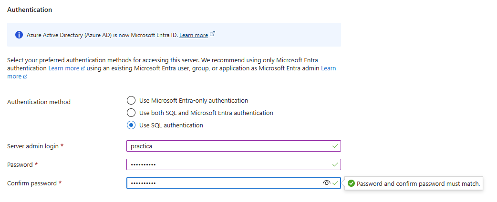

Pulsar en OK.
7. Para una práctica educativa como esta, seleccionar una configuración pequeña de desarrollo o pruebas.
8. No habilitar redundancias avanzadas (o configuración necesaria) innecesarias para el laboratorio.
9. Seleccionar **Revisar y crear**.
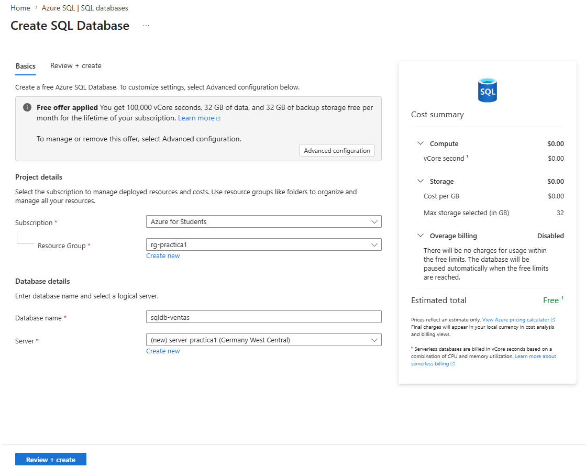
10. Seleccionar **Crear/Create**.
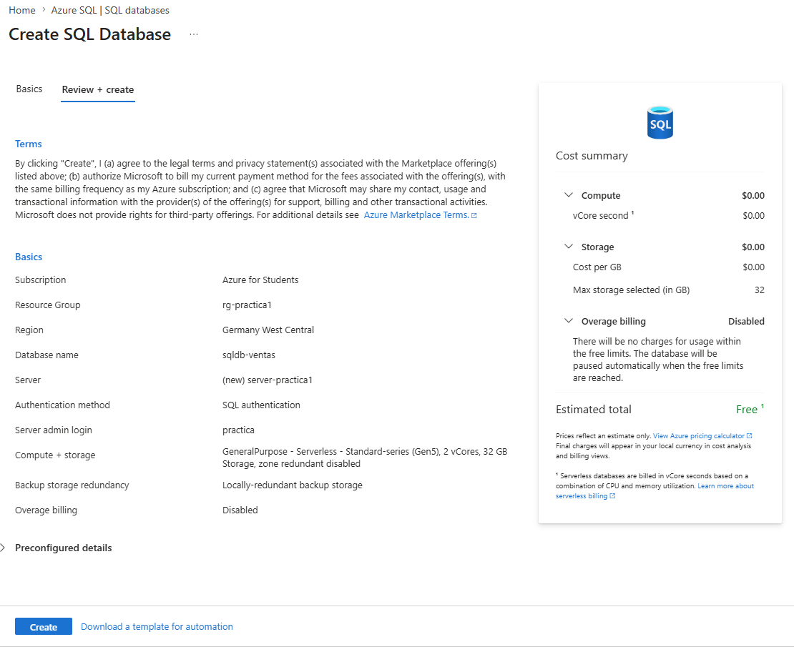
11. Tras un par de minutos,  deberias ver esto:
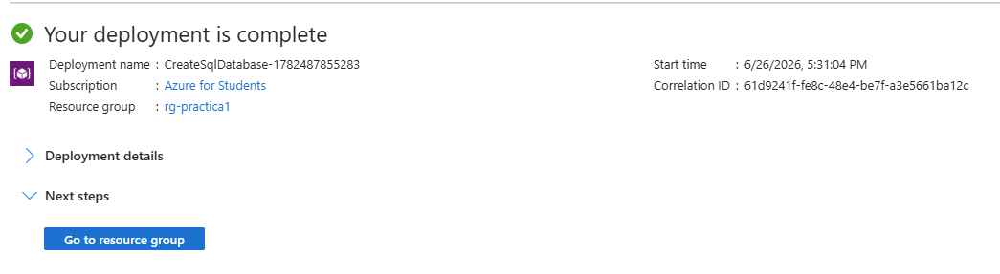
12. Despliega Deployment details y deberias ver esto:
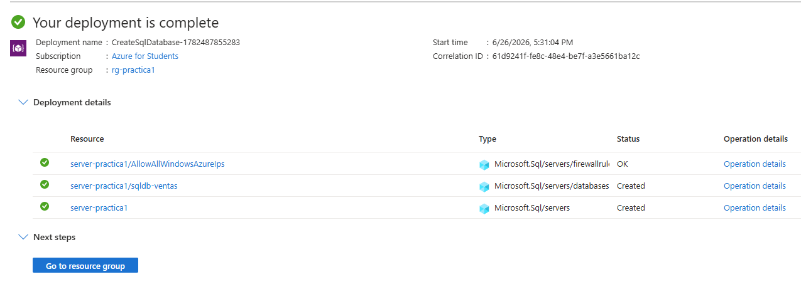
#### Paso 3. Configurar la conectividad

En el servidor lógico de Azure SQL:

> 💡 En la barra de búsqueda superior, escribe **SQL servers** o **Servidores SQL**. Abre el servidor que creaste para la práctica, por ejemplo: `server-practica1`

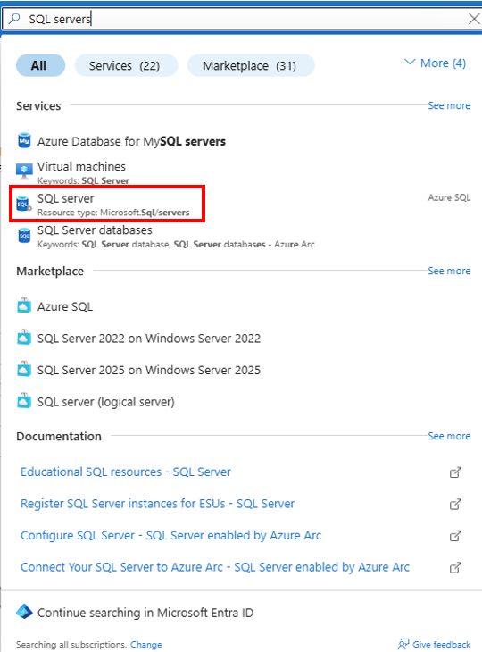

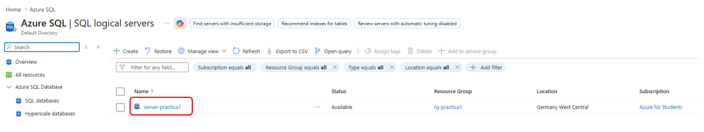

1. Acceder a Security/**Networking** o **Redes**.
2. Seleccionar acceso mediante **Public access** → **Public network access y **debes dejar seleccionada `Selected networks`
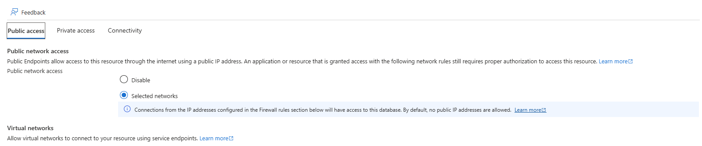

> 💡 Eso significa que el servidor acepta conexiones mediante su endpoint público, pero únicamente desde las redes o direcciones IP autorizadas.

En **Firewall rules**, pulsa: Add your client IPv4 address…

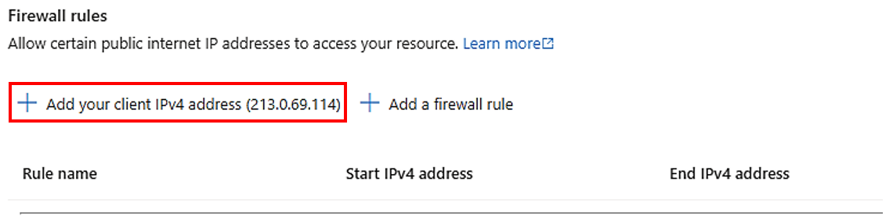
3. Agregar la dirección IP actual del equipo.
4. Para permitir la conexión desde Azure Data Factory durante el laboratorio, habilitar temporalmente:
```plain text
Allow Azure services and resources to access this server
```
5. Guardar los cambios, pulsar en Save.
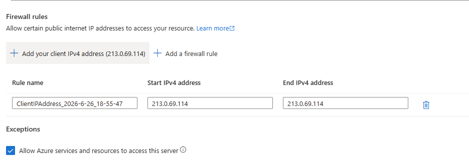
> Esta configuración simplifica el laboratorio. En producción deberían utilizarse redes privadas, endpoints privados y autenticación administrada.

### Fase 2. Crear el modelo relacional

### Modelo de datos

```plain text
Clientes  1 ─────── N Ventas
Productos 1 ─────── N Ventas
Tiendas   1 ─────── N Ventas
```

La granularidad de `Ventas` será:

> Una fila representa un producto vendido dentro de una factura.

Por esta razón, una factura puede aparecer en varias filas, diferenciadas mediante `LineaFactura`.

---

## 6. Script SQL completo

Se puede ejecutar desde:

- El editor de consultas de Azure Portal.
- SQL Server Management Studio.
- Azure Data Studio.
- Visual Studio Code con una extensión SQL.
El editor de consultas de Azure Portal permite conectarse a Azure SQL Database y ejecutar sentencias T-SQL directamente.

- Abrir la base de datos, pulsa en `sqldb-ventas (server-practica1/sqldb-ventas)`
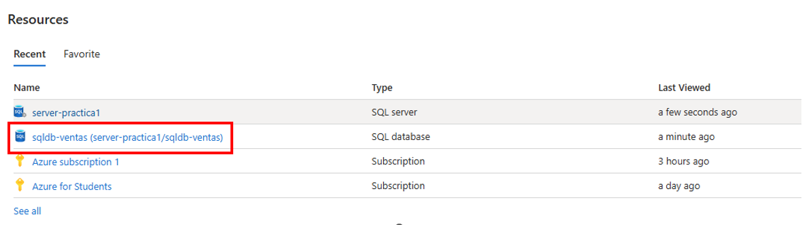
- En el menú lateral busca: **Query editor (preview)** o **Editor de consultas (versión preliminar). **
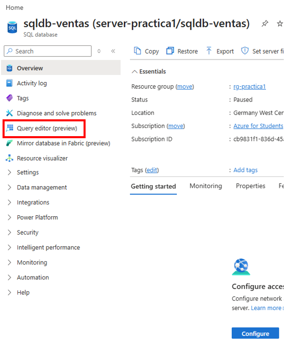

> Puedes escribir `Query editor` en el buscador del menú lateral si no aparece a primera vista. Este editor permite ejecutar sentencias T-SQL directamente desde el navegador.
- Selecciona **SQL authentication** e introduce: 
```plain text
Login: practica
Password: la contraseña que configuraste al crear el servidor
```

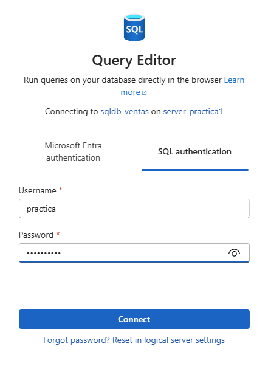
- Pulsa en Connect.
- Pulsa en New Query 
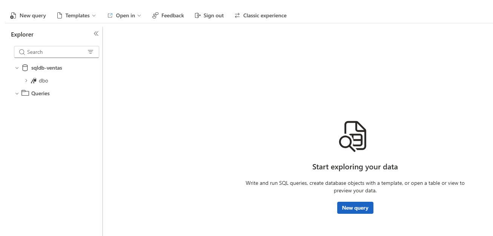
- Ahora, dentro del **Query Editor**, haz primero una prueba rápida:
```sql
SELECT
    DB_NAME() AS BaseDeDatos,
    ORIGINAL_LOGIN() AS UsuarioConectado;
```
- Pulsa **Run** y verifica que aparezca:
```sql
BaseDeDatos: sqldb-ventas
UsuarioConectado: practica
```

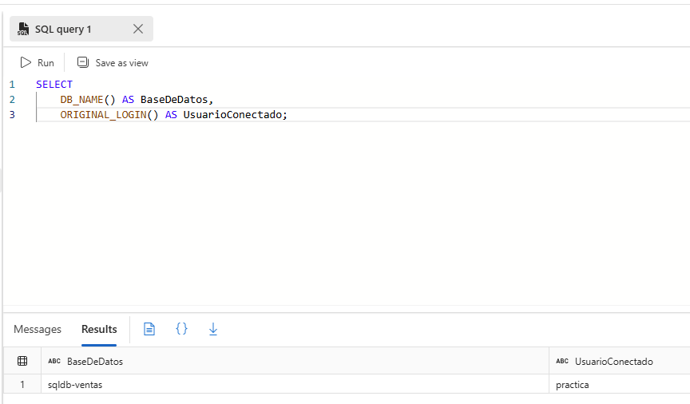
- Borra la consulta de prueba.
- Copia todo el contenido que tienes abajo
> **Advertencia:** el siguiente script elimina las tablas de la práctica si ya existen.

```sql
/* ============================================================
   Ejercicio 1
   Azure SQL Database -> Vista -> ADF -> ADLS Gen2
   ============================================================ */

SET NOCOUNT ON;

/* ============================================================
   1. ELIMINACIÓN DE OBJETOS PREVIOS
   Permite volver a ejecutar toda la práctica desde cero.
   ============================================================ */

IF OBJECT_ID(N'etl.vw_ventas_extraccion', N'V') IS NOT NULL
    DROP VIEW etl.vw_ventas_extraccion;

IF OBJECT_ID(N'dbo.Ventas', N'U') IS NOT NULL
    DROP TABLE dbo.Ventas;

IF OBJECT_ID(N'dbo.Clientes', N'U') IS NOT NULL
    DROP TABLE dbo.Clientes;

IF OBJECT_ID(N'dbo.Productos', N'U') IS NOT NULL
    DROP TABLE dbo.Productos;

IF OBJECT_ID(N'dbo.Tiendas', N'U') IS NOT NULL
    DROP TABLE dbo.Tiendas;


/* ============================================================
   2. CREACIÓN DEL ESQUEMA DE EXTRACCIÓN
   ============================================================ */

IF NOT EXISTS (
    SELECT 1
    FROM sys.schemas
    WHERE name = N'etl'
)
BEGIN
    EXEC(N'CREATE SCHEMA etl AUTHORIZATION dbo;');
END;


/* ============================================================
   3. TABLA DE CLIENTES
   ============================================================ */

CREATE TABLE dbo.Clientes
(
    ClienteId       INT IDENTITY(1,1) NOT NULL,
    Nombre          NVARCHAR(80) NOT NULL,
    Apellidos       NVARCHAR(120) NOT NULL,
    Email           NVARCHAR(255) NOT NULL,
    Ciudad          NVARCHAR(80) NOT NULL,
    Provincia       NVARCHAR(80) NOT NULL,
    Pais            CHAR(2) NOT NULL
        CONSTRAINT DF_Clientes_Pais DEFAULT ('ES'),
    FechaAlta       DATE NOT NULL
        CONSTRAINT DF_Clientes_FechaAlta
        DEFAULT (CONVERT(DATE, SYSUTCDATETIME())),
    Activo          BIT NOT NULL
        CONSTRAINT DF_Clientes_Activo DEFAULT (1),
    FechaCreacion   DATETIME2(0) NOT NULL
        CONSTRAINT DF_Clientes_FechaCreacion
        DEFAULT (SYSUTCDATETIME()),

    CONSTRAINT PK_Clientes
        PRIMARY KEY (ClienteId),

    CONSTRAINT UQ_Clientes_Email
        UNIQUE (Email)
);


/* ============================================================
   4. TABLA DE PRODUCTOS
   ============================================================ */

CREATE TABLE dbo.Productos
(
    ProductoId      INT IDENTITY(1,1) NOT NULL,
    SKU             NVARCHAR(30) NOT NULL,
    NombreProducto  NVARCHAR(150) NOT NULL,
    Categoria       NVARCHAR(80) NOT NULL,
    PrecioLista     DECIMAL(12,2) NOT NULL,
    Activo          BIT NOT NULL
        CONSTRAINT DF_Productos_Activo DEFAULT (1),
    FechaCreacion   DATETIME2(0) NOT NULL
        CONSTRAINT DF_Productos_FechaCreacion
        DEFAULT (SYSUTCDATETIME()),

    CONSTRAINT PK_Productos
        PRIMARY KEY (ProductoId),

    CONSTRAINT UQ_Productos_SKU
        UNIQUE (SKU),

    CONSTRAINT CK_Productos_PrecioLista
        CHECK (PrecioLista >= 0)
);


/* ============================================================
   5. TABLA DE TIENDAS
   ============================================================ */

CREATE TABLE dbo.Tiendas
(
    TiendaId        INT IDENTITY(1,1) NOT NULL,
    CodigoTienda    NVARCHAR(20) NOT NULL,
    NombreTienda    NVARCHAR(120) NOT NULL,
    Ciudad          NVARCHAR(80) NOT NULL,
    Provincia       NVARCHAR(80) NOT NULL,
    Canal           NVARCHAR(20) NOT NULL,
    Activa          BIT NOT NULL
        CONSTRAINT DF_Tiendas_Activa DEFAULT (1),
    FechaCreacion   DATETIME2(0) NOT NULL
        CONSTRAINT DF_Tiendas_FechaCreacion
        DEFAULT (SYSUTCDATETIME()),

    CONSTRAINT PK_Tiendas
        PRIMARY KEY (TiendaId),

    CONSTRAINT UQ_Tiendas_Codigo
        UNIQUE (CodigoTienda),

    CONSTRAINT CK_Tiendas_Canal
        CHECK (Canal IN (N'Física', N'Online'))
);


/* ============================================================
   6. TABLA DE VENTAS
   Una fila representa una línea de factura.
   ============================================================ */

CREATE TABLE dbo.Ventas
(
    VentaId             BIGINT IDENTITY(1,1) NOT NULL,
    NumeroFactura       NVARCHAR(30) NOT NULL,
    LineaFactura        SMALLINT NOT NULL,
    FechaVenta          DATETIME2(0) NOT NULL,

    ClienteId           INT NOT NULL,
    ProductoId          INT NOT NULL,
    TiendaId            INT NOT NULL,

    Cantidad            SMALLINT NOT NULL,
    PrecioUnitario      DECIMAL(12,2) NOT NULL,
    DescuentoPct        DECIMAL(5,2) NOT NULL
        CONSTRAINT DF_Ventas_Descuento DEFAULT (0),

    ImporteBruto AS
    (
        CONVERT(
            DECIMAL(14,2),
            Cantidad * PrecioUnitario
        )
    ) PERSISTED,

    ImporteDescuento AS
    (
        CONVERT(
            DECIMAL(14,2),
            Cantidad * PrecioUnitario * (DescuentoPct / 100.0)
        )
    ) PERSISTED,

    ImporteNeto AS
    (
        CONVERT(
            DECIMAL(14,2),
            Cantidad * PrecioUnitario
            * (1 - DescuentoPct / 100.0)
        )
    ) PERSISTED,

    MetodoPago         NVARCHAR(30) NOT NULL,
    EstadoVenta        NVARCHAR(20) NOT NULL
        CONSTRAINT DF_Ventas_Estado DEFAULT (N'Completada'),

    FechaCreacion      DATETIME2(0) NOT NULL
        CONSTRAINT DF_Ventas_FechaCreacion
        DEFAULT (SYSUTCDATETIME()),

    FechaModificacion  DATETIME2(0) NOT NULL
        CONSTRAINT DF_Ventas_FechaModificacion
        DEFAULT (SYSUTCDATETIME()),

    CONSTRAINT PK_Ventas
        PRIMARY KEY (VentaId),

    CONSTRAINT UQ_Ventas_FacturaLinea
        UNIQUE (NumeroFactura, LineaFactura),

    CONSTRAINT FK_Ventas_Clientes
        FOREIGN KEY (ClienteId)
        REFERENCES dbo.Clientes (ClienteId),

    CONSTRAINT FK_Ventas_Productos
        FOREIGN KEY (ProductoId)
        REFERENCES dbo.Productos (ProductoId),

    CONSTRAINT FK_Ventas_Tiendas
        FOREIGN KEY (TiendaId)
        REFERENCES dbo.Tiendas (TiendaId),

    CONSTRAINT CK_Ventas_LineaFactura
        CHECK (LineaFactura > 0),

    CONSTRAINT CK_Ventas_Cantidad
        CHECK (Cantidad > 0),

    CONSTRAINT CK_Ventas_PrecioUnitario
        CHECK (PrecioUnitario >= 0),

    CONSTRAINT CK_Ventas_Descuento
        CHECK (DescuentoPct BETWEEN 0 AND 100),

    CONSTRAINT CK_Ventas_MetodoPago
        CHECK (
            MetodoPago IN (
                N'Tarjeta',
                N'Efectivo',
                N'Transferencia',
                N'PayPal'
            )
        ),

    CONSTRAINT CK_Ventas_Estado
        CHECK (
            EstadoVenta IN (
                N'Completada',
                N'Cancelada',
                N'Devuelta'
            )
        )
);


/* ============================================================
   7. ÍNDICES DE APOYO
   ============================================================ */

CREATE INDEX IX_Ventas_FechaVenta
    ON dbo.Ventas (FechaVenta);

CREATE INDEX IX_Ventas_ClienteId
    ON dbo.Ventas (ClienteId);

CREATE INDEX IX_Ventas_ProductoId
    ON dbo.Ventas (ProductoId);

CREATE INDEX IX_Ventas_TiendaId
    ON dbo.Ventas (TiendaId);

CREATE INDEX IX_Ventas_FechaModificacion
    ON dbo.Ventas (FechaModificacion);


/* ============================================================
   8. DATOS DE CLIENTES
   ============================================================ */

INSERT INTO dbo.Clientes
(
    Nombre,
    Apellidos,
    Email,
    Ciudad,
    Provincia,
    Pais,
    FechaAlta
)
VALUES
(N'Ana',    N'López Martín',      N'ana.lopez@example.com',       N'Madrid',     N'Madrid',     'ES', '2025-10-10'),
(N'Carlos', N'García Pérez',      N'carlos.garcia@example.com',   N'Barcelona',  N'Barcelona',  'ES', '2025-10-15'),
(N'Lucía',  N'Martínez Ruiz',     N'lucia.martinez@example.com',  N'Valencia',   N'Valencia',   'ES', '2025-11-03'),
(N'Diego',  N'Sánchez Moreno',    N'diego.sanchez@example.com',   N'Sevilla',    N'Sevilla',    'ES', '2025-11-11'),
(N'Marta',  N'Ruiz Fernández',    N'marta.ruiz@example.com',      N'Bilbao',     N'Bizkaia',    'ES', '2025-12-01'),
(N'Javier', N'Torres Gómez',      N'javier.torres@example.com',   N'Zaragoza',   N'Zaragoza',   'ES', '2025-12-14'),
(N'Elena',  N'Navarro Gil',       N'elena.navarro@example.com',   N'Alicante',   N'Alicante',   'ES', '2026-01-05'),
(N'Pablo',  N'Romero Díaz',       N'pablo.romero@example.com',    N'Málaga',     N'Málaga',     'ES', '2026-01-17'),
(N'Sofía',  N'Díaz Ortega',       N'sofia.diaz@example.com',      N'Valladolid', N'Valladolid', 'ES', '2026-02-08'),
(N'Miguel', N'Castillo Molina',   N'miguel.castillo@example.com', N'Murcia',     N'Murcia',     'ES', '2026-02-20');


/* ============================================================
   9. DATOS DE PRODUCTOS
   ============================================================ */

INSERT INTO dbo.Productos
(
    SKU,
    NombreProducto,
    Categoria,
    PrecioLista
)
VALUES
(N'P001', N'Portátil Pro 15',           N'Informática',  1049.90),
(N'P002', N'Monitor 27 pulgadas',        N'Informática',   239.90),
(N'P003', N'Teclado mecánico',           N'Accesorios',     49.90),
(N'P004', N'Ratón inalámbrico',          N'Accesorios',     24.90),
(N'P005', N'Auriculares Bluetooth',      N'Audio',          79.90),
(N'P006', N'Webcam Full HD',             N'Accesorios',     69.90),
(N'P007', N'Silla ergonómica',           N'Mobiliario',    189.00),
(N'P008', N'Mesa de oficina',            N'Mobiliario',    249.00),
(N'P009', N'Disco SSD 1 TB',             N'Almacenamiento', 89.90),
(N'P010', N'Router Wi-Fi 6',             N'Redes',         119.90),
(N'P011', N'Tablet 10 pulgadas',         N'Movilidad',     399.00),
(N'P012', N'Impresora multifunción',     N'Impresión',     179.90);


/* ============================================================
   10. DATOS DE TIENDAS
   ============================================================ */

INSERT INTO dbo.Tiendas
(
    CodigoTienda,
    NombreTienda,
    Ciudad,
    Provincia,
    Canal
)
VALUES
(N'T001', N'Madrid Centro',       N'Madrid',    N'Madrid',    N'Física'),
(N'T002', N'Barcelona Diagonal',  N'Barcelona', N'Barcelona', N'Física'),
(N'T003', N'Valencia Centro',     N'Valencia',  N'Valencia',  N'Física'),
(N'T004', N'Tienda Online',       N'Madrid',    N'Madrid',    N'Online');


/* ============================================================
   11. DATOS DE VENTAS
   30 líneas de venta distribuidas entre abril y junio de 2026.
   ============================================================ */

INSERT INTO dbo.Ventas
(
    NumeroFactura,
    LineaFactura,
    FechaVenta,
    ClienteId,
    ProductoId,
    TiendaId,
    Cantidad,
    PrecioUnitario,
    DescuentoPct,
    MetodoPago,
    EstadoVenta
)
VALUES
(N'F-2026-0001', 1, '2026-04-01T10:15:00',  1,  1, 1, 1,  999.90,  5.00, N'Tarjeta',       N'Completada'),
(N'F-2026-0001', 2, '2026-04-01T10:15:00',  1,  3, 1, 1,   49.90,  0.00, N'Tarjeta',       N'Completada'),

(N'F-2026-0002', 1, '2026-04-04T12:30:00',  2,  2, 2, 2,  229.90, 10.00, N'Tarjeta',       N'Completada'),

(N'F-2026-0003', 1, '2026-04-08T18:20:00',  3,  4, 4, 2,   24.90,  0.00, N'PayPal',        N'Completada'),
(N'F-2026-0003', 2, '2026-04-08T18:20:00',  3,  5, 4, 1,   79.90,  0.00, N'PayPal',        N'Completada'),

(N'F-2026-0004', 1, '2026-04-12T11:45:00',  4,  7, 3, 1,  189.00,  5.00, N'Tarjeta',       N'Completada'),

(N'F-2026-0005', 1, '2026-04-17T09:10:00',  5, 11, 4, 1,  399.00,  0.00, N'Transferencia', N'Completada'),
(N'F-2026-0005', 2, '2026-04-17T09:10:00',  5,  6, 4, 1,   69.90,  0.00, N'Transferencia', N'Completada'),

(N'F-2026-0006', 1, '2026-04-22T17:05:00',  6,  9, 1, 2,   89.90, 10.00, N'Efectivo',      N'Completada'),

(N'F-2026-0007', 1, '2026-04-27T13:40:00',  7, 10, 2, 1,  119.90,  0.00, N'Tarjeta',       N'Completada'),
(N'F-2026-0007', 2, '2026-04-27T13:40:00',  7,  3, 2, 2,   49.90,  0.00, N'Tarjeta',       N'Completada'),

(N'F-2026-0008', 1, '2026-05-02T16:25:00',  8,  8, 3, 1,  249.00,  5.00, N'Tarjeta',       N'Completada'),

(N'F-2026-0009', 1, '2026-05-06T20:15:00',  9, 12, 4, 1,  179.90, 15.00, N'PayPal',        N'Completada'),

(N'F-2026-0010', 1, '2026-05-10T10:00:00', 10,  2, 1, 1,  229.90,  0.00, N'Efectivo',      N'Completada'),
(N'F-2026-0010', 2, '2026-05-10T10:00:00', 10,  4, 1, 1,   24.90,  0.00, N'Efectivo',      N'Completada'),

(N'F-2026-0011', 1, '2026-05-15T12:50:00',  1,  5, 2, 2,   79.90, 10.00, N'Tarjeta',       N'Completada'),

(N'F-2026-0012', 1, '2026-05-19T19:30:00',  2,  6, 4, 1,   69.90,  0.00, N'PayPal',        N'Completada'),
(N'F-2026-0012', 2, '2026-05-19T19:30:00',  2,  9, 4, 1,   89.90,  0.00, N'PayPal',        N'Completada'),

(N'F-2026-0013', 1, '2026-05-24T11:20:00',  3, 11, 3, 1,  399.00,  5.00, N'Tarjeta',       N'Completada'),

(N'F-2026-0014', 1, '2026-05-29T15:10:00',  4,  1, 1, 1, 1049.90, 10.00, N'Tarjeta',       N'Completada'),
(N'F-2026-0014', 2, '2026-05-29T15:10:00',  4, 10, 1, 1,  119.90,  0.00, N'Tarjeta',       N'Completada'),

(N'F-2026-0015', 1, '2026-06-03T13:35:00',  5,  7, 2, 2,  189.00,  5.00, N'Transferencia', N'Completada'),

(N'F-2026-0016', 1, '2026-06-07T18:10:00',  6, 12, 4, 1,  179.90,  0.00, N'PayPal',        N'Completada'),
(N'F-2026-0016', 2, '2026-06-07T18:10:00',  6,  3, 4, 1,   49.90,  0.00, N'PayPal',        N'Completada'),

(N'F-2026-0017', 1, '2026-06-11T10:45:00',  7,  8, 3, 1,  249.00, 10.00, N'Tarjeta',       N'Completada'),

(N'F-2026-0018', 1, '2026-06-14T12:20:00',  8,  2, 2, 2,  239.90,  5.00, N'Tarjeta',       N'Completada'),
(N'F-2026-0018', 2, '2026-06-14T12:20:00',  8,  4, 2, 2,   24.90,  0.00, N'Tarjeta',       N'Completada'),

(N'F-2026-0019', 1, '2026-06-18T09:40:00',  9,  9, 1, 3,   89.90, 15.00, N'Efectivo',      N'Completada'),

(N'F-2026-0020', 1, '2026-06-20T21:05:00', 10,  5, 4, 1,   79.90,  0.00, N'PayPal',        N'Completada'),
(N'F-2026-0020', 2, '2026-06-20T21:05:00', 10,  6, 4, 1,   69.90,  0.00, N'PayPal',        N'Completada');


/* ============================================================
   12. VISTA DE EXTRACCIÓN
   No agrega información y no aplica reglas analíticas.
   Solo une y proyecta los datos necesarios.
   ============================================================ */

EXEC(N'
CREATE OR ALTER VIEW etl.vw_ventas_extraccion
AS
SELECT
    v.VentaId,
    v.NumeroFactura,
    v.LineaFactura,
    v.FechaVenta,

    v.ClienteId,
    CONCAT(c.Nombre, N'' '', c.Apellidos) AS NombreCliente,
    c.Email AS EmailCliente,
    c.Ciudad AS CiudadCliente,
    c.Provincia AS ProvinciaCliente,
    c.Pais AS PaisCliente,

    v.ProductoId,
    p.SKU,
    p.NombreProducto,
    p.Categoria,

    v.TiendaId,
    t.CodigoTienda,
    t.NombreTienda,
    t.Canal,
    t.Ciudad AS CiudadTienda,
    t.Provincia AS ProvinciaTienda,

    v.Cantidad,
    v.PrecioUnitario,
    v.DescuentoPct,
    v.ImporteBruto,
    v.ImporteDescuento,
    v.ImporteNeto,

    v.MetodoPago,
    v.EstadoVenta,
    v.FechaCreacion,
    v.FechaModificacion

FROM dbo.Ventas AS v

INNER JOIN dbo.Clientes AS c
    ON v.ClienteId = c.ClienteId

INNER JOIN dbo.Productos AS p
    ON v.ProductoId = p.ProductoId

INNER JOIN dbo.Tiendas AS t
    ON v.TiendaId = t.TiendaId;
');


/* ============================================================
   13. VALIDACIONES
   ============================================================ */

SELECT N'Clientes' AS Entidad, COUNT(*) AS NumeroRegistros
FROM dbo.Clientes

UNION ALL

SELECT N'Productos', COUNT(*)
FROM dbo.Productos

UNION ALL

SELECT N'Tiendas', COUNT(*)
FROM dbo.Tiendas

UNION ALL

SELECT N'Ventas', COUNT(*)
FROM dbo.Ventas;


SELECT TOP (20)
    *
FROM etl.vw_ventas_extraccion
ORDER BY VentaId;
```
- Pégalo en el editor, y luego pulsa en Run:
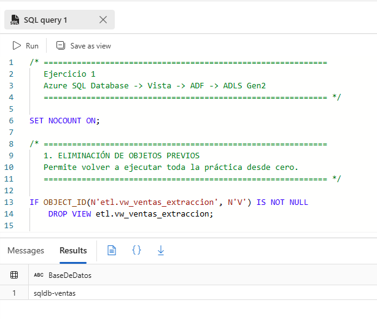

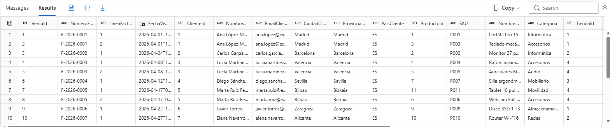
- El script creará:
- `dbo.Clientes`
- `dbo.Productos`
- `dbo.Tiendas`
- `dbo.Ventas`
- el esquema `etl`
- la vista `etl.vw_ventas_extraccion`
- índices y datos de ejemplo.
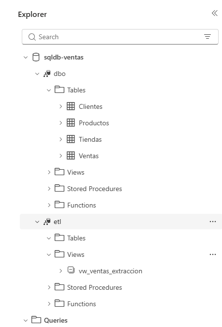
- Ejecuta también estas comprobaciones:
```sql
SELECT COUNT(*) AS Clientes FROM dbo.Clientes;
```

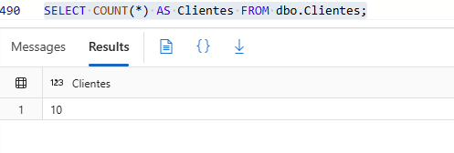

```sql
SELECT COUNT(*) AS Productos FROM dbo.Productos;
```

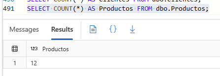

```sql
SELECT COUNT(*) AS Tiendas FROM dbo.Tiendas;
```

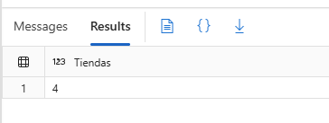

```sql
SELECT COUNT(*) AS Ventas FROM dbo.Ventas;
```

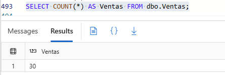

```sql
SELECT TOP (10) *
FROM etl.vw_ventas_extraccion;
```

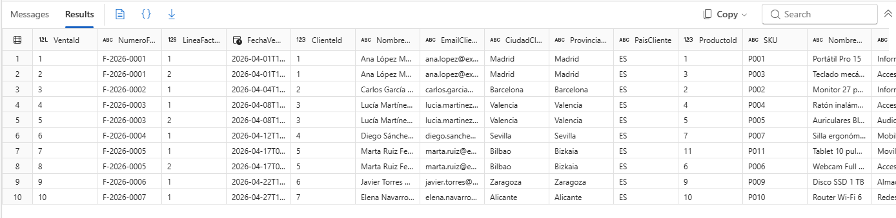
#### Resultado que debe devolver la validación

```plain text
Clientes     10
Productos    12
Tiendas       4
Ventas       30
```

La vista también debe devolver exactamente 30 filas:

```sql
SELECT COUNT(*) AS FilasVista
FROM etl.vw_ventas_extraccion;
```

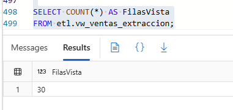

---

#### Comprobar las relaciones y los importes

```sql
SELECT
    Categoria,
    SUM(ImporteNeto) AS VentasNetas
FROM etl.vw_ventas_extraccion
GROUP BY Categoria
ORDER BY VentasNetas DESC;
```

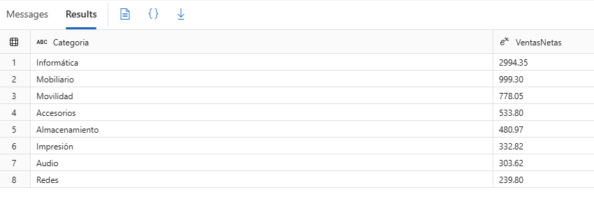

```sql
SELECT
    NombreTienda,
    Canal,
COUNT(DISTINCT NumeroFactura) AS NumeroFacturas,
    SUM(ImporteNeto) AS VentasNetas
FROM etl.vw_ventas_extraccion
GROUP BY
    NombreTienda,
    Canal
ORDER BY VentasNetas DESC;
```

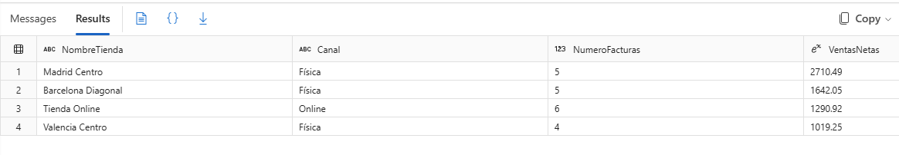

```sql
SELECT
    ClienteId,
    NombreCliente,
    COUNT(DISTINCT NumeroFactura) AS NumeroFacturas,
    SUM(ImporteNeto) AS VentasNetas
FROM etl.vw_ventas_extraccion
GROUP BY
    ClienteId,
    NombreCliente
ORDER BY VentasNetas DESC;
```

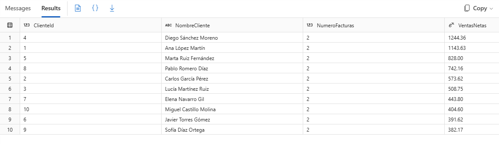

> Estas consultas son únicamente de validación. Azure Data Factory copiará las filas de la vista sin agregar los datos.

### Fase 3. Crear Azure Data Lake Storage Gen2

ADLS Gen2 se implementa mediante una cuenta de almacenamiento con el espacio de nombres jerárquico habilitado. Esta característica permite trabajar con contenedores, directorios y archivos como una estructura de Data Lake.

#### Paso 1. Crear la cuenta de almacenamiento

1. Buscar **Storage accounts**.
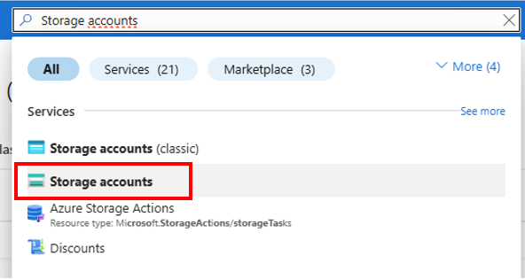
2. Seleccionar **Crear**.
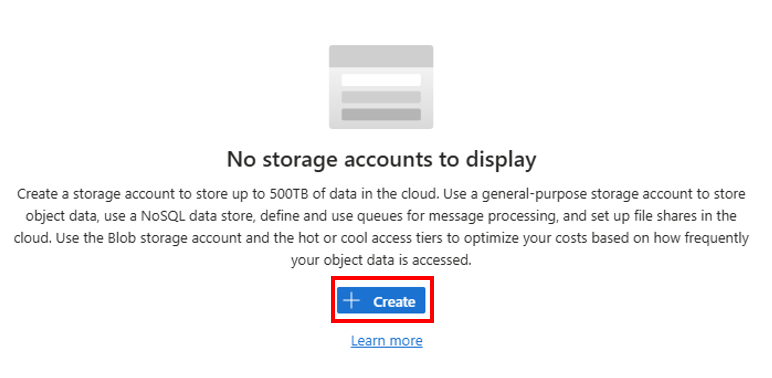
3. Configurar:
```plain text
Grupo de recursos: rg-practica1
Nombre: storageaccountpractica1
Región: la misma que los demás servicios
Primary service: Azure Blob Storage or Azure Data Lake Storage Gen 2
Rendimiento(Performance): Standard
Redundancia: LRS-Locally redundant storage
```

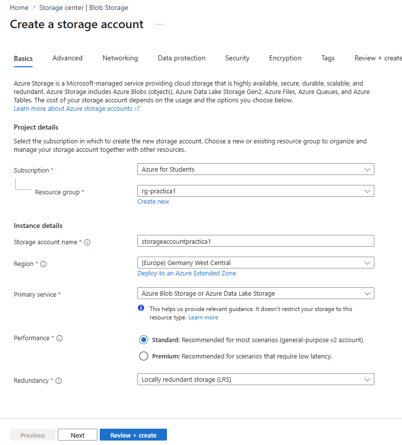
4. No pulses todavía **Review + create**. Entra en la pestaña **Advanced** y busca la sección: **`Azure Blob Storage`**y activa:
```plain text
Enable hierarchical namespace
```
5. En estas opciones
- **Enable SFTP:** desactivado
- **Allow cross-tenant replication:** desactivado
- **Access tier:** `Hot`
- **Enable network file system v3:** desactivado
- Resto de opciones: valores predeterminados
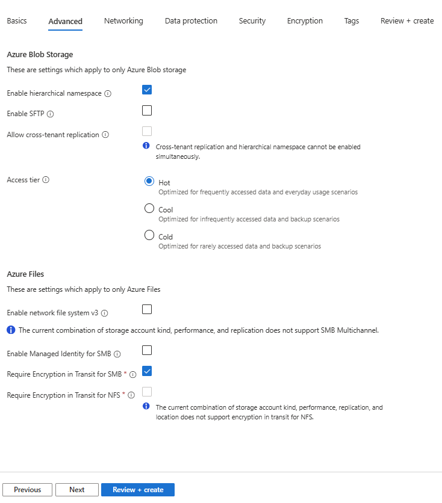
-
6. Después pulsa **Review + create**.
> La opción de espacio de nombres jerárquico es esencial porque permitirá trabajar con una estructura real de directorios como:
```plain text
raw/
└── ventas/
    └── fecha_carga=2026-06-26/
        └── ventas_20260626_172000.csv
```

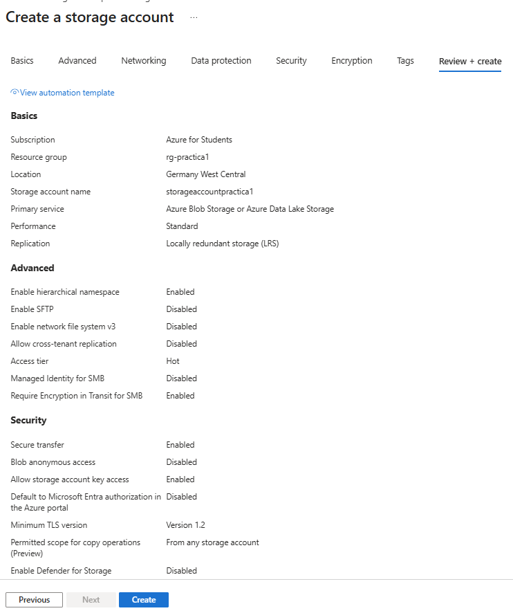
7. Pulsar en **Create**.
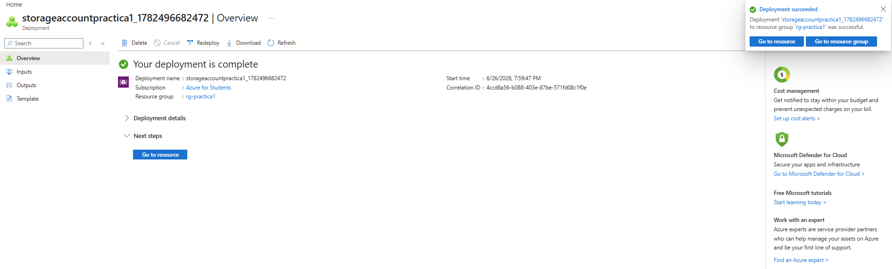

Pulsa en `Go to resource` para seguir el siguiente paso
---

### Paso 2. Crear el contenedor

1. Abrir la cuenta de almacenamiento (lo que viene despues pulsar en Go to resource).
2. Acceder a **Storage browser**.
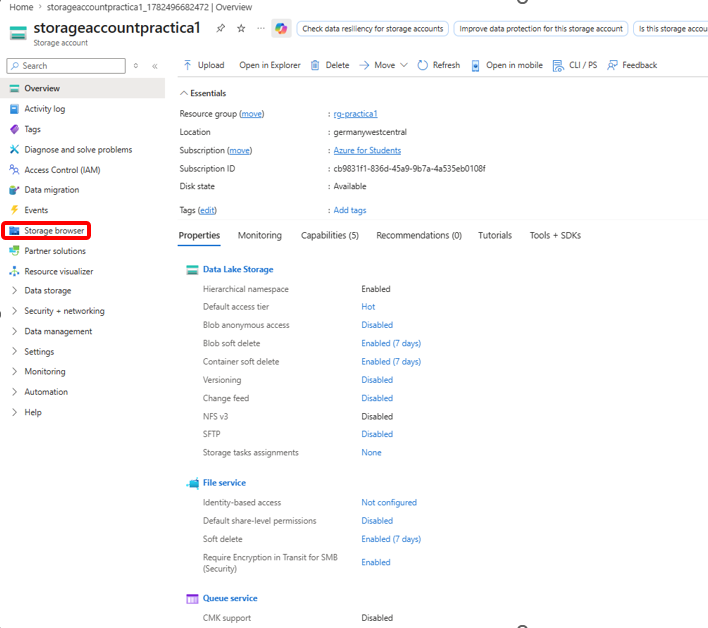
3. Seleccionar **Blob containers**.
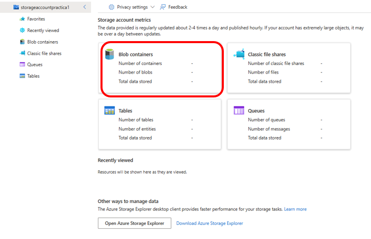
4. Pulsa **Add container** o **+ Container**.
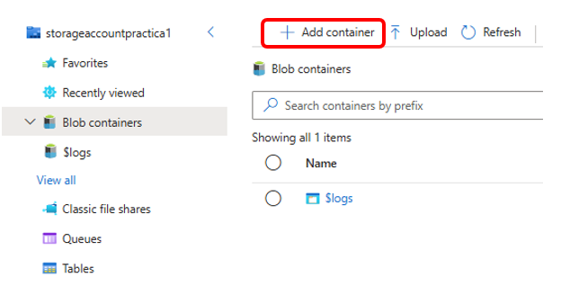
5. Configura:
```plain text
Name: datalake
Anonymous access level: Private (no anonymous access)
```

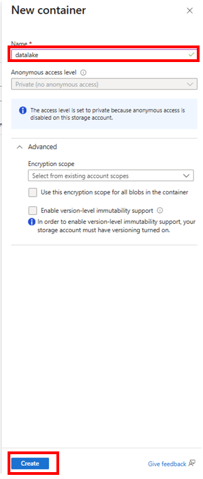
6. Pulsar en Create.
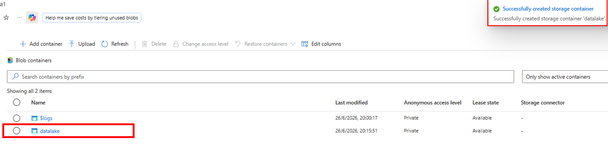
#### Paso 3. Crear la estructura inicial

- Dentro del contenedor `datalake`
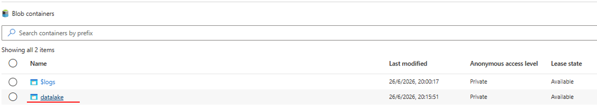
- Pulsa **Add directory** o **New directory**.
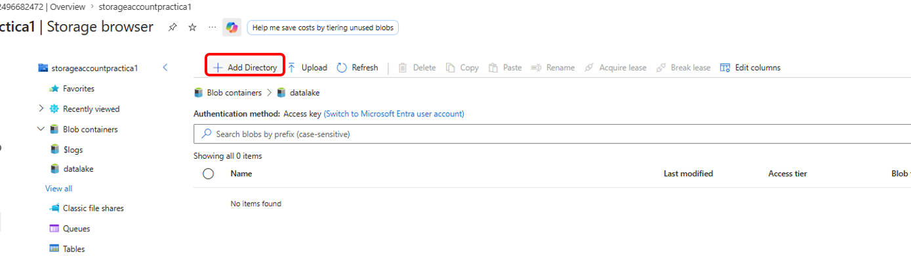
- Crea el directorio:
```plain text
raw
```

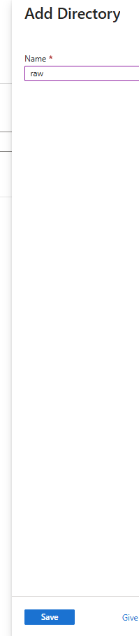
- Entra en raw y crea `ventas`
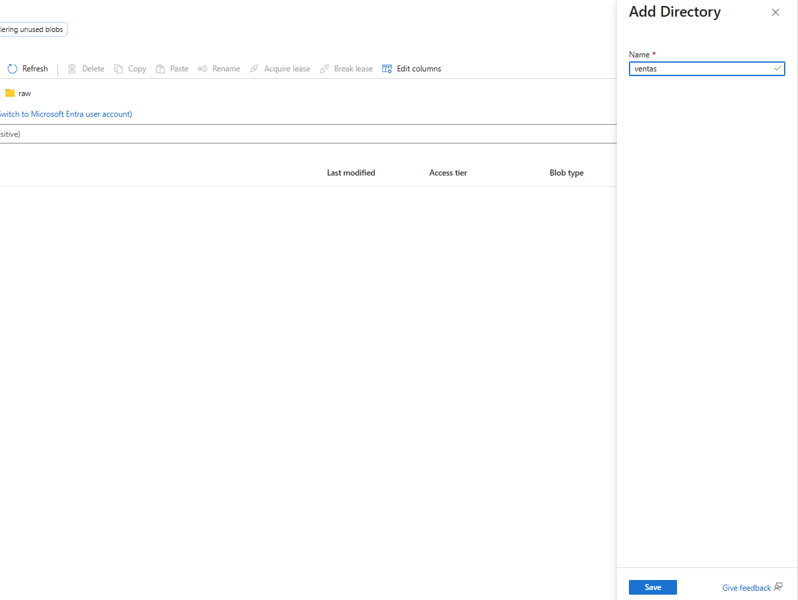
- La estructura quedará:
```plain text
datalake/
└── raw/
    └── ventas/
```

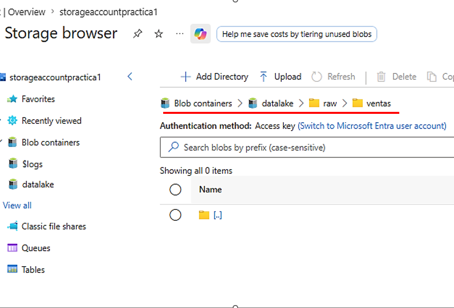
> ADF podrá crear automáticamente las subcarpetas de fecha cuando ejecute el pipeline.

---

## Fase 4. Crear Azure Data Factory

> Azure Data Factory utiliza la actividad Copy para mover datos entre almacenes cloud y locales. La actividad admite Azure SQL Database como origen y ADLS Gen2 como destino, incluyendo archivos CSV y Parquet.

### Paso 1. Crear Data Factory

1. Buscar **Data factories**.
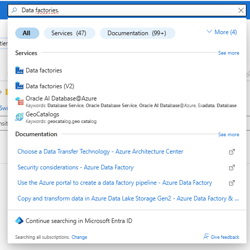
2. Seleccionar **Create**.

3. Configurar:
```plain text
Grupo de recursos: rg-practica1
Nombre: adf-practica1
Región: la misma región
Versión: V2
```


4. No es obligatorio configurar Git para esta práctica.
5. Pulsar en **Review + create **

6. Pulsar en **Create**.

7. Abrir el recurso. Pulsa en **Go to resource**

8. Pulsa en adf-practica1

9. Seleccionar **Launch Studio**.


---

## Fase 5. Autorizar a Data Factory sobre ADLS Gen2

Data Factory dispone de una identidad administrada. Esta identidad puede recibir permisos sobre otros recursos de Azure sin que sea necesario almacenar claves dentro del pipeline.

### Asignar el rol

> Deja la pestaña de adf abierta y, en otra pestaña del navegador, vuelve a Azure Portal.

1. Abre `storageaccountpractica1`.

2. En el menú lateral, entra en **Access control (IAM)**.

3. Pulsa **Add → Add role assignment**.

4. Busca y selecciona:
```plain text
Storage Blob Data Contributor
```


5. Pulsa en Next:

6. En **Assign access to**, selecciona: `Managed identity`

7. Pulsa **Select members**.

8. Configura:
```plain text
Subscription: Azure for Students
Managed identity: Data factory
Select: adf-practica1
```


> Debes pulsar en adf-practica1 para que se mueva a Selected members


9. Pulsa **Select**.
10. Termina con **Review + assign** y nuevamente **Review + assign**.


> Este rol permite a la identidad de Data Factory leer, crear, modificar y eliminar archivos o blobs dentro del almacenamiento.

> 💡 **Después espera uno o dos minutos para que el permiso se propague**. 
A continuación volveremos a la pantalla de Data Factory Studio y crearemos el primer **Linked Service** para Azure SQL Database
---

### Fase 6. Crear el Linked Service de Azure SQL Database

Vuelve a la pestaña de Data Factory Studio:


1. Abrir **Manage**.

2. Seleccionar **Linked services**.

3. Seleccionar **New**.

4. Buscar:
```plain text
Azure SQL Database
```


5. Pulsar en Azure SQL Database, luego en Continue:

6. Configurar:
```plain text
Nombre: ls_azure_sql_ventas
Version: 2.0
Account selection method: From Azure subscription
Server name: server-practica1
Database name: sqldb-ventas
Authentication type: SQL Authentication
User name: practica
Contraseña: la contraseña del servidor
Encrypt: Mandatory
Trust server certificate: desactivado
Always encrypted: desactivado
Host name in certificate: vacío
```


7. Ahora pulsa **Test connection** antes de crear el Linked Service. Si aparece: `Connection successful`pulsa **Create**.


> La contraseña queda almacenada cifrada dentro del servicio, pero para una solución empresarial debería usarse una identidad administrada o Azure Key Vault.

Si la prueba falla:

- Revisar el firewall de Azure SQL.
- Confirmar la dirección del servidor.
- Confirmar el nombre de la base de datos.
- Confirmar las credenciales.
- Confirmar que se permite temporalmente el acceso desde servicios de Azure.
- Verificar que la base de datos está online
---

## Fase 7. Crear el Linked Service de ADLS Gen2

1. En Azure Data Factory Studio: Ve a **Manage → Linked services**, seleccionar **New**.


2. Busca y selecciona: `Azure Data Lake Storage Gen2`

3. Pulsar en Continue
4. Configurar:
```plain text
Nombre: ls_adls_gen2
Connect via integration runtime: AutoResolveIntegrationRuntime
Authentication type: System Assigned Managed Identity
Account Selection method: From Azure subscription
Azure subcription: Azure for Students
Storage account name: storageaccountpractica1

```

La URL del servicio tendrá una estructura similar a:

```plain text
https://storageaccountpractica1.dfs.core.windows.net
```
5. En test connection seleccionar: **To linked service**
6. Pulsar en Test connection y si aparece `Connection succesfull` pulsa en `Create`


7. Pulsar en Validate all y luego Publish all.

8. Espera al mensaje **Successfully published**. Si no tienes errores te debería salir:


> Tener en cuenta que **Publish all publica todos los cambios pendientes a la vez**, no solamente el elemento que tienes seleccionado. Después de publicarlo, la insignia amarilla debería desaparecer. Los Linked Services publicados podrán ser utilizados posteriormente por los datasets y pipelines.
> 💡 El conector de ADLS Gen2 puede utilizarse como destino de una actividad Copy de ADF.

---

### Fase 8. Crear el dataset de origen

> Este dataset representará la vista SQL: `etl.vw_ventas_extraccion` . El **Linked Service** contiene la conexión con Azure SQL; el **dataset** indica qué objeto concreto leer dentro de esa conexión.

1.  En Azure Data Factory Abrir la sección **Author**.

2. En el panel **Factory Resources pulsa en +**

3. Selecciona Dataset 

4. En el buscador escribe `Azure SQL Database` 

5. Selecciona Continue.
6. En Set properties introduce:
```plain text
Name: ds_sql_vw_ventas_extraccion
En Linked service selecciona: ls_azure_sql_ventas 
En Table name selecciona: etl.vw_ventas_extraccion
En import schema selecciona: From connection/store
```


7. Pulsar en OK.
8. Antes de publicar es aconsejable pulsar en Preview data 
y verifica que aparecen las filas de `etl.vw_ventas_extraccion`.


9. En la pestaña **Schema**, confirma que se han importado las columnas.

10. Pulsa **Validate all**. y luego **Publish all. **


11. Pulsar en Publish y esperar que salga: `Publishin complete`

---

## Fase 9. Crear el dataset de destino

> 💡 Este dataset representará el archivo CSV que Azure Data Factory escribirá dentro de ADLS Gen2. La ruta y el nombre del archivo serán dinámicos.

#### Dataset CSV de ADLS Gen2

1. Ir a Azure Data Studio,  En Author crear un dataset nuevo pulsando en + 

2. Elegir `Azure Data Lake Storage Gen2 ` y luego pulsar en Continue.

3. En **Select Format** elige `DelimitedText`  y luego Continue

4. En Set properties: 
```plain text
1. Name: ds_adls_raw_ventas_csv
2. Linked Service: ls_adls_gen2
3. En File path: 
- File system: datalake
- Directory:  dejar vacio
- File name: dejar vacio
Tambien puedes pulsar el icono de la carpeta
para seleccionar el contenedor datalake
4. Dejar activado: First Row as header
5. En Import Schema selecciona: None
El archivo todavía no existe, así que ADF 
no puede importar su esquema desde el almacenamiento.
```

> Una vez rellenadas las propiedades, pulsa en ok.


5. A continuación, dentro del dataset, en Parameters, crea:
```plain text
pDirectorio   String
pArchivo      String
```


6. En **Connection**, configura:
```plain text
Directory: @dataset().pDirectorio
File:      @dataset().pArchivo
```


El pipeline proporcionará después valores dinámicos como:

```plain text
raw/ventas/fecha_carga=2026-06-29
ventas_20260629_153000.csv
```

> Revisa que **First row as header** esté activado.
7. Ejecuta **Validate all** y finalmente **Publish all**.


>  Esta parametrización permite que cada ejecución genere una carpeta y un archivo distintos.
---

#### Fase 10. Crear el pipeline

1. En **Author**, seleccionar **Pipelines**.

2. Pulsar en `… `y luego New pipeline

3. En el panel derecho, cambia el nombre a:
```plain text
pl_sql_ventas_to_adls_raw
```


4. Añadir la actividad Copy. En el panel **Activities busca ****`Copy data`****:**

5. Arrástra “Copy data” al lienzo. Selecciona la actividad y, en la pestaña **General**, cambia su nombre a: `cp_vw_ventas_to_raw`


6. Configurar el origen. Con la actividad seleccionada, abre la pestaña **Source**.

7. Selecciona: `Source dataset: ds_sql_vw_ventas_extraccion`

8. En **Use query** o **Query type**, selecciona: `Query`

9. Introduce esta consulta:
```sql
SELECT
    *,
    SYSUTCDATETIME() AS FechaExtraccionUtc
FROM etl.vw_ventas_extraccion;
```

> Esto copiará las 30 filas de la vista y añadirá a cada una la fecha y hora UTC de extracción. No se agregan ni eliminan registros.
Esto añade la fecha de ejecución de la extracción a cada fila.

No se aplican:

- Agregaciones.
- Reglas de negocio.
- Limpieza de nulos.
- Eliminación de registros.
- Cálculos analíticos adicionales.


10. **Configurar el destino**. Abre la pestaña **Sink** y selecciona:
```sql
Sink dataset: ds_adls_raw_ventas_csv
```


Aparecerán los parámetros del dataset.
11. `pDirectorio`Pulsa **Add dynamic content** y escribe:
```sql
@concat(
    'raw/ventas/fecha_carga=',
    formatDateTime(utcNow(),'yyyy-MM-dd')
)
```


12. `pArchivo`.Pulsa **Add dynamic content** y escribe:
```sql
@concat(
    'ventas_',
    formatDateTime(utcNow(),'yyyyMMdd_HHmmss'),
    '.csv'
)
```

La ruta resultante será similar a:

```plain text
datalake/
└── raw/
    └── ventas/
        └── fecha_carga=2026-06-29/
            └── ventas_20260629_153000.csv
```


13. Configurar el mapeo. En la pestaña **Mapping**:

14. Pulsa **Import schemas y comprueba que aparecen las columnas de origen y destino.**


15. Verifica especialmente que se incluya:
```plain text
FechaExtraccionUtc
```


> También deben aparecer columnas como `VentaId`, `NumeroFactura`, `FechaVenta`, `NombreCliente`, `NombreProducto`, `Cantidad`, `ImporteNeto`, etc.
16. Probar el pipeline. Pulsa en Vallidate:

17. Si no hay errores, pulsa **Debug**.

18. Espera a que termine la actividad. El resultado esperado es: Status Succeeded

19. Después de comprobar que funciona: `Vallidate all → Publish all`
---

---

### Fase 11. Verificar el archivo en ADLS Gen2

1. Abrir la cuenta de almacenamiento.

2. Acceder a **Storage browser**.

3. Abrir el contenedor: `datalake`

4. Navegar hasta:
```plain text
raw/
└── ventas/
    └── fecha_carga=AAAA-MM-DD/
```

y comprueba que existe un archivo: `ventas_AAAAMMDD_HHMMSS.csv`


5. Descargarlo o visualizarlo (Pulsar en View/Edit).
6. Comprobar que:
- Tiene encabezados.
- Contiene 30 registros de datos.
- Los identificadores coinciden con Azure SQL.
- Los importes aparecen correctamente.
- Incluye `FechaExtraccionUtc`.


O si lo quieres descargar en csv y vsualizarlo en excel o vscode:


---

### Validación entre origen y destino

### Recuento en Azure SQL

```sql
SELECT COUNT(*) AS FilasOrigen
FROM etl.vw_ventas_extraccion;
```

Resultado esperado:

```plain text
30
```

### Validación en ADF

En la salida de la actividad Copy:

```plain text
Rows read: 30
Rows copied: 30
```


### Validación en el archivo

El CSV debe contener:

```plain text
1 fila de encabezados
30 filas de datos
```


---

### Crear un trigger programado

Después de validar el pipeline se puede programar una carga diaria. Para ello debes ir a `Data Factory Studio`

1. Abrir el pipeline.
2. Seleccionar **Add trigger**.

3. Seleccionar **New/Edit**.

4. Crear un trigger de tipo **Schedule**.
5. Ejemplo:
```plain text
Nombre: trg_diario_ventas
Frecuencia: cada 1 día
Hora: 02:00
Zona horaria: la indicada para el curso
```


6. Pulsar en OK

7. Pulsa OK otra vez.
8. Pulsa **Publish all → Publish**.

9. Después puedes comprobarlo en: Manage → Triggers.


Gracias al nombre dinámico, cada ejecución genera un archivo diferente.

```plain text
raw/ventas/
├── fecha_carga=2026-06-25/
│   └── ventas_20260625_020000.csv
└── fecha_carga=2026-06-26/
    └── ventas_20260626_020000.csv
```

También podrás revisar sus ejecuciones en: `Monitor -> Trigger runs`

---

### Monitorización de ejecuciones automáticas

Cuando el trigger programado se active, Azure Data Factory iniciará automáticamente una ejecución del pipeline:

```plain text
pl_sql_ventas_to_adls_raw
```

Para comprobar el resultado de la ejecución:

1. Abrir **Data Factory Studio**.
2. Acceder a **Monitor**.
3. Seleccionar **Pipeline runs**.
4. Abrir la pestaña **Triggered**.
> La pestaña **Debug** muestra únicamente las ejecuciones de prueba iniciadas desde el editor mediante el botón **Debug**.
Las ejecuciones iniciadas por un trigger programado, por **Trigger now** o por otro mecanismo de activación aparecen en **Triggered**.

1. Pulsar **Refresh** si la ejecución todavía no aparece.
2. Localizar el pipeline:
```plain text
pl_sql_ventas_to_adls_raw
```
3. Revisar la columna **Status**.
Los estados habituales son:

```plain text
Succeeded
Failed
In progress
Cancelled
```
#### Interpretación de los estados

- **Succeeded:** el pipeline terminó correctamente.
- **Failed:** una actividad del pipeline produjo un error.
- **In progress:** la ejecución todavía está en curso.
- **Cancelled:** la ejecución fue cancelada antes de finalizar.
#### Revisar el detalle de la actividad Copy

Para consultar los detalles:

1. Seleccionar el nombre de la ejecución del pipeline o el icono de detalle.
2. Abrir la actividad:
```plain text
cp_vw_ventas_to_raw
```
3. Revisar las métricas de ejecución, como:
```plain text
Rows read
Rows copied
Data read
Data written
Duration
Throughput
```
En una ejecución correcta, el número de filas leídas y copiadas debería coincidir.

Por ejemplo:

```plain text
Rows read: 30
Rows copied: 30
Status: Succeeded
```

Esto confirma que los registros de la vista SQL se han extraído y escrito correctamente en ADLS Gen2.

#### Comprobar la ejecución del trigger

También se puede acceder a:

```plain text
Monitor → Trigger runs
```

En esta sección se muestra:

- el nombre del trigger;
- la fecha y hora de activación;
- el estado de la ejecución;
- el pipeline iniciado;
- el resultado de la activación.
El trigger esperado es:

```plain text
trg_diario_ventas
```

Para que el trigger se ejecute automáticamente, debe cumplirse lo siguiente:

- el trigger debe estar publicado;
- su estado debe ser **Started**;
- la fecha y hora programadas deben haberse alcanzado;
- el pipeline asociado también debe estar publicado.
#### Validar el archivo generado

Después de una ejecución correcta, abrir la cuenta de almacenamiento y comprobar la ruta:

```plain text
datalake/
└── raw/
    └── ventas/
        └── fecha_carga=AAAA-MM-DD/
            └── ventas_AAAAMMDD_HHMMSS.csv
```

Debe existir un nuevo archivo CSV correspondiente a la ejecución del trigger.

#### Diagnóstico de errores

Si el pipeline aparece con estado **Failed**, abrir el detalle de la actividad Copy y revisar el mensaje completo de error.

Las causas más habituales son:

- Azure SQL Database pausada o no disponible;
- credenciales SQL incorrectas;
- firewall del servidor SQL;
- Linked Service de Azure SQL mal configurado;
- permisos insuficientes sobre ADLS Gen2;
- identidad administrada sin el rol `Storage Blob Data Contributor`;
- nombre incorrecto del contenedor;
- ruta de destino mal construida;
- nombre incorrecto de la vista SQL;
- parámetros `pDirectorio` o `pArchivo` incorrectos;
- incompatibilidad en tipos o mapeo de columnas.
Después de corregir el problema, puede ejecutarse el pipeline manualmente mediante:

```plain text
Add trigger → Trigger now
```

De esta forma se valida la corrección sin tener que esperar a la siguiente ejecución programada.

---

###  Consideración importante sobre la zona raw

En una arquitectura empresarial estricta, la zona `raw` suele conservar una copia lo más fiel posible de las tablas de origen:

```plain text
raw/clientes/
raw/productos/
raw/tiendas/
raw/ventas/
```

En esta práctica se utiliza una vista desnormalizada porque el objetivo es trabajar un flujo sencillo:


La vista:

- No agrega ventas.
- No elimina filas.
- No aplica KPIs.
- No transforma los datos en un modelo dimensional.
- Solo resuelve las relaciones y selecciona columnas.
Por tanto, debe entenderse esta practica** como un primer paso hacia una ETL completa que se tratará mas adelante**. En un caso posterior se podrían copiar las cuatro tablas de forma independiente y realizar las uniones en una capa `silver`.

---

### Extensión para carga incremental

La tabla incluye la columna: `FechaModificacion`

Esto permitirá desarrollar posteriormente una carga incremental:

```sql
SELECT
    *,
    SYSUTCDATETIME() AS FechaExtraccionUtc
FROM etl.vw_ventas_extraccion
WHERE FechaModificacion > @UltimaFechaCarga
  AND FechaModificacion <= @FechaCargaActual;
```

Para esta primera práctica se recomienda una **carga completa**, porque:

- Solo existen 30 filas.
- Facilita la comprensión del flujo.
- Evita introducir tablas de control y watermarks.
- Permite validar fácilmente origen y destino.
### Arquitectura final implementada


## Variantes


</details>

### Ejercicio 2: **Azure Cosmos DB for NoSQL hacia Azure Data Lake Storage Gen2**

<details>
<summary>**Pasos**</summary>

Este ejercicio sigue esta arquitectura:


La implementación final será:


---

## **¿Qué representa Azure Cosmos DB?**


## **Decisión de arquitectura**


## **Fase 1. Crear Azure Cosmos DB for NoSQL**

### **Paso 1. Crear el grupo de recursos**

1. Acceder a Azure Portal.
2. Buscar:
```plain text
Resource groups
```
3. Seleccionar **Create**.
4. Configurar:
```plain text
Nombre: rg-practica2
Región: una región permitida por la suscripción
```
5. Seleccionar **Review + create**.
6. Seleccionar **Create**.


---

### **Paso 2. Crear la cuenta de Azure Cosmos DB**

1. En la barra de búsqueda del portal, escribir: `Azure Cosmos DB`
2. Seleccionar el servicio **Azure Cosmos DB**.

3. Seleccionar **Create**.

4. En la pantalla de selección de API, elegir: `Azure Cosmos DB for NoSQL`

5. Seleccionar **Create** dentro de la opción NoSQL recomendada.
> No debe seleccionarse la API de MongoDB, Cassandra, Gremlin ni Table. El conector que se utilizará en Data Factory será **Azure Cosmos DB for NoSQL**.

---

### **Paso 3. Configurar la cuenta**

Configurar:

```plain text
Workload type: Learning
Subscription: Azure for Students
Resource group: rg-practica2
Account name: cosmos-practica2
Location: la misma región utilizada para la práctica
Availability Zones: Disable
Capacity mode: Provisioned throughput
Apply Free Tier Discount: Apply
Limit total account throughput: Activado
```


Pulsar en: Next: `Global Distribution`

Dejar ambas opciones desactivadas.


> **Multi-region Writes** está pensado para aplicaciones globales que necesitan escribir localmente desde varias regiones y mantener alta disponibilidad frente a fallos regionales; no es necesario para este laboratorio.
> 

Continúa con **Next: Networking**.

#### Para simplificar el ejercicio:

```plain text
Connectivity methot: All networks
Conection Security Setting: TLS 1.2
```


> En producción se recomienda utilizar identidad administrada, redes privadas, endpoints privados y el principio de mínimo privilegio.

Pulsar en Next: **Backup Policy**


Pulsar en: Security


Pulsar en Review + create y luego Create


---

## **Fase 2. Crear el modelo documental**

### **2.1 Modelo lógico**

El modelo de la práctica es:

```plain text
Cuenta Cosmos DB
└── Base de datos: db-eventos
    └── Contenedor: eventos
        └── Documentos JSON
```

No existen tablas, claves foráneas ni joins relacionales. La unidad básica es un documento.

### **2.2 Granularidad**

La granularidad será:

> Una fila lógica o documento representa un evento producido por un usuario en un instante determinado.

Ejemplos:

- una visualización de página;
- un clic;
- una búsqueda;
- añadir un producto al carrito;
- una compra;
- un error de aplicación;
- abrir un chat;
- iniciar sesión.
Una misma persona puede generar muchos documentos.

```plain text
Usuario 1 ─────── N Eventos
```

---

### **2.3 Diseño de la clave de partición**

La clave de partición será: `/usuario_id`.Esto significa que Cosmos DB agrupa lógicamente los eventos según el valor de `usuario_id`.

Ejemplos:

```plain text
u001
u002
u003
```

La elección es razonable para el laboratorio porque:

- todos los documentos tienen `usuario_id`;
- existen varios usuarios;
- permite consultar la actividad de un usuario;
- distribuye los documentos entre diferentes valores de partición.
> En un entorno real, la clave de partición debe evaluarse según:
- volumen esperado;
- cardinalidad;
- distribución de escritura;
- consultas frecuentes;
- tamaño máximo por partición lógica;
- estabilidad del valor;
- necesidad de transacciones por partición.

> La clave de partición no debe elegirse solo porque un campo “parece importante”. Debe responder al patrón de acceso y distribución de la carga.

---

### **2.4 Esquema flexible**

Todos los documentos comparten algunos campos:

| **Campo** | **Descripción** |
| --- | --- |
| `id` | Identificador único del documento |
| `usuario_id` | Usuario que genera el evento |
| `evento` | Tipo de evento |
| `pagina` | Página o recurso asociado |
| `fecha` | Momento del evento en formato ISO 8601 |
| `dispositivo` | Tipo de dispositivo |
| `navegador` | Navegador utilizado |
| `canal` | Canal de adquisición o acceso |

Otros campos aparecen solo cuando son necesarios:

- `producto_id`;
- `cantidad`;
- `pedido_id`;
- `importe`;
- `moneda`;
- `campania`;
- `termino`;
- `resultados`;
- `error`;
- `contexto`;
- `duracion_ms`;
- `resultado`;
- `motivo`;
- `red_social`.
Esta variación permite observar una característica importante de un modelo documental:

> No todos los documentos tienen que poseer exactamente las mismas propiedades.

---

### **Paso 1. Crear la base de datos y el contenedor**

1. Abrir Cosmos DB.
2. Seleccionar **Data Explorer**.

3. Seleccionar **New Container**.

4. Configurar:
| Campo | Valor |
| --- | --- |
| **Id. de base de datos** | Crear nuevo → `db-eventos` |
| **Container id** | `eventos` |
| **Clave de partición** | `/usuario_id` |
| **Container throughput** | **Manual** |
| **RU/s** | `400` |
| **Claves únicas** | No añadir |
| **Almacén analítico** | **Desactivado** |

> 💡 Los **400 RU/s** son el mínimo admitido para un contenedor con rendimiento manual y son suficientes para este laboratorio. Como activaste Free Tier, los primeros **1000 RU/s** y **25 GB** de la cuenta están incluidos, siempre que no superes esos límites.
En la clave de partición escribe exactamente:

```plain text
/usuario_id
```

Incluye la barra inicial. No pulses **Agregar clave de partición jerárquica**. Todos los documentos de la práctica contendrán `usuario_id`, por ejemplo:

```json
{
  "id":"evt-0001",
  "usuario_id":"u001",
  "evento":"page_view"
}
```

Cosmos DB utiliza la clave de partición para distribuir los documentos y el consumo de rendimiento entre particiones lógicas.

Deja **Almacén analítico: Desactivado**, porque el ejercicio extraerá los documentos mediante **Azure Data Factory** hacia ADLS Gen2. El almacén analítico se utiliza para integraciones analíticas específicas y no es necesario para esta copia.

No modifiques:

```plain text
Claves únicas
Directiva de búsqueda de texto completo
Avanzado
```

Pulsa en Aceptar.


---

### **Paso 2. Preparar los documentos de ejemplo**

Crear un archivo local llamado:

```plain text
eventos_web.json
```

Copiar en él el siguiente contenido:

```json
[
  {
    "id": "evt-0001",
    "usuario_id": "u001",
    "evento": "page_view",
    "pagina": "/inicio",
    "fecha": "2024-01-10T09:58:12Z",
    "dispositivo": "desktop",
    "navegador": "Edge",
    "canal": "organico"
  },
  {
    "id": "evt-0002",
    "usuario_id": "u001",
    "evento": "click",
    "pagina": "/producto/101",
    "fecha": "2024-01-10T10:00:00Z",
    "dispositivo": "desktop",
    "navegador": "Edge",
    "canal": "organico",
    "producto_id": "101",
    "elemento": "boton_ver_detalle"
  },
  {
    "id": "evt-0003",
    "usuario_id": "u001",
    "evento": "add_to_cart",
    "pagina": "/producto/101",
    "fecha": "2024-01-10T10:01:25Z",
    "dispositivo": "desktop",
    "navegador": "Edge",
    "canal": "organico",
    "producto_id": "101",
    "cantidad": 1
  },
  {
    "id": "evt-0004",
    "usuario_id": "u001",
    "evento": "purchase",
    "pagina": "/checkout/confirmacion",
    "fecha": "2024-01-10T10:05:42Z",
    "dispositivo": "desktop",
    "navegador": "Edge",
    "canal": "organico",
    "pedido_id": "p-9001",
    "importe": 79.9,
    "moneda": "EUR"
  },
  {
    "id": "evt-0005",
    "usuario_id": "u002",
    "evento": "page_view",
    "pagina": "/inicio",
    "fecha": "2024-01-10T10:12:03Z",
    "dispositivo": "mobile",
    "navegador": "Chrome",
    "canal": "campania",
    "campania": "invierno_2024"
  },
  {
    "id": "evt-0006",
    "usuario_id": "u002",
    "evento": "search",
    "pagina": "/buscar",
    "fecha": "2024-01-10T10:13:15Z",
    "dispositivo": "mobile",
    "navegador": "Chrome",
    "canal": "campania",
    "termino": "zapatillas",
    "resultados": 24
  },
  {
    "id": "evt-0007",
    "usuario_id": "u002",
    "evento": "click",
    "pagina": "/producto/205",
    "fecha": "2024-01-10T10:14:10Z",
    "dispositivo": "mobile",
    "navegador": "Chrome",
    "canal": "campania",
    "producto_id": "205",
    "elemento": "imagen_producto"
  },
  {
    "id": "evt-0008",
    "usuario_id": "u002",
    "evento": "add_to_cart",
    "pagina": "/producto/205",
    "fecha": "2024-01-10T10:15:37Z",
    "dispositivo": "mobile",
    "navegador": "Chrome",
    "canal": "campania",
    "producto_id": "205",
    "cantidad": 2
  },
  {
    "id": "evt-0009",
    "usuario_id": "u003",
    "evento": "login",
    "pagina": "/login",
    "fecha": "2024-01-10T11:02:19Z",
    "dispositivo": "tablet",
    "navegador": "Safari",
    "canal": "directo",
    "resultado": "correcto"
  },
  {
    "id": "evt-0010",
    "usuario_id": "u003",
    "evento": "page_view",
    "pagina": "/mi-cuenta",
    "fecha": "2024-01-10T11:03:01Z",
    "dispositivo": "tablet",
    "navegador": "Safari",
    "canal": "directo",
    "duracion_ms": 18450
  },
  {
    "id": "evt-0011",
    "usuario_id": "u003",
    "evento": "logout",
    "pagina": "/mi-cuenta",
    "fecha": "2024-01-10T11:08:44Z",
    "dispositivo": "tablet",
    "navegador": "Safari",
    "canal": "directo"
  },
  {
    "id": "evt-0012",
    "usuario_id": "u004",
    "evento": "page_view",
    "pagina": "/categoria/electronica",
    "fecha": "2024-01-10T12:20:08Z",
    "dispositivo": "desktop",
    "navegador": "Firefox",
    "canal": "referencia",
    "referente": "blog-tecnologia.example"
  },
  {
    "id": "evt-0013",
    "usuario_id": "u004",
    "evento": "click",
    "pagina": "/producto/310",
    "fecha": "2024-01-10T12:21:17Z",
    "dispositivo": "desktop",
    "navegador": "Firefox",
    "canal": "referencia",
    "producto_id": "310",
    "elemento": "ficha_tecnica"
  },
  {
    "id": "evt-0014",
    "usuario_id": "u004",
    "evento": "error",
    "pagina": "/producto/310",
    "fecha": "2024-01-10T12:21:19Z",
    "dispositivo": "desktop",
    "navegador": "Firefox",
    "canal": "referencia",
    "error": {
      "codigo": "JS-500",
      "mensaje": "No se pudo cargar la recomendacion"
    }
  },
  {
    "id": "evt-0015",
    "usuario_id": "u005",
    "evento": "page_view",
    "pagina": "/ofertas",
    "fecha": "2024-01-11T08:15:55Z",
    "dispositivo": "mobile",
    "navegador": "Chrome",
    "canal": "email",
    "campania": "newsletter_enero"
  },
  {
    "id": "evt-0016",
    "usuario_id": "u005",
    "evento": "click",
    "pagina": "/producto/115",
    "fecha": "2024-01-11T08:16:20Z",
    "dispositivo": "mobile",
    "navegador": "Chrome",
    "canal": "email",
    "producto_id": "115",
    "elemento": "banner_oferta"
  },
  {
    "id": "evt-0017",
    "usuario_id": "u005",
    "evento": "wishlist_add",
    "pagina": "/producto/115",
    "fecha": "2024-01-11T08:17:02Z",
    "dispositivo": "mobile",
    "navegador": "Chrome",
    "canal": "email",
    "producto_id": "115"
  },
  {
    "id": "evt-0018",
    "usuario_id": "u006",
    "evento": "page_view",
    "pagina": "/inicio",
    "fecha": "2024-01-11T09:30:11Z",
    "dispositivo": "desktop",
    "navegador": "Edge",
    "canal": "organico",
    "contexto": {
      "idioma": "es-ES",
      "pais": "ES"
    }
  },
  {
    "id": "evt-0019",
    "usuario_id": "u006",
    "evento": "search",
    "pagina": "/buscar",
    "fecha": "2024-01-11T09:31:03Z",
    "dispositivo": "desktop",
    "navegador": "Edge",
    "canal": "organico",
    "termino": "mochila",
    "resultados": 12
  },
  {
    "id": "evt-0020",
    "usuario_id": "u006",
    "evento": "click",
    "pagina": "/producto/420",
    "fecha": "2024-01-11T09:31:58Z",
    "dispositivo": "desktop",
    "navegador": "Edge",
    "canal": "organico",
    "producto_id": "420",
    "elemento": "resultado_busqueda"
  },
  {
    "id": "evt-0021",
    "usuario_id": "u007",
    "evento": "page_view",
    "pagina": "/ayuda/envios",
    "fecha": "2024-01-11T15:40:07Z",
    "dispositivo": "mobile",
    "navegador": "Safari",
    "canal": "directo"
  },
  {
    "id": "evt-0022",
    "usuario_id": "u007",
    "evento": "chat_open",
    "pagina": "/ayuda/envios",
    "fecha": "2024-01-11T15:41:33Z",
    "dispositivo": "mobile",
    "navegador": "Safari",
    "canal": "directo",
    "agente_virtual": "support-bot-v2"
  },
  {
    "id": "evt-0023",
    "usuario_id": "u007",
    "evento": "chat_close",
    "pagina": "/ayuda/envios",
    "fecha": "2024-01-11T15:44:28Z",
    "dispositivo": "mobile",
    "navegador": "Safari",
    "canal": "directo",
    "resuelto": true,
    "duracion_ms": 175000
  },
  {
    "id": "evt-0024",
    "usuario_id": "u008",
    "evento": "page_view",
    "pagina": "/producto/501",
    "fecha": "2024-01-12T07:50:09Z",
    "dispositivo": "desktop",
    "navegador": "Chrome",
    "canal": "campania",
    "campania": "retargeting_enero",
    "producto_id": "501"
  },
  {
    "id": "evt-0025",
    "usuario_id": "u008",
    "evento": "add_to_cart",
    "pagina": "/producto/501",
    "fecha": "2024-01-12T07:51:22Z",
    "dispositivo": "desktop",
    "navegador": "Chrome",
    "canal": "campania",
    "campania": "retargeting_enero",
    "producto_id": "501",
    "cantidad": 1
  },
  {
    "id": "evt-0026",
    "usuario_id": "u008",
    "evento": "remove_from_cart",
    "pagina": "/carrito",
    "fecha": "2024-01-12T07:53:10Z",
    "dispositivo": "desktop",
    "navegador": "Chrome",
    "canal": "campania",
    "producto_id": "501",
    "cantidad": 1
  },
  {
    "id": "evt-0027",
    "usuario_id": "u009",
    "evento": "login",
    "pagina": "/login",
    "fecha": "2024-01-12T18:03:47Z",
    "dispositivo": "mobile",
    "navegador": "Edge",
    "canal": "directo",
    "resultado": "fallido",
    "motivo": "credenciales_invalidas"
  },
  {
    "id": "evt-0028",
    "usuario_id": "u009",
    "evento": "login",
    "pagina": "/login",
    "fecha": "2024-01-12T18:04:35Z",
    "dispositivo": "mobile",
    "navegador": "Edge",
    "canal": "directo",
    "resultado": "correcto"
  },
  {
    "id": "evt-0029",
    "usuario_id": "u010",
    "evento": "page_view",
    "pagina": "/categoria/hogar",
    "fecha": "2024-01-12T20:10:18Z",
    "dispositivo": "tablet",
    "navegador": "Safari",
    "canal": "social",
    "red_social": "instagram"
  },
  {
    "id": "evt-0030",
    "usuario_id": "u010",
    "evento": "click",
    "pagina": "/producto/608",
    "fecha": "2024-01-12T20:11:02Z",
    "dispositivo": "tablet",
    "navegador": "Safari",
    "canal": "social",
    "red_social": "instagram",
    "producto_id": "608",
    "elemento": "imagen_producto"
  }
]
```

Este archivo contiene **30 documentos**.

Se han introducido diferencias de esquema de forma intencionada. Por ejemplo:

- los eventos de compra incluyen `pedido_id`, `importe` y `moneda`;
- los eventos de búsqueda incluyen `termino` y `resultados`;
- los errores incluyen un objeto anidado llamado `error`;
- algunos eventos incluyen un objeto `contexto`;
- otros incluyen datos de campaña o red social.
---

### **Paso 3. Cargar los documentos**

#### **Ruta recomendada: Upload Item**

1. En Data Explorer, expandir:
```plain text
db-eventos
└── eventos
```
2. Seleccionar **Items**.

3. Seleccionar **Upload Item**.

4. Elegir:
```plain text
eventos_web.json
```


Pulsar en Upload


5. Esperar a que termine la carga.
6. Pulsar **Refresh** si los elementos no aparecen inmediatamente.
El resultado esperado es: `30 items`


---

### **Paso 4. Validar la carga de documentos**

Seleccionar **New SQL Query**.


#### **Comprobación 1. Número total de documentos**

```sql
SELECT VALUE COUNT(1)
FROM c
```


#### **Comprobación 2. Mostrar documentos**

```sql
SELECT *
FROM c
```


Debe aparecer una colección de documentos JSON.

---

#### **Comprobación 3. Consultar un usuario**

```sql
SELECT *
FROM c
WHERE c.usuario_id = "u001"
```

Resultado esperado: cuatro eventos del usuario `u001`.


---

#### **Comprobación 4. Consultar clics**

```sql
SELECT
    c.id,
    c.usuario_id,
    c.pagina,
    c.fecha,
    c.producto_id
FROM c
WHERE c.evento = "click"
```


---

#### **Comprobación 5. Contar por tipo de evento**

```sql
SELECT
    c.evento,
    COUNT(1) AS numero_eventos
FROM c
GROUP BY c.evento
```


---

#### **Comprobación 6. Revisar campos opcionales**

```sql
SELECT
    c.id,
    c.evento,
    c.campania,
    c.error,
    c.contexto,
    c.importe
FROM c
WHERE
    IS_DEFINED(c.campania)
    OR IS_DEFINED(c.error)
    OR IS_DEFINED(c.contexto)
    OR IS_DEFINED(c.importe)
```

Esta consulta permite comprobar que el contenedor admite documentos con estructuras diferentes.


---

#### **Comprobación 7. Validar fechas**

Las fechas se almacenan como cadenas ISO 8601:

```plain text
2024-01-10T10:00:00Z
```

JSON no dispone de un tipo fecha nativo. Por ello, se recomienda guardar fechas como texto ISO 8601 para facilitar:

- ordenación;
- filtrado;
- comparación;
- interoperabilidad;
- interpretación en herramientas analíticas.
```sql
SELECT VALUE c.fecha
FROM c
WHERE IS_DEFINED(c.fecha)
ORDER BY c.fecha ASC
```


## **Fase 3. Crear Azure Data Lake Storage Gen2**

ADLS Gen2 se implementa mediante una cuenta de almacenamiento con el espacio de nombres jerárquico habilitado.

Esto permite trabajar con una estructura de directorios como:

```plain text
datalake/
└── raw/
    └── eventos/
        └── fecha_carga=2026-07-01/
            └── eventos_20260701_153000.json
```

---

### **Paso 1. Crear la cuenta de almacenamiento**

1. Buscar: `Storage accounts`

2. Seleccionar **Create**.

3. Configurar:
```plain text
Resource group: rg-practica2
Storage account name: storagepractica2
Region: la misma región
Primary service: Azure Blob Storage or Azure Data Lake Storage Gen2
Performance: Standard
Redundancy: LRS
```


4. Antes de crear el recurso, abrir la pestaña **Advanced y activar **`Enable hierarchical namespace`
5. Mantener:
```plain text
SFTP: Disabled
NFS v3: Disabled
Access tier: Hot
```

> 💡 Lo más importante es mantener activado **Enable hierarchical namespace**. Esa opción convierte la cuenta de almacenamiento en una cuenta con capacidades de **Azure Data Lake Storage Gen2**, permitiendo organizar los archivos mediante directorios y subdirectorios como `raw/eventos/`.
Selecciona **Hot** porque durante el laboratorio Azure Data Factory escribirá los archivos y probablemente accederás a ellos varias veces para validarlos. El nivel Hot está optimizado para datos consultados o modificados con frecuencia y tiene menores costes de acceso que Cool o Cold.

No necesitas habilitar **SFTP**, **NFS v3** ni opciones de Azure Files, porque el ejercicio utilizará el conector de ADLS Gen2 de Azure Data Factory, no transferencias SFTP ni montajes NFS.


6. Seleccionar **Review + create**. Luego pulsar en Create.


7. Cuando termine, seleccionar **Go to resource**.
> El espacio de nombres jerárquico es necesario para trabajar con rutas de Data Lake de forma natural.
---

### **Paso 2. Crear el contenedor**

1. Abrir la cuenta de almacenamiento.
2. Acceder a **Storage browser**.

3. Seleccionar **Blob containers**.

4. Seleccionar **Add container**.

5. Configurar:
```plain text
Name: datalake
Anonymous access level: Private
```


6. Seleccionar **Create**.


---

### **Paso 3. Crear la estructura inicial**

Dentro del contenedor `datalake`:


1. Seleccionar **Add directory**.

2. Crear:
```plain text
raw
```


3. Entrar en `raw`.

4. Crear:
```plain text
eventos
```


La estructura inicial será:

```plain text
datalake/
└── raw/
    └── eventos/
```

Azure Data Factory creará después las carpetas de fecha.

## **Fase 4. Crear Azure Data Factory**


---

### **Paso 1. Crear Data Factory**

1. Buscar: `Data factories`

2. Seleccionar `Data factories V2` 
3. **Pulsar en Create**.

4. Configurar:
```plain text
Resource group: rg-practica2
Name: adf-practica2
Region: la misma región
Version: V2
```


5. No es obligatorio configurar Git.
6. Seleccionar **Review + create**.
7. Seleccionar **Create**.
8. Esperar a que termine el despliegue.


9. Seleccionar **Go to resource**.

10. Seleccionar **Launch Studio**.

## **Fase 5. Autorizar a Data Factory sobre ADLS Gen2**

Data Factory dispone de una identidad administrada. Esta identidad podrá escribir en ADLS Gen2 sin almacenar una clave de la cuenta de almacenamiento dentro del pipeline.

---

### **Asignar el rol Storage Blob Data Contributor**

1. Mantener Data Factory Studio abierto en una pestaña.
2. Abrir otra pestaña de Azure Portal.
3. Abrir: `storagepractica2`

4. Seleccionar:
```plain text
Access control (IAM)
```


5. Seleccionar:
```plain text
Add → Add role assignment
```


6. Buscar y seleccionar:
```plain text
Storage Blob Data Contributor
```


7. Seleccionar **Next**.
8. En **Assign access to**, seleccionar:
```plain text
Managed identity
```


9. Seleccionar **Select members**.

10. Configurar:
```plain text
Managed identity: Data factory
Select: adf-practica2
```


11. Confirmar la selección.

12. Pulsar en Select.

13. Pulsar en Next.
14. Seleccionar **Review + assign**.
15. Seleccionar nuevamente **Review + assign**.


16. Esperar uno o dos minutos para que el permiso se propague.
Este rol permite a Data Factory:

- crear directorios;
- crear archivos;
- escribir blobs;
- actualizar blobs;
- eliminar blobs cuando proceda.
> En un entorno de producción, el acceso de Azure Data Factory debería limitarse a los directorios estrictamente necesarios. Mediante ACL de ADLS Gen2 puede concederse a su identidad administrada permiso para atravesar la jerarquía y escribir únicamente en `datalake/raw/eventos/`, evitando el acceso al resto de los datos del Data Lake.

> 💡 En producción no conviene conceder a Azure Data Factory permisos amplios sobre toda la cuenta de almacenamiento. Lo recomendable es aplicar el principio de **mínimo privilegio**: permitir que la identidad administrada de Data Factory acceda únicamente a la ruta que necesita, por ejemplo:
```plain text
datalake/raw/eventos/
```

Para conseguirlo, pueden utilizarse las **ACL de ADLS Gen2**, que permiten definir permisos de lectura, escritura y ejecución sobre directorios y archivos concretos. Por ejemplo:

```plain text
datalake/              → Execute
datalake/raw/          → Execute
datalake/raw/eventos/  → Read + Write + Execute
```

El permiso **Execute** en los directorios superiores permite atravesar la ruta, mientras que **Write + Execute** en `raw/eventos/` permite crear archivos y subdirectorios. Puede añadirse **Read** si Data Factory también necesita consultar o enumerar el contenido.

También puede configurarse una **ACL predeterminada** en `raw/eventos/` para que los nuevos archivos y carpetas creados hereden automáticamente los permisos establecidos

## **Fase 6. Crear el Linked Service de Azure Cosmos DB**

> Un Linked Service define la conexión entre Data Factory y un servicio externo. En esta fase se crea la conexión con la fuente.

---

### **Paso 1. Abrir Linked Services**

En Data Factory Studio:

1. Seleccionar **Manage**.
2. Seleccionar **Linked services**.

3. Seleccionar **New**.
4. Buscar:
```plain text
Azure Cosmos DB for NoSQL
```
5. Seleccionar el conector.
6. Seleccionar **Continue**.

> No seleccionar “Azure Cosmos DB for MongoDB”.

---

### **Paso 2. Obtener la clave de Cosmos DB**

En otra pestaña del portal:

1. Abrir la cuenta de Cosmos DB.

2. Seleccionar **Keys**.

3. Localizar:
```plain text
URI
PRIMARY KEY
PRIMARY CONNECTION STRING
```
Para esta práctica se puede utilizar autenticación por clave.

> No compartir la clave, no incluirla en capturas públicas y no pegarla en documentos de entrega.

---

### **Paso 3. Configurar el Linked Service**

Vuelve a ADF Studio:


Configurar:

```plain text
Name: ls_cosmos_eventos
Connect via integration runtime: AutoResolveIntegrationRuntime
Authentication type: Account key
Account selection method: From Azure subscription
Azure subscription: la suscripción del curso
Azure Cosmos DB account name: cosmos-practica2
Database name: db-eventos
```


Si la interfaz solicita una clave o cadena de conexión:

```plain text
Account key: PRIMARY KEY
```

o seleccionar la cuenta desde la suscripción.

1. Seleccionar **Test connection**.
2. Resultado esperado:
```plain text
Connection successful
```


3. Seleccionar **Create**.


## **Fase 7. Crear el Linked Service de ADLS Gen2**

> Los mismos pasos de la fase 6.

1. En Data Factory Studio, abrir:
```plain text
Manage → Linked services
```
2. Seleccionar **New**.
3. Buscar:
```plain text
Azure Data Lake Storage Gen2
```
4. Seleccionar el conector.
5. Seleccionar **Continue**.
6. Configurar:
```plain text
Name: ls_adls_practica2
Authentication type:  System-assigned managed identity
Account selection method: From Azure subscription
Azure subscription: la suscripción del curso
Storage account name: storagepractica2
Test connection: To linked service
```


7. Seleccionar **Test connection**.
8. Resultado esperado:
```plain text
Connection successful
```


9. Seleccionar **Create**.
10. Luego Vallidate All y despues Publish all.


## **Fase 8. Crear el dataset de origen**

> El dataset identifica el contenedor concreto que Data Factory leerá.

---

### **Paso 1. Crear el dataset**

1. Abrir **Author**.
2. Seleccionar **Datasets**.
3. Seleccionar **New dataset**.

4. Buscar:
```plain text
Azure Cosmos DB for NoSQL
```
5. Seleccionar el dataset.
6. Seleccionar **Continue**.

7. Configurar:
```plain text
Name: ds_cosmos_eventos
Linked service: ls_cosmos_eventos
Collection name / Container: eventos
Import Schema: None
```

> Selecciona **None** porque Cosmos DB es documental y los eventos pueden tener campos diferentes. En esta práctica queremos copiar los documentos hacia la zona `raw` sin imponer un esquema fijo ni crear un mapeo cerrado. El conector de Cosmos DB permite exportar los documentos JSON tal como están y trabajar con un esquema vacío.


8. Seleccionar **OK**.
9. Antes de publicarlo, haz esta comprobación:
1. Pulsa **Preview data**.
2. Verifica que aparecen los documentos del contenedor `eventos`.


También pueden aparecer campos opcionales.

> Si aparecen propiedades técnicas de Cosmos DB, como `_ts` o `_etag`, deben interpretarse como metadatos del sistema y no como campos funcionales del evento.
3. Pulsa **Validate all**.
4. Si la validación termina sin errores, pulsa **Publish all** y confirma con **Publish**.
```plain text
Preview data
      ↓
Validate all
      ↓
Publish all
```


---

## **Fase 9. Crear el dataset de destino**

> El destino será un archivo JSON en ADLS Gen2.

---

### **Paso 1. Crear el dataset JSON**

1. En **Author**, seleccionar **Datasets**.
2. Seleccionar **New dataset**.
3. Seleccionar:
```plain text
Azure Data Lake Storage Gen2
```


4. Elegir el formato:
```plain text
JSON
```


5. Seleccionar **Continue**.
6. Configurar:
```plain text
Name: ds_adls_raw_eventos_json
Linked service: ls_adls_practica2
File system: datalake
Directory: vacío inicialmente
File: vacío inicialmente
Import schema: None
```


7. Seleccionar **OK**.
---

### **Paso 2. Crear los parámetros del dataset**

Abrir la pestaña **Parameters**.

Crear: `pDirectorio`.Tipo: `String`

Crear: `pArchivo` .Tipo: `String`


---

### **Paso 3. Parametrizar la ruta**

Abrir la pestaña **Connection**. En **Directory**, seleccionar **Add dynamic content** e introducir: `@dataset().pDirectorio`

En **File name**, seleccionar **Add dynamic content** e introducir: `@dataset().pArchivo`


---

1. Seleccionar **Validate all**;
2. corregir cualquier error;
3. seleccionar **Publish all**.

## **Fase 10. Crear el pipeline**

### **Paso 1. Crear el pipeline**

1. En **Author**, seleccionar **Pipelines**.
2. Seleccionar **New pipeline**.

3. Cambiar el nombre a:
```plain text
pl_cosmos_eventos_to_adls_raw
```


---

### **Paso 2. Añadir la actividad Copy**

1. En Activities, buscar:
```plain text
Copy data
```


2. Arrastrar la actividad al lienzo.

3. En la pestaña **General**, cambiar el nombre a:
```plain text
cp_eventos_to_raw
```


---

### **Paso 3. Configurar el origen**

1. Abrir la pestaña **Source**.
2. Seleccionar:
```plain text
Source dataset: ds_cosmos_eventos
```


> 
Como el objetivo es conservar los documentos en la zona `raw` con la máxima fidelidad posible, conviene que valores como:

```plain text
"fecha":"2024-01-10T10:00:00Z"
```

sigan tratándose como cadenas JSON y no se interpreten automáticamente como un tipo fecha durante la copia. La propiedad `detectDatetime` controla precisamente esa detección y su valor predeterminado es `true`.


Seleccionar **Container** significa que se leerán los documentos del contenedor completo. No necesitas una consulta personalizada en esta primera carga. Azure Data Factory permite exportar los documentos de Cosmos DB hacia un destino JSON sin imponer un esquema tabular

Antes de continuar, pulsa **Preview data** y verifica que aparecen los documentos. 


Después pasa a **Sink**, donde seleccionarás `ds_adls_raw_eventos_json` e introducirás los valores de los parámetros del directorio y del archivo. No configures nada en **Mapping** para esta copia sin transformación.
---

### **Paso 4. Configurar el destino**

1. Abrir la pestaña **Sink**.
2. Seleccionar:
```plain text
Sink dataset: ds_adls_raw_eventos_json
```


Aparecerán los parámetros del dataset.


- **pDirectorio**
En Value, seleccionar **Add dynamic content** e introducir:

```plain text
@concat(
    'raw/eventos/fecha_carga=',
    formatDateTime(utcNow(),'yyyy-MM-dd')
)
```

- **pArchivo**
En Value, seleccionar **Add dynamic content** e introducir:

```plain text
@concat(
    'eventos_',
    formatDateTime(utcNow(),'yyyyMMdd_HHmmss'),
    '.json'
)
```

La ruta resultante será similar a:

```plain text
datalake/
└── raw/
    └── eventos/
        └── fecha_carga=2026-07-01/
            └── eventos_20260701_153000.json
```

---

### **Paso 5. Revisar el mapeo**

Abrir la pestaña **Mapping**. Para esta práctica:

```plain text
No definir un mapeo explícito
```

La finalidad es realizar una copia de documentos JSON con esquema flexible. 

No seleccionar un conjunto cerrado de columnas.

No renombrar propiedades.

No eliminar campos.

No convertir tipos.

> En el Ejercicio 1 era razonable importar el esquema porque el origen era una vista relacional estable. En este ejercicio se evita fijar el esquema para respetar la naturaleza documental de Cosmos DB.


---

### **Paso 6. Configurar el formato de escritura**

En la pestaña Sink o en las propiedades de formato:

```plain text
File pattern: Set of objects
```


El patrón `Set of objects` produce un documento por línea.

---

### **Paso 7. Validar el pipeline**

1. Seleccionar **Validate**.
2. Comprobar que no aparecen errores.
3. Si aparecen advertencias, revisar:
- datasets;
- Linked Services;
- parámetros;
- rutas;
- formato JSON.
---

### **Paso 8. Ejecutar con Debug**

1. Seleccionar **Debug**.
2. Esperar a que finalice la actividad.
3. Resultado esperado:
```plain text
Status: Succeeded
```


4. Abrir la salida de la actividad Copy.
5. Revisar métricas similares a:
```plain text
Rows read: 30
Rows copied: 30
Files written: 1
```
El nombre exacto de las métricas puede variar según la versión de la interfaz.

```json
{
	"dataRead": 19311,
	"dataWritten": 12537,
	"filesWritten": 1,
	"sourcePeakConnections": 1,
	"sinkPeakConnections": 1,
	"rowsRead": 30,
	"rowsCopied": 30,
	"copyDuration": 15,
	"throughput": 4.828,
	"errors": [],
	"effectiveIntegrationRuntime": "AutoResolveIntegrationRuntime (Germany West Central)",
	"usedDataIntegrationUnits": 4,
	"billingReference": {
		"activityType": "DataMovement",
		"billableDuration": [
			{
				"meterType": "AzureIR",
				"duration": 0.06666666666666667,
				"unit": "DIUHours"
			}
		],
		"totalBillableDuration": [
			{
				"meterType": "AzureIR",
				"duration": 0.06666666666666667,
				"unit": "DIUHours"
			}
		]
	},
	"usedParallelCopies": 1,
	"executionDetails": [
		{
			"source": {
				"type": "CosmosDb"
			},
			"sink": {
				"type": "AzureBlobFS",
				"region": "Germany West Central"
			},
			"status": "Succeeded",
			"start": "7/1/2026, 9:11:52 PM",
			"duration": 15,
			"usedDataIntegrationUnits": 4,
			"usedParallelCopies": 1,
			"profile": {
				"queue": {
					"status": "Completed",
					"duration": 8
				},
				"transfer": {
					"status": "Completed",
					"duration": 5,
					"details": {
						"readingFromSource": {
							"type": "CosmosDbSqlApi",
							"workingDuration": 0,
							"timeToFirstByte": 1
						},
						"writingToSink": {
							"type": "AzureBlobFS",
							"workingDuration": 0
						}
					}
				}
			},
			"detailedDurations": {
				"queuingDuration": 8,
				"timeToFirstByte": 1,
				"transferDuration": 4
			}
		}
	],
	"dataConsistencyVerification": {
		"VerificationResult": "NotVerified"
	},
	"durationInQueue": {
		"integrationRuntimeQueue": 0
	}
}
```

---

### **Paso 9. Publicar**

Después de confirmar que funciona:

1. Seleccionar **Validate all**;
2. Seleccionar **Publish all**;
3. Confirmar con **Publish**.


## **Fase 11. Verificar el archivo en ADLS Gen2**

1. Abrir la cuenta de almacenamiento.
2. Seleccionar **Storage browser**.
3. Abrir el contenedor:
```plain text
datalake
```
4. Navegar hasta:
```plain text
raw/
└── eventos/
    └── fecha_carga=AAAA-MM-DD/
```
5. Comprobar que existe un archivo:
```plain text
eventos_AAAAMMDD_HHMMSS.json
```


6. Seleccionar **View/Edit** o descargarlo.

7. Comprobar que contiene documentos JSON.

---

### **Validación entre origen y destino**

#### **Recuento en Cosmos DB**

```sql
SELECT VALUE COUNT(1)
FROM c
```


#### **Validación en Data Factory**

En la salida de Copy:

```plain text
Rows read: 30
Rows copied: 30
Status: Succeeded
```


---

## **Crear un trigger programado**

Después de validar el pipeline se puede programar una carga diaria.

1. Abrir el pipeline:
```plain text
pl_cosmos_eventos_to_adls_raw
```
2. Seleccionar **Add trigger**.
3. Seleccionar **New/Edit**.

4. Crear un trigger de tipo:
```plain text
Schedule
```
5. Configurar un ejemplo:
```plain text
Name: trg_diario_eventos
Recurrence: cada 1 día
Time: 02:00
Time zone: la indicada para el curso
```


6. Seleccionar **OK**.
7. Confirmar la asociación con el pipeline.
8. Seleccionar **Publish all**.
9. Comprobarlo en:
```plain text
Manage → Triggers
```


El trigger debe aparecer en estado:

```plain text
Started
```
Gracias a la ruta dinámica, cada ejecución genera un archivo diferente:

```plain text
raw/eventos/
├── fecha_carga=2026-07-01/
│   └── eventos_20260701_020000.json
└── fecha_carga=2026-07-02/
    └── eventos_20260702_020000.json
```

---

## **Monitorización de ejecuciones automáticas**

Cuando el trigger se active, Data Factory iniciará:

```plain text
pl_cosmos_eventos_to_adls_raw
```

### **Revisar Pipeline runs**

1. Abrir Data Factory Studio.
2. Seleccionar **Monitor**.

3. Seleccionar **Pipeline runs**.

4. Abrir la pestaña **Triggered**.

5. Seleccionar **Refresh** si no aparece todavía.
6. Localizar:
```plain text
pl_cosmos_eventos_to_adls_raw
```


7. Revisar **Status**.


Estados habituales:

```plain text
Succeeded
Failed
In progress
Cancelled
```
#### **Interpretación**

- `Succeeded`: el pipeline terminó correctamente.
- `Failed`: una actividad produjo un error.
- `In progress`: la ejecución sigue en curso.
- `Cancelled`: la ejecución se canceló.
---

### **Revisar el detalle de Copy**

1. Abrir la ejecución.
2. Seleccionar:
```plain text
cp_eventos_to_raw
```
3. Revisar:
```plain text
Rows read
Rows copied
Data read
Data written
Files written
Duration
Throughput
```

En una ejecución correcta:

```plain text
Rows read = Rows copied
```

Ejemplo:

```plain text
Rows read: 30
Rows copied: 30
Status: Succeeded
```

#### Cómo llegar al detalle de `cp_eventos_to_raw`

1. En la barra vertical izquierda, pulsa el icono **Monitor**:
2. En Monitor, entra en:
**Pipeline runs**
3. Selecciona la pestaña o filtro **Triggered**.
- **Triggered**: ejecuciones iniciadas por un trigger programado o mediante **Trigger now**.
- **Debug**: ejecuciones realizadas con el botón **Debug**.
4. Pulsa **Refresh** y localiza tu pipeline:
```plain text
pl_cosmos_eventos_to_adls_raw
```
5. En la fila de la ejecución, pulsa:
- el nombre del pipeline, o
- en Activity Runs verás la actividad `cp_eventos_to_raw` pulsa en **Details**


6. Tambien puedes pulsar sobre el icono de **Output**. Allí podrás ver:
```plain text
Rows read
Rows copied
Data read
Data written
Files written
Duration
Throughput
```


```json
{
	"dataRead": 19311,
	"dataWritten": 12537,
	"filesWritten": 1,
	"sourcePeakConnections": 1,
	"sinkPeakConnections": 1,
	"rowsRead": 30,
	"rowsCopied": 30,
	"copyDuration": 15,
	"throughput": 6.437,
	"errors": [],
	"effectiveIntegrationRuntime": "AutoResolveIntegrationRuntime (Germany West Central)",
	"usedDataIntegrationUnits": 4,
	"billingReference": {
		"activityType": "DataMovement",
		"billableDuration": [
			{
				"meterType": "AzureIR",
				"duration": 0.06666666666666667,
				"unit": "DIUHours"
			}
		],
		"totalBillableDuration": [
			{
				"meterType": "AzureIR",
				"duration": 0.06666666666666667,
				"unit": "DIUHours"
			}
		]
	},
	"usedParallelCopies": 1,
	"executionDetails": [
		{
			"source": {
				"type": "CosmosDb"
			},
			"sink": {
				"type": "AzureBlobFS",
				"region": "Germany West Central"
			},
			"status": "Succeeded",
			"start": "7/2/2026, 2:00:14 AM",
			"duration": 15,
			"usedDataIntegrationUnits": 4,
			"usedParallelCopies": 1,
			"profile": {
				"queue": {
					"status": "Completed",
					"duration": 9
				},
				"transfer": {
					"status": "Completed",
					"duration": 4,
					"details": {
						"readingFromSource": {
							"type": "CosmosDbSqlApi",
							"workingDuration": 0,
							"timeToFirstByte": 1
						},
						"writingToSink": {
							"type": "AzureBlobFS",
							"workingDuration": 0
						}
					}
				}
			},
			"detailedDurations": {
				"queuingDuration": 9,
				"timeToFirstByte": 1,
				"transferDuration": 3
			}
		}
	],
	"dataConsistencyVerification": {
		"VerificationResult": "NotVerified"
	},
	"durationInQueue": {
		"integrationRuntimeQueue": 0
	}
}
```
La ruta sería, resumidamente:

```plain text
Monitor
└── Pipeline runs
    └── Triggered
        └── pl_cosmos_eventos_to_adls_raw
            └── cp_eventos_to_raw
                └── Details / Output
```
---

### **Revisar Trigger runs**

Abrir:

```plain text
Monitor → Trigger runs
```


Comprobar:

- nombre del trigger;
- hora de activación;
- pipeline iniciado;
- estado;
- resultado de la activación.
El trigger esperado es:

```plain text
trg_diario_eventos
```

Para que se ejecute automáticamente:

- debe estar publicado;
- debe estar en estado Started;
- debe haberse alcanzado la hora programada;
- el pipeline debe estar publicado;
- los Linked Services deben seguir siendo válidos.


## **Consideración importante sobre la zona raw**


---

## **Esquema flexible y evolución**


---

---

---

## **Diferencias con el Ejercicio 1**


---

## **Arquitectura final implementada**


> **Actividad complementaria
¿Cuál es la diferencia en Linked Service y Managed Identity?
¿En que casos se aplica una o la otra? **
</details>

### Ejercicio 3: **Ingesta EL de archivos históricos desde Azure Blob Storage hacia ADLS Gen2**

<details>
<summary>**Pasos**</summary>

### **1. Contexto**


### **2. Arquitectura**


### **3. Nombres recomendados**


## **Fase 1. Preparar los archivos**

> [Descarga los csv’s aqui](https://github.com/rodbalza/Master_IA-Modulo_Big_Data_26-27/tree/main/content/clases/contenido/csv/csv_clase_23).


## **Fase 2. Crear el grupo de recursos**

1. Accede a Azure Portal.
2. Busca **Resource groups** o **Grupos de recursos**.
3. Selecciona **Create**.
4. Configura:
```plain text
Resource group: rg-practica3
Region: una región permitida por la suscripción
```
5. Selecciona **Review + create**.
6. Selecciona **Create**.

Usa la misma región para todos los recursos del laboratorio.

## **Fase 3. Crear Azure Blob Storage como origen**

### **Paso 1. Crear la cuenta**

1. Busca **Storage accounts**.
2. Selecciona **Create**.
3. Configura:
```plain text
Resource group: rg-practica3
Storage account name: stblobpractica3<identificador>
Region: la misma región
Performance: Standard
Redundancy: LRS
Primary service: Azure Blob Storage
```


4. En **Advanced**, deja desactivado:
```plain text
Enable hierarchical namespace
```

La cuenta funcionará como almacenamiento de objetos estándar, no como Data Lake jerárquico.
5. Para el laboratorio, permite acceso de red público desde todas las redes.
6. Selecciona **Review + create** y después **Create**.


### **Paso 2. Crear el contenedor**

1. Abre la cuenta de almacenamiento.
2. Ve a **Data storage → Containers**.

3. Selecciona **+ Container**.
4. Configura:
```plain text
Name: historico
Public access level: Private
```


5. Selecciona **Create**.
### **Paso 3. Subir los archivos**

1. Abre el contenedor `historico`.
2. Crea o utiliza la carpeta virtual:
```plain text
ventas/
```
3. Sube:
```plain text
ventas_2020.csv
ventas_2021.csv
ventas_2022.csv
```
La estructura debe quedar:

```plain text
historico/
└── ventas/
    ├── ventas_2020.csv
    ├── ventas_2021.csv
    └── ventas_2022.csv
```


---

## **Fase 4. Crear ADLS Gen2 como destino**

### **Paso 1. Crear la cuenta**

1. Busca **Storage accounts**.
2. Selecciona **Create**.
3. Configura:
```plain text
Resource group: rg-practica3
Storage account name: stadlspractica3<identificador>
Region: la misma región
Performance: Standard
Redundancy: LRS
```


4. En **Advanced**, activa:
```plain text
Enable hierarchical namespace
```

Esta opción convierte la cuenta en ADLS Gen2 y permite trabajar con una jerarquía real de directorios.
5. Para el laboratorio, permite acceso de red público desde todas las redes.
6. Selecciona **Review + create** y después **Create**.

### **Paso 2. Crear el file system**

1. Abre la cuenta de ADLS Gen2.
2. Ve a **Data storage → Containers**.
3. Selecciona **+ Container**.
4. Crea:
```plain text
datalake
```
5. Dentro de `datalake`, crea la estructura inicial:
```plain text
raw/
└── ventas/
    └── historico/
```

ADF creará las subcarpetas de fecha y ejecución.


## **Fase 5. Crear Azure Data Factory**

1. Busca **Data factories**.
2. Selecciona **Create**.
3. Configura:
```plain text
Resource group: rg-practica3
Name: adf-practica3
Region: la misma región
Version: V2
Git configuration: Configure later
```
4. Selecciona **Review + create**.
5. Selecciona **Create**.

6. Cuando termine el despliegue, selecciona **Launch Studio**.

## **Fase 6. Autorizar la identidad administrada de ADF**

> Un **Linked Service** representa la conexión. La **Managed Identity** es el mecanismo de autenticación usado por esa conexión.

### **Paso 1. Permiso de lectura en el origen**

1. Abre la cuenta `stblobpractica3`.
2. Ve a **Access control (IAM)**.
3. Selecciona **Add → Add role assignment**.
4. Elige:
```plain text
Storage Blob Data Reader
```
5. En miembros, selecciona:
```plain text
Managed identity
```
6. Busca el tipo **Data Factory** y selecciona `adf-practica3`.

7. Confirma la asignación.
### **Paso 2. Permiso de escritura en el destino**

1. Abre `stadlspractica3`.
2. Ve a **Access control (IAM)**.
3. Añade el rol:
```plain text
Storage Blob Data Contributor
```
4. Asígnalo a la identidad administrada de la misma Data Factory.
5. Espera entre uno y cinco minutos para que se propaguen los permisos.
> Para este laboratorio, la asignación se realiza a nivel de cuenta. En producción conviene limitar el acceso al contenedor o directorio necesario y complementar con ACL de ADLS Gen2.

## **Fase 7. Crear el Linked Service del Blob Storage de origen**

En Data Factory Studio:

1. Abre **Manage**.
2. Selecciona **Linked services**.
3. Selecciona **New**.
4. Busca:
```plain text
Azure Blob Storage
```
5. Selecciona **Continue**.
6. Configura:
```plain text
Name: ls_blob_historico_practica3
Authentication type: System-assigned managed identity
Account selection method: From Azure subscription
Azure subscription: la suscripción del curso
Storage account name: stblobpractica3
```

1. Selecciona **Test connection**.
2. Debe aparecer **Connection successful**.
3. Selecciona **Create**.

## **Fase 8. Crear el Linked Service de ADLS Gen2**

1. En **Manage → Linked services**, selecciona **New**.
2. Busca:
```plain text
Azure Data Lake Storage Gen2
```
3. Selecciona **Continue**.
4. Configura:
```plain text
Name: ls_adls_practica3
Authentication type: System-assigned managed identity
Account selection method: From Azure subscription
Azure subscription: la suscripción del curso
Storage account name: stadlspractica3
```
5. Selecciona **Test connection**.
6. Selecciona **Create**.


## **Fase 9. Crear el dataset Binary de origen**

Usaremos el formato **Binary** para que ADF copie los bytes de los archivos sin analizarlos ni reescribirlos.

1. Abre **Author**.
2. En **Datasets**, selecciona **New dataset**.
3. Selecciona:
```plain text
Azure Blob Storage
```


4. Elige:
```plain text
Binary
```


5. Configura:
```plain text
Name: ds_blob_historico_ventas_bin
Linked service: ls_blob_historico_practica3
Container: historico
Directory: ventas
File: dejar vacío
```


6. Selecciona **OK**.
7. Comprueba que puedes navegar hasta los archivos. Desde el Botón Browse.

8. Ejecuta **Validate all y Publish All**
> No se importa esquema porque un dataset Binary no interpreta columnas.

## **Fase 10. Crear el dataset Binary de destino**

1. En **Author → Datasets**, selecciona **New dataset**.
2. Selecciona:
```plain text
Azure Data Lake Storage Gen2
```
3. Elige:
```plain text
Binary
```
4. Configura:
```plain text
Name: ds_adls_raw_ventas_bin
Linked service: ls_adls_practica3
File system: datalake
```
5. En la pestaña **Parameters**, crea:
```plain text
Name: pDirectorio
Type: String
Default value: raw/ventas/historico
```
6. En **Connection**, configura el directorio mediante contenido dinámico:
```plain text
@dataset().pDirectorio
```
7. Deja el nombre de archivo vacío.
8. Ejecuta **Validate all y Publish All.**
> El nombre de cada archivo se conservará desde el origen.

## **Fase 11. Crear el pipeline**

### **Paso 1. Crear el pipeline**

1. En **Author**, selecciona **Pipelines**.
2. Selecciona **New pipeline**.
3. Cambia el nombre a:
```plain text
pl_blob_historico_to_adls_raw
```
### **Paso 2. Añadir Copy data**

1. En **Activities**, busca **Copy data**.
2. Arrastra la actividad al lienzo.
3. Cambia su nombre a:
```plain text
cp_ventas_historicas_to_raw
```
### **Paso 3. Configurar Source**

1. Abre la pestaña **Source**.
2. Selecciona:
```plain text
Source dataset: ds_blob_historico_ventas_bin
```
3. En el tipo de ruta, selecciona:
```plain text
Wildcard file path
```
4. Configura:
```plain text
Wildcard folder path: vacío, porque el dataset ya apunta a ventas/
Wildcard file name: ventas_*.csv
Recursive: desactivado
Delete files after completion: desactivado
```


En algunas versiones de la interfaz puede solicitarse el directorio dentro de la configuración del wildcard. En ese caso, utiliza `ventas`.

El patrón `ventas_*.csv` seleccionará los tres archivos.

### **Paso 4. Configurar Sink**

1. Abre la pestaña **Sink**.
2. Selecciona:
```plain text
Sink dataset: ds_adls_raw_ventas_bin
```
3. Para el parámetro `pDirectorio`, selecciona **Add dynamic content**.
4. Introduce:
```plain text
@concat(
  'raw/ventas/historico/fecha_carga=',
  formatDateTime(utcNow(),'yyyy-MM-dd'),
  '/ejecucion=',
  formatDateTime(utcNow(),'yyyyMMdd_HHmmss')
)
```
5. En **Copy behavior**, selecciona:
```plain text
Preserve hierarchy
```
6. Deja desactivado el staging (Pestaña Settings).
El resultado esperado será:

```plain text
datalake/
└── raw/
    └── ventas/
        └── historico/
            └── fecha_carga=AAAA-MM-DD/
                └── ejecucion=AAAAMMDD_HHMMSS/
                    ├── ventas_2020.csv
                    ├── ventas_2021.csv
                    └── ventas_2022.csv
```
### **Paso 5. Mapping**

En una copia Binary no existe mapeo de columnas. La ausencia de Mapping confirma que no se están transformando los datos.

## **Fase 12. Validar y ejecutar en modo Debug**

1. Selecciona **Validate all**.
2. Corrige cualquier error.
3. Selecciona **Debug**.
4. Espera a que la actividad termine.
El estado esperado es:

```plain text
Succeeded
```

En la salida de una copia Binary, revisa principalmente:

```plain text
Files read: 3
Files written: 3
Data read 43627
Data written 43627
Duration
Throughput
```

```json
{
	"dataRead": 43627,
	"dataWritten": 43627,
	"filesRead": 3,
	"filesWritten": 3,
	"sourcePeakConnections": 3,
	"sinkPeakConnections": 3,
	"copyDuration": 12,
	"throughput": 14.542,
	"errors": [],
	"effectiveIntegrationRuntime": "AutoResolveIntegrationRuntime (Germany West Central)",
	"usedDataIntegrationUnits": 4,
	"billingReference": {
		"activityType": "DataMovement",
		"billableDuration": [
			{
				"meterType": "AzureIR",
				"duration": 0.06666666666666667,
				"unit": "DIUHours"
			}
		],
		"totalBillableDuration": [
			{
				"meterType": "AzureIR",
				"duration": 0.06666666666666667,
				"unit": "DIUHours"
			}
		]
	},
	"usedParallelCopies": 3,
	"executionDetails": [
		{
			"source": {
				"type": "AzureBlobStorage",
				"region": "Germany West Central"
			},
			"sink": {
				"type": "AzureBlobFS",
				"region": "Germany West Central"
			},
			"status": "Succeeded",
			"start": "7/2/2026, 7:00:57 PM",
			"duration": 12,
			"usedDataIntegrationUnits": 4,
			"usedParallelCopies": 3,
			"profile": {
				"queue": {
					"status": "Completed",
					"duration": 7
				},
				"transfer": {
					"status": "Completed",
					"duration": 3,
					"details": {
						"listingSource": {
							"type": "AzureBlobStorage",
							"workingDuration": 0
						},
						"readingFromSource": {
							"type": "AzureBlobStorage",
							"workingDuration": 0
						},
						"writingToSink": {
							"type": "AzureBlobFS",
							"workingDuration": 0
						}
					}
				}
			},
			"detailedDurations": {
				"queuingDuration": 7,
				"transferDuration": 3
			}
		}
	],
	"dataConsistencyVerification": {
		"VerificationResult": "NotVerified"
	},
	"durationInQueue": {
		"integrationRuntimeQueue": 0
	}
}
```

Una copia Binary no suele mostrar `Rows read` y `Rows copied`, porque ADF no interpreta las filas.

## **Fase 13. Publicar**

Después de una ejecución correcta:

1. Selecciona **Publish all**.
2. Revisa los cambios pendientes.
3. Confirma con **Publish**.
> La publicación guarda el pipeline, datasets y Linked Services como versión desplegada.

## **Fase 14. Verificar los archivos en ADLS Gen2**

1. Abre `stadlspractica3`.
2. Selecciona **Storage browser**.
3. Abre:
```plain text
datalake/
raw/
ventas/
historico/
fecha_carga=AAAA-MM-DD/
ejecucion=AAAAMMDD_HHMMSS/
```


4. Comprueba que existen:
```plain text
ventas_2020.csv
ventas_2021.csv
ventas_2022.csv
```


5. Descarga o abre uno de los archivos.
6. Verifica:
- la cabecera se conserva;
- el archivo contiene 60 registros de datos;
- las fechas corresponden al año del archivo;
- no se han añadido ni eliminado columnas;
- los nombres de archivo no han cambiado.


## **Fase 15. Ejecutar como carga histórica**

Esta práctica representa una carga histórica puntual. La opción recomendada es:

1. Abrir el pipeline publicado.
2. Seleccionar **Add trigger**.
3. Seleccionar **Trigger now**.

4. Confirmar la ejecución.


> No es necesario crear un trigger diario para tres archivos estáticos. Si en el futuro llegan nuevos archivos históricos, se puede añadir:
- un trigger programado;
- un trigger basado en eventos de Blob Storage;
- un proceso de archivo o cuarentena;
- una tabla de control de archivos ya procesados.

## **Fase 16. Monitorización**

1. En Data Factory Studio, abre **Monitor**.
2. Entra en **Pipeline runs**.
3. Recuerda:
- Debug: ejecuciones realizadas con Debug
- Triggered: ejecuciones realizadas con Trigger now o un trigger
4. Localiza:
```plain text
pl_blob_historico_to_adls_raw
```
5. Abre la actividad:
```plain text
cp_ventas_historicas_to_raw
```
6. Revisa:
```plain text
Status
Files read
Files written
Data read
Data written
Duration
Throughput
```

Pulsando en Details:


7. El resultado esperado es (Pulsar en Output):
```json
{
	"dataRead": 43627,
	"dataWritten": 43627,
	"filesRead": 3,
	"filesWritten": 3,
	"sourcePeakConnections": 3,
	"sinkPeakConnections": 3,
	"copyDuration": 15,
	"throughput": 10.907,
	"errors": [],
	"effectiveIntegrationRuntime": "AutoResolveIntegrationRuntime (Germany West Central)",
	"usedDataIntegrationUnits": 4,
	"billingReference": {
		"activityType": "DataMovement",
		"billableDuration": [
			{
				"meterType": "AzureIR",
				"duration": 0.06666666666666667,
				"unit": "DIUHours"
			}
		],
		"totalBillableDuration": [
			{
				"meterType": "AzureIR",
				"duration": 0.06666666666666667,
				"unit": "DIUHours"
			}
		]
	},
	"usedParallelCopies": 3,
	"executionDetails": [
		{
			"source": {
				"type": "AzureBlobStorage",
				"region": "Germany West Central"
			},
			"sink": {
				"type": "AzureBlobFS",
				"region": "Germany West Central"
			},
			"status": "Succeeded",
			"start": "7/2/2026, 7:09:25 PM",
			"duration": 15,
			"usedDataIntegrationUnits": 4,
			"usedParallelCopies": 3,
			"profile": {
				"queue": {
					"status": "Completed",
					"duration": 9
				},
				"transfer": {
					"status": "Completed",
					"duration": 4,
					"details": {
						"listingSource": {
							"type": "AzureBlobStorage",
							"workingDuration": 0
						},
						"readingFromSource": {
							"type": "AzureBlobStorage",
							"workingDuration": 0
						},
						"writingToSink": {
							"type": "AzureBlobFS",
							"workingDuration": 0
						}
					}
				}
			},
			"detailedDurations": {
				"queuingDuration": 9,
				"transferDuration": 4
			}
		}
	],
	"dataConsistencyVerification": {
		"VerificationResult": "NotVerified"
	},
	"durationInQueue": {
		"integrationRuntimeQueue": 0
	}
}
```
</details>
